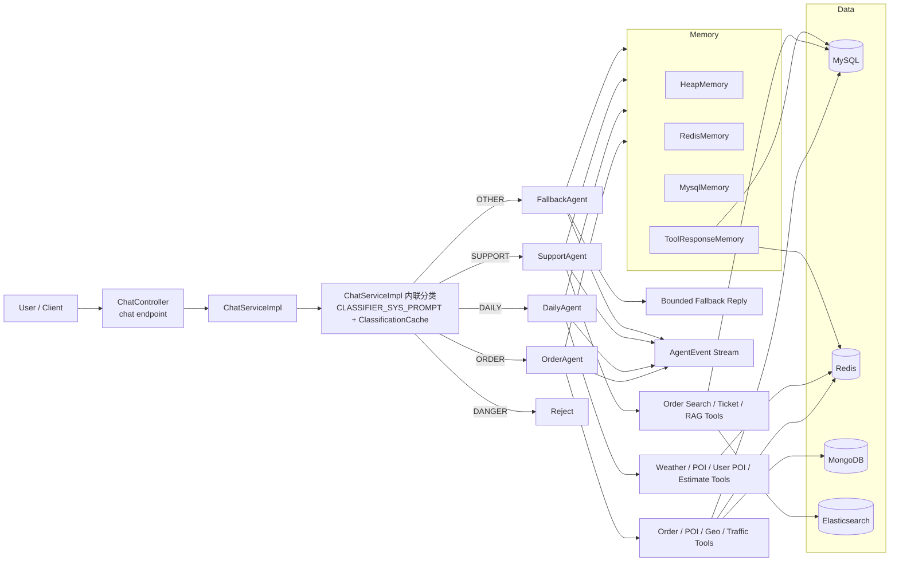
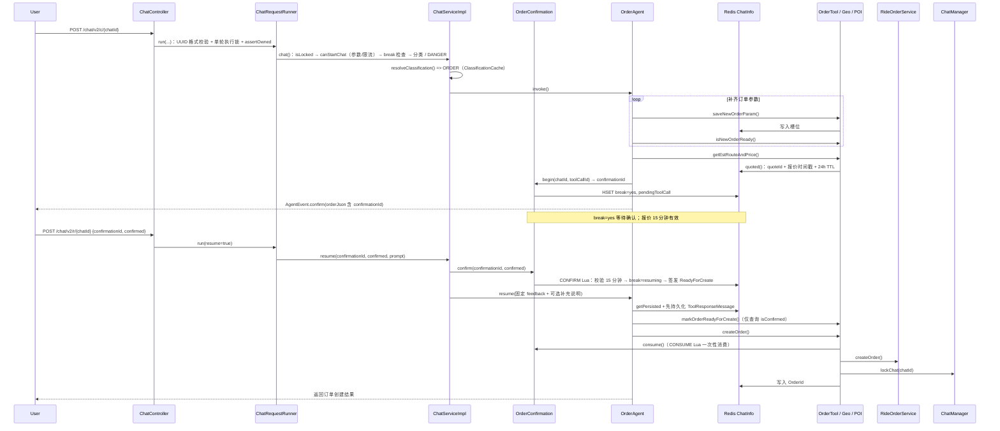

# RideAgentHub

<div align="center">

**网约车场景的 Spring Boot 全栈实战：Redis 高并发 + 多 Agent + RAG**

一套代码、两条学习主线：抢单预检、GEO 附近订单、延迟队列与缓存一致性对应实际业务场景；同一套业务之上，再叠一层多 Agent 编排与混合检索 RAG。


</div>

## 项目简介

`RideAgentHub` 将网约车业务系统与多 Agent 应用结合，同一套代码提供**两条可以分别学习的主线**：

| 主线 | 能学到什么 | 入口 |
| --- | --- | --- |
| **Redis 高并发** | 抢单 Lua 原子预检、GEO 附近订单、成员级 TTL 心跳、ZSet 延迟队列、缓存穿透 / 击穿 / 雪崩、分布式锁、缓存一致性三解法（延迟双删 / 墓碑 / Lease 令牌） | 下方 [Redis 高并发实战](#redis-高并发实战)；专题学习笔记在 [`docs/learn/redis/`](docs/learn/redis/README.md)（25 篇，一个考点一篇） |
| **多 Agent + RAG** | 分类路由、工具调用循环、订单确认断点（HITL）、多层记忆、混合检索 RAG | 下方 [Agent 与 RAG 链路](#agent-与-rag-链路) |

Redis 既承担 Agent 的**对话状态存储**（订单槽位、确认断点、分类结果），也提供业务侧的**并发协调与查询加速**（抢单预检、附近订单、超时兜底）。两条学习主线因此共享同一组业务场景。

Agent 这条线将网约车场景拆成了清晰的执行链路：

- 入口层先做意图分类，决定应该交给哪个领域 Agent
- 领域 Agent 再进入工具循环，逐步补齐信息、调用业务能力、生成回复
- 订单链路在创建前强制进入用户确认阶段，避免“模型直接下单”
- 对话与工具结果分别做了分层缓存和持久化，控制上下文长度，同时保留可恢复能力

如果你想看一个 **更偏工程化的 Agent 应用**，这个项目的重点不在“会不会聊天”，而在：

- 怎样把 **路由、记忆、工具调用、业务状态** 串成稳定链路
- 怎样让 Agent 在 **下单、查单、售后、知识库** 之间各司其职
- 怎样把“模型生成”约束进 **可确认、可恢复、可追踪** 的业务流程

## 亮点

**Redis 高并发**

- **抢单用 Lua 做原子预检**：「判断可抢」与「占住司机」在同一次执行内完成
- **GEO 查询附近订单**：在线司机可查看三公里内按距离排序的候选订单，索引不可用时降级为数据库时间排序
- **ZSet 延迟队列**：Lua 原子读取并移除到期任务，避免多实例重复领取及误删已改期任务；失败重试与数据库扫描补偿遗漏
- **缓存一致性三解法对照**：延迟双删 / 墓碑 / Lease 令牌，各自解决什么、边界在哪
- **手写锁与 Redisson 并存**：统计缓存与索引重建使用令牌锁，订单状态流转使用 Redisson 看门狗续期并持锁到事务结束
- **单轮执行锁**：`chat:execution:{chatId}` 与「对话锁定」是两个 key、两种语义；后台订阅 + `doFinally` 解锁，客户端断开不会提前放锁（[12 篇](docs/learn/redis/12-chat-lock-atomic.md)）
- **两套限流并存**：按 userId 的 30 次/60 秒（对话）+ 按来源地址摘要的 120 次/60 秒（入口层），共用同一段 ZSet Lua（[22 篇](docs/learn/redis/22-sliding-window-rate-limit.md)）

**Agent 与 RAG**

- **多 Agent 分工明确**：`OrderAgent`、`DailyAgent`、`SupportAgent`、`FallbackAgent`
- **前置分类路由**：基于用户对话的连续性进行分类，再分发到领域 Agent；分类内联在 `ChatServiceImpl.resolveClassification()`，结果由 `ClassificationCache` 缓存
- **双模型编排**：路由/分类与领域执行使用不同模型
- **订单 HITL**：下单前触发 `confirm` 事件（携带 `confirmationId`），用户确认后再 `resume`；报价 15 分钟有效、创建权限一次性消费
- **工具结果按需反查**：历史消息中的 TOOL 响应保存全文，`ToolResponseMemory`（Redis 24h + MySQL 两级，key `chat:tool:v2:{chatId}:{callId}`）提供按 `(callId, chatId)` 的辅助反查，`getCalling(callId)`（chatId 由服务端上下文提供） 与提示词契约配合，需要时才把长工具结果重新注入上下文（[20 篇](docs/learn/redis/20-tool-response-cache.md)）
- **多层记忆**：Heap(L1) + Redis(L2) + MySQL(L3)，配合 Lease 版本令牌；版本 key `PERSIST` 永久保留
- **混合检索 RAG**：向量检索 + BM25 + RRF 融合；另有 8 秒共享检索预算与 `authoritative()` 用 DB 最新答案覆盖（[agent/02](docs/learn/agent/02-rag-consistency-and-budget.md)）
- **SSE 生命周期受控**：`ChatRequestRunner` 的 Redisson 单轮执行锁（看门狗、无显式 TTL）与 `doFinally` 解锁、`AgentStreams.guard` 统一异常出口、`AgentStreams.subscribe` 内**单次模型流 3 分钟**超时（每次工具循环重置，整轮无总时长上限）、`ragExecutor`/`chatExecutor` 双线程池隔离（[agent/01](docs/learn/agent/01-orchestration-and-sse.md)）
- **安全边界**：服务端按 `RidePricing` 重算价格、`confirmationId` 一次性消费、会话版本 + 凭据摘要三重校验、支付渠道未接入时默认 503（[agent/03](docs/learn/agent/03-security-and-boundaries.md)）
- **对话锁定机制**：避免跨主题污染，尤其是订单创建后的误续写

## 总体架构



## Redis 高并发实战

这里不是“把 Redis 命令挨个试一遍”，而是**每个考点都由一个真实的业务需求逼出来** —— 没有订单超时兜底的需求，就不会有延迟队列。

| 业务需求 | Redis 考点 | 用到的能力 | 代码落点 |
| --- | --- | --- | --- |
| 司机抢单（订单唯一 + 一人一单） | **秒杀模型** | 司机账号行锁串行校验 + Lua 原子判断与占位；数据库按订单状态和司机为空做条件更新 | [`OrderGrabService`](src/main/java/com/fancy/rideagenthub/service/base/OrderGrabService.java)、[`RideOrderServiceImpl`](src/main/java/com/fancy/rideagenthub/service/impl/RideOrderServiceImpl.java) |
| 司机端“附近订单”排序 | **GEO** | `GEORADIUS` 查询三公里内最近的至多 200 个候选；提交后失效、版本校验重建，回表发现候选或版本不一致时整页降级为数据库查询 | [`OrderGeoPool`](src/main/java/com/fancy/rideagenthub/service/base/OrderGeoPool.java) |
| 司机在线状态 | **成员级 TTL** | 共享 GEO key + 心跳 Hash，以 Redis 时间判定 60 秒有效期；Lua 原子更新、检查与清理成员 | [`DriverGeoIndex`](src/main/java/com/fancy/rideagenthub/service/base/DriverGeoIndex.java) |
| 订单超时兜底（无人接单 / 未到达 / 未支付） | **ZSet 延迟队列** | 提交后 `ZADD` 排期；Lua 原子执行 `ZRANGEBYSCORE` + `ZREM` 领取任务；失败重新入队并由数据库补偿扫描兜底 | [`OrderDelayQueue`](src/main/java/com/fancy/rideagenthub/service/base/OrderDelayQueue.java)、[`OrderTimeoutJob`](src/main/java/com/fancy/rideagenthub/service/base/OrderTimeoutJob.java) |
| 用户名占用查询 | **缓存穿透** | Redisson 布隆过滤器 | [`UserUsernameBloomFilterService`](src/main/java/com/fancy/rideagenthub/service/base/UserUsernameBloomFilterService.java) |
| 工单统计热点 key | **缓存击穿** | 互斥锁 + 双检；未拿到锁时有限重试读缓存，仍未命中则直查 DB | [`TicketServiceImpl`](src/main/java/com/fancy/rideagenthub/service/impl/TicketServiceImpl.java) |
| 缓存批量过期 | **缓存雪崩** | TTL 随机抖动 | 同上 |
| 工单写操作后的脏缓存 | **延迟双删** | 事务提交后立即删除，再延迟删除；降低旧快照回填风险，仍受延迟窗口与进程存活限制 | [`DelayedCacheEvictor`](src/main/java/com/fancy/rideagenthub/service/base/DelayedCacheEvictor.java) |
| 城市编码（TTL 7 天） | **墓碑机制** | 5 秒墓碑阻止直接回填，失效时递增版本；Lua 拒绝墓碑过期后的旧快照 | [`CityCodeUtil`](src/main/java/com/fancy/rideagenthub/agentbase/amap/util/citycode/CityCodeUtil.java) |
| 聊天历史回填丢消息 | **Lease 令牌** | 版本号 + Lua 原子校验，租约失效则拒绝回填；版本号独立于历史数据保留 | [`RedisMemory`](src/main/java/com/fancy/rideagenthub/agentbase/memory/RedisMemory.java) |
| 订单状态机并发流转 | **分布式锁** | Redisson `RLock` 看门狗续期，事务结束后解锁；统计与索引重建采用固定 TTL 的手写令牌锁 | [`RideOrderServiceImpl`](src/main/java/com/fancy/rideagenthub/service/impl/RideOrderServiceImpl.java)、[`RedisLock`](src/main/java/com/fancy/rideagenthub/service/base/RedisLock.java) |
| LLM 调用配额 | **滑动窗口限流** | ZSet + Lua，避开固定窗口边界的双倍放行；Redis 异常时放行 | [`ChatRateLimiter`](src/main/java/com/fancy/rideagenthub/service/base/ChatRateLimiter.java) |
| 工单池分页排序 | **ZSet 复合排序** | 优先级与更新时间组成 score；提交后失效、完整重建，Lua 校验版本和成员数后读取总数与当前页 | [`TicketPoolIndex`](src/main/java/com/fancy/rideagenthub/service/base/TicketPoolIndex.java) |
| 对话记忆 | **多级缓存** | Heap → Redis → MySQL 分层读取，以版本租约保护逐级回填 | [`MessageMemory`](src/main/java/com/fancy/rideagenthub/agentbase/memory/MessageMemory.java) |

### 代码组织上的几个约定

- **Lua 脚本集中维护**于 [`RedisScripts`](src/main/java/com/fancy/rideagenthub/util/RedisScripts.java)，覆盖位置心跳、索引发布与读取、延迟任务领取、锁释放、版本校验和抢单预检。
- **主要 key 由** [`RedisKeyConstants`](src/main/java/com/fancy/rideagenthub/constant/RedisKeyConstants.java) **统一生成**；工单编号仍在 `TicketServiceImpl` 内使用局部前缀 `ticket:no:`。
- **抢单正确性由数据库约束兜底**：司机账号行锁保障跨订单的一人一单，订单条件更新裁决是否接单成功；Redis Lua 承担原子预检与占位。
- **故障策略按组件区分**：附近订单与工单池索引不可用时回退数据库查询，对话限流异常时放行；抢单路径仍依赖 Redisson 锁与 Redis 预检，不能承诺 Redis 故障时继续接单。延迟队列的任务丢失由数据库扫描补偿，实际状态流转仍会获取订单锁。

关于缓存一致性的三种解法（延迟双删 / 墓碑 / Lease）各自解决什么、仍留下什么（例如令牌消费已原子化但与业务执行分离、城市编码墓碑写路径未接线、布隆重建期假阴性由唯一索引兜底），统一整理在 [`docs/02-cache-consistency-race.md`](docs/02-cache-consistency-race.md) 与各考点笔记的「边界与已知问题」章节。

## Agent 与 RAG 链路

### 1. 总路由链路

仓库里的主入口是 [`ChatServiceImpl`](src/main/java/com/fancy/rideagenthub/service/impl/ChatServiceImpl.java)：

1. `ChatController` 接收对话请求，返回流式 `Flux<AgentEvent>`
2. `ChatServiceImpl` 根据历史对话和本轮输入做分类
3. 分类结果写入 Redis 的 chat metadata
4. 请求被分发到 4 个专用 Agent 之一
5. Agent 执行工具循环，并把回复、工具状态、确认事件持续推回前端

当前代码中的路由分类标签一共 5 类：

| 标签 | 含义 |
| --- | --- |
| `ORDER` | 新订单创建全流程 |
| `DAILY` | 天气、地点、常用地点、估时估价等日常咨询 |
| `SUPPORT` | 查单、取消、售后、工单、知识库 |
| `OTHER` | 非出行相关内容，交给兜底 Agent |
| `DANGER` | 注入、越权、恶意请求，直接拦截 |

### 2. 四个 Agent 的职责分工

| Agent | 负责什么 | 典型工具 |
| --- | --- | --- |
| `OrderAgent` | 新建订单、补槽位、算价、确认、创建订单 | `saveNewOrderParam`、`isNewOrderReady`、`getEstRouteAndPrice`、`createOrder` |
| `DailyAgent` | 天气、POI 搜索、地址编解码、常用地点管理、简单估时估价 | `CurWeatherTool`、`POISearchTool`、`GeoRegeoTool`、`UserPOITool` |
| `SupportAgent` | 查历史订单、取消订单、改终点、工单流转、规则问答 | `OrderSearchTool`、`TicketTool`、`RagTool` |
| `FallbackAgent` | 非业务域内容兜底，引导用户回到网约车场景 | 纯文本回复，不执行业务工具 |

### 3. OrderAgent 的完整业务链

`OrderAgent` 是这个项目最能体现“Agent 工程化”的部分。它不是简单生成文本，而是在 Redis 里维护订单槽位状态，并强制经过确认断点。



这条链路里有几个关键点：

- **槽位不是只存在 Prompt 里**，而是显式写入 Redis
- **算价与路径规划分离**，起终点未变时可以只重新算价；价格由服务端 `RidePricing` 重算，模型不能自报价格
- **订单创建前必须确认**，由 `confirm` 事件把服务端签发的 `confirmationId` 交给前端原样回传；前端不能从用户文字推断 `confirmed`
- **恢复不是补一句话继续聊**，而是 `ChatServiceImpl.resume` 先调 `OrderConfirmation.confirm()`（校验 15 分钟有效期、置 `break=resuming`、签发 `ReadyForCreate`），再调 `orderAgent.resume(sink, id, userId, feedback + chatParam.getPrompt())` 接回工具链 —— 固定 feedback 后**原样拼接用户 `prompt`**（空则自动填「确认/拒绝」），注入面靠服务端确认状态机兜底，而非靠「不转发原话」；相同决定可幂等重放，不同决定返回 409
- **`markOrderReadyForCreate()` 只做只读查询**，创建权限由 `createOrder()` 落单前调 `consume()` 一次性消费，模型无法自授权限或重复下单
- **订单创建后先 `lockChat` 再写 `OrderId`**（接收方是 `ChatManager`，不是 `ChatServiceImpl`），引导用户开启新会话处理后续需求
- 完整调用链与 SSE 生命周期见 [`docs/learn/agent/01-orchestration-and-sse.md`](docs/learn/agent/01-orchestration-and-sse.md)，确认状态机见 [`docs/learn/redis/25-agent-hitl-state.md`](docs/learn/redis/25-agent-hitl-state.md)

### 4. SupportAgent 的知识与售后链

`SupportAgent` 负责把“规则解释”和“动态业务操作”分开处理：

- 静态规则问题：走 `RagTool.searchKnowledgeBase()`
- 动态订单问题：走 `OrderSearchTool`
- 售后跟进：走 `TicketTool`

RAG 部分不是单一路径检索，而是：

1. DashScope Embedding 生成向量（与下面两路共享 **8 秒 deadline**，由 `ragExecutor` 线程池执行）
2. Elasticsearch 执行向量检索（`knn`，窗口 100）
3. Elasticsearch 同时执行 BM25 文本检索（窗口 100）
4. 后端用 RRF（`K=60`）做结果融合
5. 再按 `groupId` 去重，取 Top5
6. **`authoritative()` 权威库核对**：用 ES 文档 id 反查 MySQL 映射，校验 `question` 与 `groupId` 完全一致，并用当前 `QaInfo.answer` 覆盖 ES 里的旧答案；已删除、已改问题或同步失败留下的文档直接丢弃

管理接口写入只落 MySQL 与持久同步任务表（`addQA` 等 `@Transactional` 方法内 `syncJobs.enqueue(groupId)`），索引由 `QaIndexSynchronizer` 每 5 秒扫描（失败 30 秒后重试）异步重建，因此「接口成功 ≠ 立刻可检索」；检索超时只做逻辑 `cancel(true)`。完整推导见 [`docs/learn/agent/02-rag-consistency-and-budget.md`](docs/learn/agent/02-rag-consistency-and-budget.md)。

这让它更像一个可控的客服支持 Agent，而不是只会“猜规则”的聊天机器人。

## 事件流设计

前端接收到的不是单次 JSON，而是一串 `AgentEvent`：

| 事件类型 | 说明 |
| --- | --- |
| `message` | Agent 的文本输出（`AgentEvent.message`） |
| `tool_start` | 某个工具开始执行（`AgentEvent.tool`）；来源为 `agentbase/tool/ToolNotifySupport.java` 的 `Consumer<String>` 回调：全项目 39 处通知调用点 / 14 个类，真正注入 `AgentEvent.tool` 回调的有 6 处（Daily/Order/Support 各 2），回调异常被隔离，不影响主流 |
| `notify` | 路由提示、状态提示或系统通知（限流拒绝、等待确认提示也走这里） |
| `confirm` | 订单待确认摘要（`AgentEvent.comfirm`，注意源码中的拼写），携带 `confirmationId`，前端应进入确认交互并原样回传 |
| `error` | 执行错误；`AgentStreams.guard` 统一把异常转成 error 事件并结束流（`AgentStreams.subscribe` 的 3 分钟是单次模型流上限，每轮工具循环重置） |

这意味着前端可以把它渲染成一种 **“可见工具执行过程 + 最终回复”** 的体验，而不是纯黑盒对话。

## 记忆与数据存储

### 多层记忆

`MessageMemory` 采用分层读取、租约保护回填：

- `HeapMemory`：当前聚焦对话的热数据（L1）
- `RedisMemory`：短中期缓存（L2）
- `MysqlMemory`：长期持久化消息（L3）

读取顺序是 `Heap -> Redis -> MySQL`，三层都取全量再由 `MessageWindow.tail` 截出完整的工具调用批次；回填时先取版本租约，再用 Lua 校验版本后写回，版本 key 通过 `PERSIST` 永久保留（避免数据过期/清空后旧租约复活）。写入顺序与读取相反：**先落 MySQL，再按租约追加 Redis(L2) 与 Heap(L1)**，并对会话做归属守卫 `isNewOwnedChat` / `assertOwned`（会话不存在 404、**非本人 `ForbiddenException` → 403**、停用会话 410）。详见 [19 篇](docs/learn/redis/19-multi-level-cache.md) 与 [09 篇](docs/learn/redis/09-lease-token.md)。

此外，工具结果还会单独进入 `ToolResponseMemory`（Redis 24h + MySQL 两级），需要时再反查；历史窗口内仍包含完整工具结果，不能保证长结果不占上下文；历史消息里的 TOOL 响应本身保存全文，`getCalling(callId)`（chatId 由服务端上下文提供） 提供按 `(callId, chatId)` 的辅助反查（[20 篇](docs/learn/redis/20-tool-response-cache.md)）。

### 数据层职责

| 存储 | 用途 |
| --- | --- |
| MySQL | 用户、订单、工单、对话消息、工具调用结果、RAG 映射 |
| Redis | 对话分类、订单槽位、确认断点、缓存消息、工具结果缓存 |
| MongoDB | 订单路径规划轨迹 |
| Elasticsearch | 知识库索引与混合检索 |

## 当前模型编排

从代码实现看，模型编排是分层的：

- **路由默认模型**：`qwen-plus-2025-12-01`
- **分类模型**：`qwen3-max-preview`
- **领域 Agent 执行模型**：`deepseek-chat`
- **Embedding 模型**：`text-embedding-v4`

这种拆分很适合业务 Agent：

- 路由模型专注意图判定
- 领域模型专注工具调用和任务完成
- Embedding 模型专注知识检索

## 技术栈

- Java 21
- Spring Boot 3.5.9
- Spring AI Alibaba Agent Framework 1.1.0.0-RC2
- Spring AI OpenAI Starter（版本由 `spring-ai-bom 1.1.0` 统一管理，`pom.xml` 未单独指定）
- MyBatis-Plus 3.5.9
- MySQL
- Redis
- MongoDB
- Elasticsearch
- DashScope
- DeepSeek-compatible OpenAI API

## 目录结构

```text
src/main/java/com/fancy/rideagenthub
├─ agents/                 # 4 个领域 Agent
├─ agentbase/tool/         # 工具定义与业务回调
├─ agentbase/memory/       # 多层记忆与工具结果缓存
├─ agentbase/rag/          # 知识库检索与 ES/RRF 融合
├─ agentbase/amap/         # 地图与路线能力
├─ agentbase/qweather/     # 天气能力
├─ service/base/           # Redis 组件：抢单预检、GEO 池、延迟队列、分布式锁、限流…
├─ util/                   # RedisScripts 等通用工具
├─ constant/               # RedisKeyConstants 等常量与 key 生成方法
├─ controller/             # HTTP 入口
├─ service/                # 业务服务层
├─ mapper/                 # MyBatis-Plus Mapper
├─ domain/                 # DTO / VO / Entity / Enum
└─ config/                 # 配置与系统 Prompt

docs/
├─ 01-redis-application-points.md   # Redis 应用点全景：每个考点对应的业务需求与当前实现
├─ 02-cache-consistency-race.md     # 缓存一致性三解法的竞态推导与当前落地边界
└─ learn/
   ├─ redis/                        # 25 篇考点笔记，一个考点一篇
   └─ agent/                        # 3 篇 Agent 层笔记（编排与 SSE / RAG 一致性 / 安全边界）
```

## 快速启动

### 1. 准备基础依赖

你至少需要准备：

- MySQL
- Redis
- MongoDB
- Elasticsearch
- DashScope API Key
- DeepSeek 或兼容 OpenAI API 的 Key
- 高德地图 Key
- 和风天气 Key & Token
- SMTP 邮箱配置

### 2. 初始化数据库

执行：

在 MySQL 客户端中执行（以下是 SQL 客户端命令）：

```sql
SOURCE src/main/resources/sql/init.sql;
SOURCE src/main/resources/sql/bus_citycode.sql;
```

`init.sql` 面向新库，直接 CREATE TABLE，未创建/选择数据库，也不是可重复执行的迁移脚本；执行前需在客户端选中目标数据库（默认配置为 taxi_agent）。旧库升级应先备份并核对历史重复数据，再按 `src/main/resources/sql/migrations/20261113_security_consistency.sql` 的迁移说明执行。

### 3. 填写配置

`application.yaml` 已导入工作目录下的 `.env.properties`。优先在此 Git 忽略文件或环境变量中配置凭据；MySQL 的 `MYSQL_USERNAME` / `MYSQL_PASSWORD` 无默认值，必须提供。其他服务也可在 `.env.properties` 中用完整 Spring 属性名覆盖占位值：

```properties
MYSQL_URL=jdbc:mysql://127.0.0.1:3306/taxi_agent?useUnicode=true&characterEncoding=UTF-8&serverTimezone=Asia/Shanghai&allowPublicKeyRetrieval=true&useSSL=false
MYSQL_USERNAME=your-database-username
MYSQL_PASSWORD=your-database-password
spring.ai.dashscope.api-key=your-dashscope-api-key
spring.ai.openai.api-key=your-deepseek-api-key
spring.elasticsearch.uris=http://127.0.0.1:9200
spring.elasticsearch.username=your-elasticsearch-username
spring.elasticsearch.password=your-elasticsearch-password
spring.data.redis.host=127.0.0.1
spring.data.redis.password=your-redis-password
spring.data.mongodb.uri=mongodb://127.0.0.1:27017/rideagenthub
spring.mail.host=your-mail-host
spring.mail.username=your-mail-username
spring.mail.password=your-mail-password
amap.key=your-amap-api-key
qweather.key=your-qweather-api-key
qweather.token=your-qweather-api-token
```

上述地址为示例，以本机部署为准。多实例须为每个实例配置唯一的 `(id.datacenter-id, id.worker-id)` 组合（均默认 1、范围 0–31）；重复组合会在启动时被节点锁拒绝。现有多 key Lua 未统一使用 Redis Cluster hash tag，不能直接假定支持 Cluster。

### 4. 启动项目

```bash
mvn compile
mvn spring-boot:run
```

## 本地调试方式

主聊天接口位于（全部在 `/chat/v2` 下，默认需要登录态与 Token 鉴权）：

- `POST /chat/v2/newuuid`：生成新的 `chatId`（推荐起点）
- `POST /chat/v2/c/{id}`：发起对话，返回 `Flux<AgentEvent>` SSE 流
- `POST /chat/v2/r/{id}`：恢复订单确认后的会话，请求体 `{"confirmationId":"确认事件返回的编号","confirmed":true,"prompt":"可选补充说明"}`；报价 15 分钟内有效，创建权限一次性消费
- `GET /chat/v2/restore`：检查是否存在可恢复订单会话，返回 `Result<Boolean>`（仅判定，并续 60 分钟）
- `POST /chat/v2/restore`：恢复当前用户最近的可恢复订单会话，返回 `Result<RestoreChatVO>`（chatId + 以 100 条为目标、保留完整工具批次后经 simpleParse 的消息（可能超过 100 条）），且会 `unlockChat` + `persist`
- `POST /chat/v2/lock/{id}`：锁定本人会话

注意：GET 与 POST `/restore` 的**返回类型和副作用不同** —— GET 判定并续期，POST 才真正恢复并把 `chat:info` 设为永久，这正是 [12 篇](docs/learn/redis/12-chat-lock-atomic.md) 讨论的 TTL 语义矛盾来源。经 `ChatRequestRunner.run` 的 `/c/{id}`、`/r/{id}` 只要求 `chatId` 是合法 UUID 格式且会话属于当前用户，不要求由 `/newuuid` 签发；`/lock/{id}` 只校验归属、不做 UUID 格式校验。另：两个流式端点只返回 `Flux<AgentEvent>`，**源码没有 `produces = text/event-stream` 声明**，项目是 `spring-boot-starter-web` Servlet 栈，靠返回值协商输出。

示例：

```bash
curl -N -X POST http://localhost:8080/chat/v2/c/<chatId> \
  -H "Content-Type: application/json" \
  -H "Accept: text/event-stream" \
  -H "X-Auth-Token: <token>" \
  -d '{"prompt":"帮我从杭州东站打车去西湖，快车，现在出发"}'
```

## 这个项目适合谁看

**想补 Redis 高并发实战的**（如果你觉得“缓存 + 分布式锁”的练习项目不够用）：

- 抢单怎么用 Lua 把「判断」和「占位」做成一步，以及司机行锁与订单条件更新怎样兜底
- GEO 怎么查询附近订单；共享的司机 GEO key 为什么采用成员级心跳，订单池又如何用固定 TTL 与版本校验重建
- ZSet 延迟队列怎么用 Lua 原子领取到期任务，为什么领取无需额外锁，而业务处理仍需要订单锁与补偿机制
- 缓存穿透 / 击穿 / 雪崩各自对应哪种解法，以及**它们各自解决不了什么**
- 延迟双删、墓碑、Lease 令牌三种一致性方案的适用边界，以及长耗时回填、墓碑到期与旧租约带来的竞态
- 手写锁和 Redisson 的差距，具体体现在哪几行代码上

**想做 Agent 工程化的**：

- 如何把 Agent 接进真实业务系统，而不是只停留在 prompt playground
- 如何设计一个“先分类、再执行”的多 Agent 架构
- 如何给高风险动作加上确认断点
- 如何把工具调用结果做成可追踪、可回放、可压缩的上下文
- 如何把 RAG、订单系统、工单系统放进同一条 Agent 链路

## 后续可以继续增强的方向

- 增加统一的可观测性：trace、token、tool latency、失败率
- 把路由策略从硬编码 prompt 升级为可评估配置
- 补齐 API 文档与前端事件协议示例
- 增加自动化回归集，覆盖典型订单与售后场景

---

如果你正在做一个垂直业务 Agent，这个项目的重点不是“模型多强”，而是：  
**怎样把模型放进一条能落地、能确认、能恢复、能追踪的业务链路里。**

如果你正在补 Redis 高并发的实战经验，这个项目的重点也不是“用了多少条命令”，而是：

**怎样让每个考点都由一个真实需求逼出来 —— 而不是为了用 Redis 而用 Redis。**
