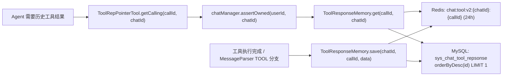

# 工具调用结果缓存：`chat:tool:v2:{chatId}:{callId}` 两级辅助索引

> **Redis 考点**：以业务唯一 ID 为 key 缓存不可变的大对象；滑动过期（读取即续期）；`set` 与 `setIfAbsent` 在幂等语义上的差别。
> **来源**：`docs/01-redis-application-points.md` 第一节（工具调用结果缓存）、第三节第 1 条（现存缺陷）
> **完整路径**：`src/main/java/com/fancy/rideagenthub/agentbase/memory/ToolResponseMemory.java`、`MessageParser.java`、`MessageWindow.java`、`agentbase/tool/ToolRepPointerTool.java`
> **代码版本**：当前工作区为 `RideAgentHub` / `com.fancy.rideagenthub`（基准路径 `src/main/java/com/fancy/rideagenthub/`）。本系列撰写于历史快照 `bdc40d7`（旧名 `TaxiAgent`、旧包 `com.fancy.taxiagent`，属已被重写合并的旧分支），文中的 `文件:行号` 与部分代码块是**改造前快照**，整体已漂移；学习时以「类名 + 方法名 + 章节名」定位当前源码，具体行为一律以当前代码为准。

---

## 【当前实现总览】（先看这一节，再读下方改造前推导）

> **审计阅读约定（2026-11-13 代码反向复核）**：本篇一～五、七章写于「工具结果指针化 + L1/L2/L3 三级 + 滑动过期」的改造前版本，**作为推导教材保留**；凡与本节冲突，一律以本节与当前源码为准。

| # | 正文中的旧说法 | 当前代码事实（`agentbase/memory/ToolResponseMemory.java`） |
|---|---|---|
| 1 | 七章全部 `redis-cli` 命令基于 `tool:{callId}`，并验证「读命中续期 / 滑动过期」 | 当前 key 是就地拼的 **`chat:tool:v2:{chatId}:{callId}`**（`:39,41`），TTL **24h（86400）且读不续期**。命令应改为 `redis-cli --scan --pattern "chat:tool:v2:*"`、`GET chat:tool:v2:{chatId}:{callId}`、`TTL ...`（期望 ≤86400，读后不回满），删除全部滑动过期步骤 |
| 2 | 一/二/三章「指针化 + 三级缓存 + `heapCache` + `DEFAULT_TOOL_CACHE_TTL`」为当前实现 | 均为改造前：历史消息中的 TOOL 响应**保存全文**（`MessageParser.java:56-74`），`ToolResponseMemory` 只是 Redis + MySQL **两级辅助索引**（save 先 MySQL 后 Redis，`:21-25`） |
| 3 | `ToolRepPointerTool.getToolResponse(callId)` 单参反查 | 反查按 **`call_id + chat_id` 双条件**（`:32-34`），仅 chatId 不匹配不能反查 —— 这是与 `assertOwned` 并列的第二道跨会话隔离防线 |
| 4 | 延伸阅读链接 `../README.md` | 指向不存在的 `docs/learn/README.md`；术语规范在 **`./README.md`**（`docs/learn/redis/README.md`） |

### 1. 业务背景与问题定义

一次工具调用（天气、路径规划、订单查询）可能返回很大的 JSON。把整段结果反复塞进模型上下文会撑爆 token，于是系统需要「按业务 ID 存一份、需要时再反查」。这里要澄清一句最容易误读的结论：**「工具结果指针化」并没有被取消** —— `agentbase/tool/ToolRepPointerTool.java` 的 `getCalling` 工具、`recordCalling`、`config/ChatProperties.java` 里「依赖历史工具结果必须先调 `getCalling` 反查」的提示词契约、三个 Agent 的 `getCalling` 分支都完整存在。真正变的是**历史消息的形状**：

- 改造前：TOOL 消息只留 `call_id` 指针；
- 当前：`agentbase/memory/MessageParser.java` 的 TOOL 分支把 `responseData()` **全文写入历史**，`ToolResponseMemory` 从「三级主缓存」退化为 **Redis + MySQL 两级的辅助反查索引**。

所以正确表述是「**全文持久化 + 两级辅助索引**」二分，而不是「指针化已取消」。

### 2. 架构与依赖关系



落点：`agentbase/memory/ToolResponseMemory.java`（约 44 行）、`MessageParser.java`、`MessageWindow.java`、`agentbase/tool/ToolRepPointerTool.java`、`agentbase/chatinfo/ChatManager.java`。

### 3. 完整执行链与关键源码

**写入**（`ToolResponseMemory.save`，顺序与旧版相反）：

```java
// 先 MySQL（持久化权威），再 Redis（快速反查）
chatToolResponseMapper.insert(new ChatToolResponse(chatId, callId, response));
try {
    stringRedisTemplate.opsForValue().set(cacheKey(chatId, callId), response, TTL);  // TTL = Duration.ofHours(24)
} catch (RuntimeException e) { log.warn("工具结果缓存写入失败，MySQL 仍可反查", e); }
```

**读取**（`ToolResponseMemory.get(callId, chatId)`）：先 Redis，命中**直接 return，固定 24h TTL 不续期**（没有滑动过期）；未命中回 MySQL 按 `orderByDesc(id) LIMIT 1` 取最新一行；读异常 catch 后降级返回 `null`。`ToolRepPointerTool.getCalling` 在调 `get` 之前会 `chatManager.assertOwned` 校验会话归属，防止用别人的 `callId` 跨会话读数据。

**key 形态**：`chat:tool:v2:{chatId}:{callId}` 在 `ToolResponseMemory.cache()` 内**就地拼接**；旧常量 `RedisKeyConstants.TOOL_RESPONSE_KEY = "tool:"` 与 `toolResponseKey(callId)` 现在是 **0 调用方的死代码**，不要照着它去 `KEYS tool:*`。加 `chatId` 这一层是跨会话隔离：同一个 `callId` 在不同会话里不应互相命中。

### 4. 底层原理与设计决策

- **为什么先 MySQL 后 Redis**：工具结果是审计与恢复的依据，Redis 只是加速。反序写（先 Redis）会在 DB 失败时留下「缓存里有、库里没有」的幽灵结果。
- **为什么固定 TTL 而不是滑动续期**：结果不可变且只在相近的几轮对话里被反查，读一次就把 TTL 刷回 24h 会让冷数据长期驻留；统一 24h 也便于容量估算。
- **为什么保留 `set` 而不是 `setIfAbsent`**：这是本文第五章保留的**优质反例**。重复的 tool call 会覆盖 Redis 值，且 MySQL 每次 `insert` 新行（表上无唯一索引），靠取最新行掩盖重复 —— 语义上不是幂等。改成 `setIfAbsent` + 唯一索引是**可选优化**，当前未实现。
- **替代方案对比**：① 只存指针（旧）→ 历史恢复时无法重建完整上下文；② 全文入历史 + 两级索引（当前）→ 上下文可控且可回放；③ 直接用对象存储/ES → 多一次网络依赖，对本项目的小结果不划算。

### 5. 完整示例

输入：用户问「刚才那条路线多少钱」→ 模型调 `getCalling(callId="t-9f", chatId="c-1")`。
中间状态：`assertOwned` 通过 → Redis `GET chat:tool:v2:c-1:t-9f` 命中（TTL 约 80000s，读后**不回满 86400**）→ 返回完整 JSON。
异常路径：Redis 未命中 → MySQL 查到 2 行（重复 save 造成）→ 取 `id` 最大的一行；若都不存在，`get` 返回 `null`，模型按提示词要求不得编造。

### 6. 边界、常见问题与面试延伸

| 问题 | 当前答案 |
|---|---|
| `MessageWindow.tail` 为什么相关 | 历史截取必须保持完整工具调用批次；它拒绝孤立的 `ToolResponseMessage`，损坏历史从下一个用户轮恢复（见 [19 篇](19-multi-level-cache.md)） |
| 旧「三级缓存 / 滑动过期 / `DEFAULT_TOOL_CACHE_TTL` / `heapCache`」 | 均已删除；正文一/二/四/七章保留作改造前对照 |
| 跨会话越权 | `getCalling(callId, chatId)` 双参 + `assertOwned`，单参版本已废弃 |
| 面试追问 | 「为什么不用 `setIfAbsent`？」→ 当前实现有重复行与覆盖，第五章的推导就是答案；「Redis 挂了怎么办？」→ MySQL 仍可反查；「为什么要 chatId？」→ 隔离与归属校验 |

---

## 一、业务场景

Agent 调用工具（查订单、RAG 问答、创建工单……）拿到结果后，要把结果放进对话历史，再交给模型继续推理。问题是：**工具结果可能很大** —— 一个订单列表、一段 RAG 答案，动辄几百到几千字符。

如果把这些原文全部写进历史，那么：

- 每轮对话的 prompt 都会膨胀；
- 历史条数越多，膨胀越严重（十轮对话 = 十份工具结果原文）；
- 而模型在大多数轮次里根本不需要这些原文。

所以本项目做了一个"**工具结果指针化**"的处理：持久化历史时只写一个指针（`MessageParser.java:36-55`）：

```java
case TOOL: {
    ...
    new ToolResponseMessage.ToolResponse(
            response.id(),
            response.name(),
            "callId: " + response.id()      // ← 结果被替换成指针
    );
    ...
    .fluentPut("responses", responses)
```

历史里留下的是 `callId: call_abc123` 这样一行，而不是几千字的原文。模型需要原文时，**再调一次工具**去取：

```java
// ToolRepPointerTool.java:20-27
@Tool(description = "根据工具调用结果历史中的调用ID，查询调用过的工具的返回结果")
public String getToolResponse(@ToolParam(description = "调用ID") String callId, ToolContext toolContext){
    ...
    String response = toolResponseMemory.get(callId);
    ...
    return response;
}
```

于是"取回工具结果"退化成一个**纯读取、无副作用、结果不可变**的查询：key 是框架生成的 `callId`（全局唯一），value 是那次调用的返回值（一旦产生就不再变化）。

这是缓存最理想的形态：**无写入竞争、无失效语义争议、命中率可预期（同一个工具结果在一次会话里可能被读多次，跨会话重放历史时还会再读）。**

---

## 二、Redis 结构选型

| 层 | 实现 | 结构 | Key / 表 | TTL |
|---|---|---|---|---|
| L1 | `ToolResponseMemory.java:19` | `ConcurrentHashMap<String, String>` | `callId` | **无** |
| L2 | `ToolResponseMemory.java:35` | String | `tool:{callId}`（`RedisKeyConstants.java:79`） | 24 小时，读命中后续期 |
| L3 | `ToolResponseMemory.java:37-42` | 表 `sys_chat_tool_repsonse`（`init.sql:96-102`） | `call_id` 列 | 永久 |

TTL 常量：`ToolResponseMemory.java:17`（`DEFAULT_TOOL_CACHE_TTL = Duration.ofHours(24)`）。

**为什么用 String 而不是 Hash**：每个 `callId` 是一个独立的对象，彼此没有聚合关系 —— 一个 Hash 存所有 `callId` 反而会造出大 key、无法逐条设 TTL、也无法让单条独立淘汰。这一点与抢单预检里 `order:status:{orderId}` 选 String 是同一个理由。

**为什么 value 直接存字符串而不是序列化对象**：工具返回值本身就是 `String`（`recordCalling` 的入参就是 `String response`），不需要任何转换。

---

## 三、代码落点

| 位置 | 方法 | 职责 |
|---|---|---|
| `ToolResponseMemory.java:17` | `DEFAULT_TOOL_CACHE_TTL` | 24 小时 TTL 常量 |
| `ToolResponseMemory.java:19` | `heapCache` | L1，进程内 map |
| `ToolResponseMemory.java:28-43` | `save` | 写三层：L1 (`:32`) → Redis (`:35`) → MySQL (`:37-42`) |
| `ToolResponseMemory.java:45-72` | `get` | 读三层：L1 (`:49-52`) → Redis (`:53-59`) → MySQL (`:60-71`) |
| `ToolResponseMemory.java:57` | `expire` | **Redis 命中后续期 24 小时**（滑动过期） |
| `ToolResponseMemory.java:70` | `set` | MySQL 命中后回填 Redis |
| `RedisKeyConstants.java:75-79` | 声明在 `:79`（`TOOL_RESPONSE_KEY = "tool:"`） | `tool:` 前缀 |
| `RedisKeyConstants.java:278-280` | `toolResponseKey(callId)` | key 构建方法 |
| `ToolRepPointerTool.java:21-27` | `getToolResponse` | 读入口（暴露给模型的 `@Tool`） |
| `ToolRepPointerTool.java:32-45` | `recordCalling` | 写入口；从 `ToolContext` 取 `chatId` |
| `MessageParser.java:36-55` | `parse` 的 `TOOL` 分支 | **指针化的实现处**：历史里只写 `callId: {id}` |
| `DailyAgent.java:177` | `recordCalling` 调用点 | |
| `OrderAgent.java:246` | `recordCalling` 调用点 | |
| `SupportAgent.java:174` | `recordCalling` 调用点 | |
| `init.sql:96-102` | `sys_chat_tool_repsonse` | 建表语句（注意表名里 `repsonse` 是拼写错误，代码里 `@TableName` 跟着一起错了） |

---

## 四、实现拆解

### 4.1 写：一次调用写三层

`ToolResponseMemory.java:28-43`：

```java
public void save(String callId, String chatId, String response) {
    if (callId == null || callId.isBlank() || chatId == null || chatId.isBlank() || response == null) {
        return;
    }
    heapCache.put(callId, response);

    String key = RedisKeyConstants.toolResponseKey(callId);
    redisTemplate.opsForValue().set(key, response, DEFAULT_TOOL_CACHE_TTL);

    ChatToolResponse row = ChatToolResponse.builder()
            .callId(callId)
            .chatId(chatId)
            .response(response)
            .build();
    chatToolResponseMapper.insert(row);
}
```

`save` 由 `recordCalling` 调用（`ToolRepPointerTool.java:32-45`），而 `recordCalling` 在**工具真正执行之后**被调用：

```java
// DailyAgent.java:176-177
String result = executeTool(toolName, args, toolContext, sink);
toolRepPointerTool.recordCalling(toolCall.id(), result, toolContext);
```

`chatId` 从 `ToolContext` 里取（`ToolRepPointerTool.java:36-43`），取不到就**直接返回、不写** —— 因为 L3 的 `chat_id` 列是 `not null`，没有 `chatId` 就没法落库。

### 4.2 读与滑动过期

`ToolResponseMemory.java:45-72`：

```java
String inHeap = heapCache.get(callId);
if (inHeap != null) {
    return inHeap;                                    // L1
}
String key = RedisKeyConstants.toolResponseKey(callId);
String inRedis = redisTemplate.opsForValue().get(key);
if (inRedis != null) {
    heapCache.put(callId, inRedis);
    redisTemplate.expire(key, DEFAULT_TOOL_CACHE_TTL);  // :57 读命中即续期
    return inRedis;                                   // L2
}
ChatToolResponse row = chatToolResponseMapper.selectOne(
        new LambdaQueryWrapper<ChatToolResponse>()
                .eq(ChatToolResponse::getCallId, callId)
                .orderByDesc(ChatToolResponse::getId)
                .last("limit 1"));
if (row == null) {
    return null;
}
heapCache.put(callId, row.getResponse());
redisTemplate.opsForValue().set(key, row.getResponse(), DEFAULT_TOOL_CACHE_TTL);  // 回填 L2
return row.getResponse();                             // L3
```

**滑动过期的准确语义**（`:57` 这一行）：每次从 Redis 命中就把 TTL 重置回 24 小时，所以

> `tool:{callId}` 的实际寿命 = "自最后一次被**从 Redis 读取**起 24 小时"，而不是"自创建起 24 小时"。

效果是"**只要还有人引用，它就不会消失**"。对照 `MessageMemory` 的 L2：那边是"读不续期、只有写续期"（见 [`19-multi-level-cache.md`](19-multi-level-cache.md) 4.5），这里是"读就续期"。两者的取舍依据是一样的 —— 取决于这份缓存是"热读冷写"还是"热写热读"。工具结果显然属于热读冷写（一次写入、可能被反复读取），所以读时续期是对的。

**但有一个不对称值得点出**：只有 **L2 命中**才续期，**L1 命中不续期**（`:49-52` 直接 return）。在同一个 JVM 里，第一次读之后结果就驻留在 L1，后续读取根本不会碰到 Redis，也就不会再续期。所以"只要还有人引用就不会消失"这句话只在**跨进程/跨重启**的读取下才成立；单实例长跑的场景里，这份数据是"24 小时后过期"，除非 L1 被清掉。

### 4.3 L3 查询为什么要 `orderByDesc(id) limit 1`

`:60-65` 用 `orderByDesc(ChatToolResponse::getId).last("limit 1")` 取"最新的一条"。这条语句本身就是**对 4.4 缺陷的绕过而不是修复**：因为允许同一 `callId` 存在多行，所以查的时候必须显式挑一行出来，否则 `selectOne` 会因为返回多行而报错。

---

## 五、现存缺陷：`save` 用 `set` 而不是 `setIfAbsent`

这是 `docs/01-redis-application-points.md` 第三节第 1 条明确列出的缺陷，代码在 `ToolResponseMemory.java:35`：

```java
redisTemplate.opsForValue().set(key, response, DEFAULT_TOOL_CACHE_TTL);
```

### 5.1 后果

同一个 `callId` 被重复 `save` 时：

| 层 | 行为 | 结果 |
|---|---|---|
| L1 `heapCache.put` | 覆盖 | 以最后一次为准 |
| L2 `SET` | 覆盖 | 以最后一次为准 |
| L3 `insert` | **新增一行** | 表里出现同一 `call_id` 的多行 |

三层都"以最后一次为准"（因为 L3 读的是 `orderByDesc(id) limit 1`），表面上是一致的。真正的问题是：

1. **`sys_chat_tool_repsonse` 表上 `call_id` 没有唯一索引**（`init.sql:96-102` 只有主键 `id`），DB 侧完全不设防，重复行会一直堆积。
2. **指针不再指向模型当时看到的那份结果**。历史里的 `callId: {id}` 是一个指针，语义上应当指向"那次工具调用返回的内容"。一旦被覆盖，后续任何一次重放历史（比如用户刷新页面、Agent 恢复 HITL）解析出来的都变成了新内容 —— **指针指向的对象被替换了**，而历史里的其它部分（模型基于旧结果说出的结论）没有变。这会让模型看到的上下文自相矛盾。
3. 缓存命中路径与缓存未命中路径可能给出不同的答案：若某次读取先命中了 L1（旧的），就会拿到旧值；清掉 L1 再读（走了 L2）才拿到新值。**同一份数据在不同实例/不同时刻返回不同结果**。

### 5.2 改造方向

| 层 | 改法 |
|---|---|
| L1 | `heapCache.putIfAbsent(callId, response)` —— `ConcurrentHashMap` 原生支持 |
| L2 | `redisTemplate.opsForValue().setIfAbsent(key, response, DEFAULT_TOOL_CACHE_TTL)` |
| L3 | 加 `UNIQUE KEY uk_call_id (call_id)`，写入改用"先查后插"或 `INSERT ... ON DUPLICATE KEY UPDATE call_id = call_id`（幂等写入，不更新内容） |
| 整体 | `save` 改成"已存在则直接返回"的幂等写：`if (get(callId) != null) return;` |

三层的改法必须**一起**做。只把 Redis 改成 `setIfAbsent` 的话，L1 或 L3 仍会覆盖，问题只是从 Redis 挪到了别处 —— 这是"多级缓存的写路径必须逐层保持同一语义"的直接体现。

### 5.3 「工具调用天然幂等吗」

这个缺陷值得展开，因为它牵扯到一个更根本的问题。

**从协议上看：是的。** LLM 的 function calling 里，`callId` 由模型/框架为**一次具体的调用意图**生成，一次意图一个 id。既然 id 相同，就代表"同一个意图"，那么返回同一个结果才是正确的 —— 这也正是缓存这份结果的前提。

**从副作用上看：不是。** 工具分两类：

| 类型 | 例子 | 幂等？ |
|---|---|---|
| 查询类 | `getToolResponse`、查订单、RAG 检索 | 幂等，重复执行无害 |
| 变更类 | 创建订单、取消订单、发工单 | **不幂等**，重复执行会产生重复副作用 |

**而这份缓存完全不能阻止重复执行** —— 因为 `recordCalling` 是在 `executeTool` **之后**才调用的（`DailyAgent.java:176-177`）：工具已经跑完了，结果才被写进缓存。所以 `ToolResponseMemory` 是**结果查看器**，不是**幂等守卫**。

真正的幂等守卫应该放在 `executeTool` **之前**：执行前先 `setIfAbsent(callId, "PENDING")` 抢占，抢不到就说明这个 `callId` 正在/已经被执行过，直接返回已有结果；执行完再把结果 `set` 进去。这才是一个完整的"接口幂等"实现（01 文档 P2 表里的「接口幂等」条目）。

所以在讲幂等时，`ToolResponseMemory.save:35` 是一个**现成的反例**：它演示了"有 callId 这个天然幂等键、却选择了覆盖语义"的错误做法 —— 把本可以做成幂等的写入做成了可覆盖的写入。

---

## 六、边界与已知问题

1. **L1 无淘汰，且比 L2 更"长寿"**：`heapCache`（`:19`）没有 TTL、没有容量上限、没有淘汰策略。L2 是 24 小时过期，L1 是**永不过期**，形成了倒挂 —— 在长跑进程里，一个 24 小时后已经"过期"的工具结果，仍会从 L1 被返回。多实例部署时还会造成"实例 A 返回旧值、实例 B 返回 `null`"的不一致：B 的 L2 已过期，L3 也查不到。`get`（`:45-72`）只在 L1/L2/L3 **三级全部未命中**时才返回 `null`，所以这里的"查不到"不是指"MySQL 有但没命中" —— MySQL 若真有该行，B 会在 L3 命中、回填 Redis 后照常返回。返回 `null` 的前提是 `save` 当初只写成功 L1/L2（L3 的 `insert` 失败，或该行事后被删除）。
2. **`save` 与 `get` 都没有 try/catch**：Redis 或 MySQL 抖动时异常会直接抛给调用方。`save` 的调用点在 Agent 的工具循环里（`DailyAgent.java:177`），异常会打断整轮对话；`get` 的调用点是模型主动调的工具，异常会变成工具执行失败。对照 `ClassificationCache`（`get:64-68`、`put:92-94` 都有降级）与 `ChatRateLimiter`（`:72-75` 降级放行），这里的容错是缺失的。
3. **MySQL 表无限增长**：`save` 只 insert、从不删除，也没有归档策略。`response` 是 `text` 类型，长期运行后表会显著膨胀。
4. **L3 的重复行只能靠 `orderByDesc(id) limit 1` 绕过**：见 4.3、5.1。
5. **`get` 返回 `null` 是合法的**：`getToolResponse` 会把 `null` 直接返回给模型（`ToolRepPointerTool.java:26`）。模型拿到 `null` 后如何应对取决于提示词，代码侧不做兜底。
6. **`chat_id` 缺失时静默不写**：`recordCalling` 在拿不到 `chatId` 时直接 return（`ToolRepPointerTool.java:41-43`）。工具结果就此丢失（连 L1 都不写），而调用方 `handleToolCalls` 不感知。这是一个静默失败点。
7. **表名拼写错误**：`sys_chat_tool_repsonse`（应为 `response`），`ChatToolResponse.java:18` 的 `@TableName` 必须跟着错。改表名要同时改代码，属于历史包袱。

---

## 七、如何验证

```bash
# 1. 触发一次工具调用（在对话里问一个需要查数据的请求）
redis-cli --scan --pattern "tool:*"
redis-cli GET tool:{callId}            # 工具返回的原文
redis-cli TTL tool:{callId}            # ≈ 86400（24 小时）

# 2. 验证滑动过期（:57）：读取一次，TTL 回满
redis-cli TTL tool:{callId}            # 先等它掉到 86300 左右
redis-cli GET tool:{callId}
redis-cli TTL tool:{callId}            # 回到 ≈ 86400

# 3. 验证 L3 回填
redis-cli DEL tool:{callId}
# 再让模型调 getToolResponse(callId)
# 期望：仍能拿到值（来自 MySQL），且 tool:{callId} 重新出现，TTL 为 24 小时
redis-cli GET tool:{callId}

# 4. 【关键】复现 5.1 的覆盖缺陷
redis-cli SET tool:{callId} "被篡改的结果"
# 让模型调 getToolResponse(callId)
# 期望：模型拿到「被篡改的结果」—— 指针指向的内容可以被外部改写
# 验证「缓存超前于 DB」：此时 MySQL 里仍是最初的响应
redis-cli DEL tool:{callId}
# 再读一次 → 值恢复为 MySQL 中的原始响应，证明刚才那次读到的是被覆盖的 L2

# 5. 验证 L3 的重复行（无唯一索引）
#    用同一个 callId 让 save 走两次（例如重放一次工具调用），然后查库：
#    SELECT call_id, COUNT(*) FROM sys_chat_tool_repsonse GROUP BY call_id HAVING COUNT(*) > 1;
#    期望：能查到 count > 1 的行 —— 表上没有 uk_call_id，DB 不会拦
```

---

## 八、延伸阅读

- [`19-multi-level-cache.md`](19-multi-level-cache.md) —— 会话历史 L1/L2/L3 的分层读取与 Lease 回填；对照「版本 key `PERSIST`」与本篇「固定 24h TTL」两种 TTL 策略（旧「三级缓存两种写法」的说法已过时）
- [`09-lease-token.md`](09-lease-token.md) —— 回填覆盖数据的另一种解法（版本号 + 原子校验）
- [`10-lua-scripts-overview.md`](10-lua-scripts-overview.md) —— 当前 22 个主脚本 + 11 个内联脚本的速查表
- [`README.md`](README.md) —— 术语与状态标注规范
- [`../01-redis-application-points.md`](../../01-redis-application-points.md) —— P2 的「接口幂等」条目与第三节第 1 条的缺陷描述（已补 MySQL 重复行）
- [`../02-cache-consistency-race.md`](../../02-cache-consistency-race.md) —— 缓存一致性问题在本项目的总体盘点
- Redis 官方文档：[SETNX / SET NX](https://redis.io/commands/set/)、[EXPIRE 的语义](https://redis.io/commands/expire/)
