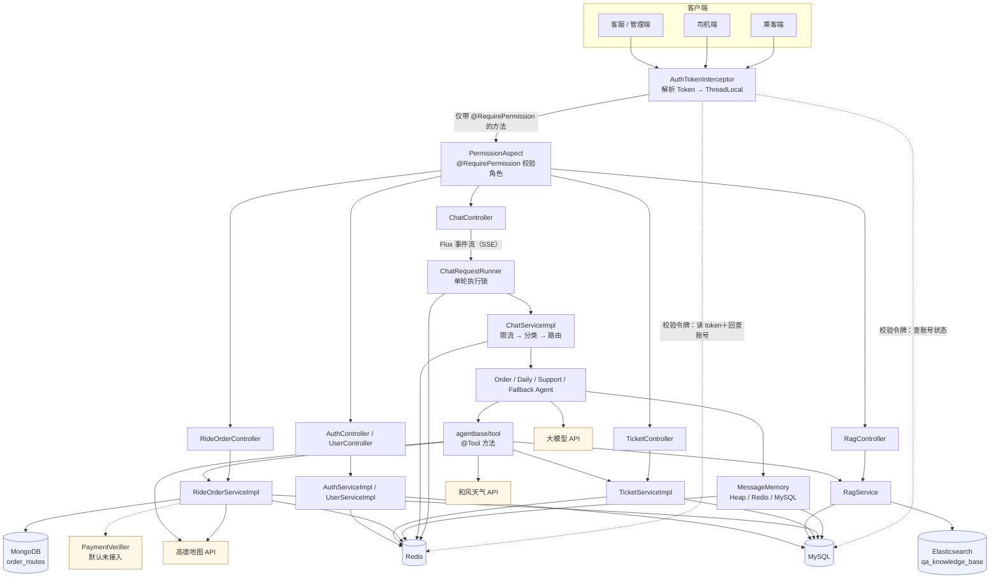

# 第 1 章 业务地图：一个乘客、一个司机、一次咨询

> 这一章不解释任何并发技巧，也不要求你启动项目。它只做一件事：让你在看到任意一个接口、任意一句用户消息时，知道它大概会走到哪里、改动什么数据、失败了谁会拒绝。

## 学习目标

读完本章，你应该能：

1. 说出系统里的四类角色各自能做什么、不能做什么，并指出"限制"写在代码的哪一层。
2. 画出两条路径：**普通 HTTP 请求**（前端 → 鉴权 → 控制器 → 服务 → 存储）和**对话请求**（前端 → 对话入口 → Agent → 工具 → 同一个服务）。
3. 按真实顺序复述"乘客下单"这条调用链，包括每一步谁调用谁、读写了什么、失败了返回什么。
4. 说清 MySQL、MongoDB、Elasticsearch、Redis 各自存什么，谁是权威数据，哪些丢了可以重建。
5. 区分四件容易被混为一谈的事：**模型产生文字**、**工具执行业务**、**服务端授权**、**数据库落地**。

## 前置知识与阅读时间

- 需要：能读懂 Java 类与方法、看得懂注解、会在 IDE 里"跳转到定义"、会用全局搜索找一个方法名。
- 不需要：Redis、Elasticsearch、MongoDB、大模型、Agent 的任何前置知识；也不需要把项目跑起来。
- 阅读时间：约 60～80 分钟（含练习与自测）。第一次读建议一口气读完第五、六、七节，它们是本章主干。
- **路径约定**：正文提到 Java 类时使用简写，基准是 `src/main/java/com/fancy/rideagenthub/`（例如 `controller/RideOrderController.java` 指 `src/main/java/com/fancy/rideagenthub/controller/RideOrderController.java`）；SQL、配置和资源文件写完整仓库相对路径（例如 `src/main/resources/sql/init.sql`）。代码块里的注释给的是完整路径。

---

## 一、场景：林小雨的一天

> 人物均为虚构。订单号、坐标、金额只用于说明流程。

- **林小雨**：乘客，普通用户，角色 `USER`。
- **老陈**：司机，角色 `DRIVER`，有自己的账号（不是林小雨账号里的一个开关）。
- **小周**：客服，角色 `SUPPORT`。
- **管理员**：角色 `ADMIN`，负责知识库和账号。

一天里发生了四件事：

| 时刻 | 发生了什么 | 系统里对应什么 |
|---|---|---|
| 08:30 | 林小雨注册并登录 | `POST /auth/email-code` → `POST /auth/register` → `POST /auth/login/password`，拿到一个 token |
| 08:35 | 她输入起点"文三路地铁站"、终点"萧山机场"，看到预估价，点了"叫车" | `POST /order/estimate` 估价；`POST /order` 创建订单，得到一个订单号 |
| 08:36 | 老陈刚上线，在司机端看到附近订单，点了"接单" | `POST /order/driver/location` 上报位置；`GET /order/driver/pool/page` 看附近；`POST /order/driver/accept` 接单 |
| 09:20 | 行程结束，林小雨觉得费用比预期高，想问清楚 | 她可以直接提交工单（`POST /ticket/submit`），也可以在对话里说"这单怎么这么贵"，由 AI 助手判断并调用工具建单 |

第四件事是这套系统和普通网约车 Demo 最大的区别：**同一个业务能力有两个入口**——人点按钮走 HTTP 接口，人说话走对话接口，最后落到同一批服务方法上。

先记住这条主线，本章剩下的部分都在解释它：

```text
前端（乘客端 / 司机端 / 客服端）
   │  带 token 的 HTTP 请求
   ▼
鉴权链（解析 token、写上下文、检查角色）
   ▼
Controller（收参数、取身份）
   ▼
Service（业务规则、事务、状态流转）
   ▼
Mapper / 客户端（MySQL、MongoDB、Redis、Elasticsearch、外部 API）

另一条入口：
前端 ──► /chat/v2（SSE 流）──► Agent ──► 工具方法 ──► 上面同一个 Service
```

---

## 二、角色与业务边界

角色定义在 `src/main/java/com/fancy/rideagenthub/domain/enums/UserRole.java`，只有四个值：`USER`、`ADMIN`、`SUPPORT`、`DRIVER`。没有"运营""审核员"这类角色。

| 角色 | 主要能做什么 | 边界（当前实现） |
|---|---|---|
| `USER`（乘客） | 估价、下单、查看/取消自己的订单、支付自己的订单、提交与查看自己的工单、保存当前位置、和 AI 对话 | 只能看自己的订单与工单；行程开始后不能取消；`/rag/**` 全部不可用 |
| `DRIVER`（司机） | 上报位置、上下线、看附近订单池、接单、到达、开始行程、结束行程、看自己的任务、提交工单 | 只能操作分配给自己的订单；不能查看其他司机的订单详情；不能管理知识库 |
| `SUPPORT`（客服） | 工单池分页、认领工单、回复/处理、查看任意订单 | **不能**把工单分配给别人（只能认领给自己）；不能删除知识库 |
| `ADMIN`（管理员） | 工单池 / 认领 / 转交 / 处理、查看任意订单、知识库增删改查、用户管理、创建后台账号 | 不能调用只允许 `DRIVER` 的接单/行程接口 |

三个容易忽略的事实：

1. **角色是账号属性，不是请求参数。** 角色存在 `sys_user.role`，登录时写进 token，请求时从 token 解析。客户端传什么角色都不作数。
2. **乘客和司机是两个账号。** 司机提交工单时，控制器用 `UserTokenContext.hasAnyRole("DRIVER")` 把 `userType` 设成 2（司机），否则是 1（乘客）——见 `TicketController#submit`。
3. **"有角色"和"有权限动这条数据"是两件事。** 前者由注解 `@RequirePermission` 检查，后者由 Service 里比较 `userId` / `driverId` 检查。认证部分的第 2 篇（`01-auth/02-authorization-and-defense.md`）会专门讲这条链，本章只需记住它分两层。
4. **上表列的是"主要用途"，不等于接口级的硬限制。** 例如 `POST /order` 的注解只要求登录，没有限定 `USER`；司机账号调用它也会进入方法体。具体差异见 9.3。

后台账号的登录格式是 `username#role`（例如 `zhouxiaosu#SUPPORT`），乘客用邮箱或用户名登录，默认 `USER`。这个分支在 `AuthServiceImpl#parseLoginPrincipal`。

---

## 三、最少概念

这一节只解释本章马上要用的词。每个词都给出"是什么、解决什么问题、本项目哪里用"。

**Controller / Service / Mapper（控制器 / 服务 / 数据访问）**
Controller 只做三件事：接住 HTTP 请求、把参数变成对象、取出当前用户身份，然后交给 Service。Service 放业务规则（能不能取消、状态对不对、要不要加锁）。Mapper 是 MyBatis-Plus 的接口，一个方法对应一条 SQL 或一次表操作。例：`RideOrderController#create` → `RideOrderServiceImpl#createOrder` → `RideOrderMapper#insert`。

**Entity / DTO / VO（实体 / 传输对象 / 展示对象）**
Entity 对应数据库一行（`domain/entity/RideOrder`，表 `sys_ride_order`）。DTO 是请求体（`domain/dto/CreateOrderDTO`），字段按前端方便设计。VO 是响应体（`domain/vo/RideOrderVO`），字段按展示需要拼装。三者字段相近但不是同一个类，转换发生在 Service 里。

**Token（令牌）与 ThreadLocal（线程本地变量）**
登录成功后服务端生成一个随机字符串作为 token，客户端之后每次请求都带上它。服务端用 ThreadLocal 保存"这次请求是谁"——它是**一个线程一份**的变量，请求结束必须清理，否则线程被复用时会串号。本项目的上下文类是 `security/UserTokenContext`。

**缓存与 TTL（过期时间）**
缓存是把"查一次很贵、短时间不变"的结果放在内存数据库里。TTL 是这个 key 多久后自动消失。TTL 到期不等于业务数据被删除——订单还在 MySQL 里，只是缓存要重新查一次。例：`order:status:{orderId}` 缓存订单状态，5 分钟过期。

**事务（Transaction）与"提交后"**
事务是"一组数据库操作要么全成功、要么全失败"的机制；`@Transactional` 标注的方法会在结束时提交（commit）或回滚（rollback）。"提交后执行"指某段代码挂到事务提交之后才运行，避免"数据还没落库、缓存已经更新"。本项目只在部分方法上使用事务，`createOrder` 就没有（见 5.6）。

**条件更新（Conditional Update）**
不先查再改，而是把"旧值"写进 `UPDATE ... WHERE` 条件里，用返回的"影响行数"判断这次修改是否成立：影响 1 行说明状态确实还是旧值，0 行说明已被别人改过。本书后面反复出现的"数据库才是最终裁决者"就是指它。

**文档数据库（MongoDB）**
按"整份文档"存数据，适合结构不固定、整体读写的对象。本项目只用它存订单轨迹（集合 `order_routes`：预估路线、预估折线、真实折线），不存对话。

**检索索引（Elasticsearch）**
为"按相关性搜索"设计的存储，支持分词匹配与向量相似度。本项目用它存知识库索引 `qa_knowledge_base`，**答案的权威数据仍在 MySQL**。

**Agent 与工具调用（Tool / Function Calling）**
Agent 在这里指"带着一段系统提示词、可以请求调用若干 Java 方法的大模型调用循环"。模型不直接改数据库，它输出"我要调用哪个方法、参数是什么"，由服务端真正执行这些方法（`agentbase/tool/` 下带 `@Tool` 注解的方法）。

**SSE 与 Flux**
SSE（Server-Sent Events）是"服务端持续往一个 HTTP 响应里写事件"的协议；`Flux` 是 Reactor 的"多条数据流"类型，这里只是作为返回值把事件一条条写出去。本项目是普通 Servlet 应用（`pom.xml` 里没有 WebFlux starter），`Flux` 不等于"整个应用是响应式的"。

---

## 四、系统有哪些入口

七个控制器，构成全部 HTTP 入口：

| 控制器 | 基础路径 | 代表性端点 | 谁能用 |
|---|---|---|---|
| `AuthController` | `/auth` | `/email-code`、`/register`、`/login/password`、`/login/email-code`、`/logout` | 匿名可调（登录类）；`/account` 需登录 |
| `UserController` | `/user` | `/loc`、`/current`、`/rebuild` | 按端点不同 |
| `UserPOIController` | `/user/poi` | 增删改查"家/公司"等常用地点 | `USER` |
| `RideOrderController` | `/order` | 估价、创建、详情、分页、支付、取消；司机接单/到达/开始/结束/位置/任务 | 登录即可（角色限制在 Service 或注解里） |
| `TicketController` | `/ticket` | C 端提交/查询/评价；B 端工单池/认领/处理/统计 | C 端登录即可；B 端限 `ADMIN`/`SUPPORT` |
| `ChatController` | `/chat/v2` | `/c/{id}` 发消息、`/r/{id}` 恢复确认、`/restore`、`/lock/{id}` | 登录即可（会话归属另行校验） |
| `RagController` | `/rag` | 问答分页/新增/删除/改答案/改问题/搜索 | 仅 `ADMIN` |

两个统一约定：

- **普通接口**返回 `Result`：`{ code, message, data, total }`，HTTP 状态由异常处理器另行决定（见第九节）。
- **对话接口**返回 `AgentEvent` 流：`{ type, payload }`，`type` 有 `message`、`tool_start`、`error`、`confirm`、`notify` 五种（`domain/dto/AgentEvent`）。

---

## 五、一次真实的下单：`POST /order`

选这条链做样板，因为它同时经过身份、业务规则、外部服务、两种数据库和缓存副作用，而且**不涉及锁和 Lua**——那些留给后面的章节。

### 5.1 请求长什么样

```http
POST /order HTTP/1.1
Host: localhost:8080
Authorization: Bearer <登录时拿到的 token>
Content-Type: application/json

{
  "startAddress": "文三路地铁站",
  "startLat": 30.278900,
  "startLng": 120.128300,
  "endAddress": "萧山国际机场",
  "endLat": 30.229500,
  "endLng": 120.434200,
  "vehicleType": 1,
  "isExpedited": 0,
  "isReservation": 0
}
```

说明：字段名对应 `domain/dto/CreateOrderDTO`；请求体里**即使写了 `userId`、`estPrice` 也不会生效**，原因见 5.3 与 5.6。本章出现的请求与响应示例都是示意，未实际调用。

### 5.2 第一步：请求进入鉴权链

所有路径（除 `/error`、`/favicon.ico`）都挂了 `AuthTokenInterceptor`（`config/WebMvcConfig#addInterceptors`）。它从 `Authorization: Bearer xxx` 或 `X-Auth-Token: xxx` 取出 token，去 Redis 换回用户上下文，写进 ThreadLocal。

```java
// src/main/java/com/fancy/rideagenthub/interceptor/AuthTokenInterceptor.java
@Override
public boolean preHandle(HttpServletRequest request, HttpServletResponse response, Object handler) {
    String token = extractToken(request);

    if (token != null && !token.isBlank()) {
        UserToken userToken = tokenService.getToken(token);
        if (userToken != null) {
            // 检查是否过期
            if (userToken.getExpiresAtEpochMs() > System.currentTimeMillis()) {
                UserTokenContext.set(userToken);
                log.debug("Token validated: userId={}", userToken.getUserId());
            } else {
                log.debug("Token expired");
                // 可选：删除过期 token
                tokenService.deleteToken(token);
            }
        } else {
            log.debug("Token not found in Redis");
        }
    }

    // 始终放行，权限控制由 @RequirePermission 注解处理
    return true;
}
```

**这里有一个初学者最常误判的点：只要执行到正常分支，拦截器就 `return true`。** 它不主动拒绝任何请求，只负责"能认出来就写进上下文"。所以"未登录返回 401"不是它干的，而是后面的切面或 Service 干的。

需要补充两个边界，避免把这句话读成绝对结论：

- 这是**正常执行路径**的结论。如果 `tokenService.getToken` 内部抛异常（例如 Redis 连不上），异常会从 `preHandle` 抛出去，请求被中断并走 500，而不是"没登录继续走"。
- 当前实现选择"拦截器只解析、按注解拒绝"，不代表框架只能这样。按端点配置拦截规则、在拦截器里做认证，都是常见做法；本项目只是没用。

那为什么不在拦截器里统一拒绝？因为注册、登录、发验证码这些接口本来就允许匿名访问。如果拦截器"没有 token 就 401"，用户连登录都做不到。哪些接口需要登录，只有看到方法上的 `@RequirePermission` 才知道——这属于"切面"的职责。

`tokenService.getToken` 也不是"Redis 里有就认"：它还会回查 MySQL，要求账号未删除、状态正常、角色一致、密码指纹一致，并要求会话版本号没变（`TokenServiceImpl#getToken`）。这些细节在 `01-auth/01-login-and-session.md` 展开。

### 5.3 第二步：控制器拿到可信身份

```java
// src/main/java/com/fancy/rideagenthub/controller/RideOrderController.java
@PostMapping
@RequirePermission
public Result create(@RequestBody CreateOrderDTO req) {
    req.setUserId(UserTokenContext.getUserIdInString());
    String orderId = rideOrderService.createOrder(req);
    return Result.ok(orderId);
}
```

这个方法只做了三件事：

1. `@RequirePermission` 不带参数 = **只要求登录**，不限制角色。也就是说这个注解本身不区分乘客和司机。
2. `UserTokenContext.getUserIdInString()` 从 ThreadLocal 取当前用户，**覆盖**请求体里的 `userId`。客户端伪造的 userId 在这里就没用了。
3. 返回值是 `Result.ok(orderId)`，即 `data` 是订单号字符串。

### 5.4 第三步：服务做校验与默认值

```java
// src/main/java/com/fancy/rideagenthub/service/impl/RideOrderServiceImpl.java
@Override
public String createOrder(CreateOrderDTO dto) {
    if (dto == null) {
        throw new IllegalArgumentException("createOrderDTO不能为空");
    }

    // HTTP 与异步 Agent 都必须显式传递可信身份；不信任客户端预估价和轨迹引用。
    if (UserTokenContext.isLoggedIn()) dto.setUserId(UserTokenContext.getUserIdInString());
    if (dto.getUserId() == null || dto.getUserId().isBlank()) {
        throw new BusinessException(401, "缺少下单身份");
    }
    if (dto.getVehicleType() == null) {
        dto.setVehicleType(1);
    }
    if (dto.getIsExpedited() == null) {
        dto.setIsExpedited(0);
    }
    if (dto.getIsReservation() == null) {
        dto.setIsReservation(0);
    }
    if (dto.getIsReservation() == 0) dto.setScheduledTime(null);

    // 调用 DTO 的校验与补充方法
    CreateOrderDTO.ValidationResult result = dto.validateAndSupplement(amapGeoRegeoService);

    if (!result.isComplete()) {
        throw new IllegalArgumentException("订单信息不完整，缺失: " + result.missingFields());
    }
    // 输出警告信息（如地址通过逆地理编码补充）
    for (String warning : result.warnings()) {
        log.warn("订单创建警告: {}", warning);
    }

    // 使用补充后的DTO
    CreateOrderDTO validatedDto = result.supplementedDTO();
    Long orderId = snowflakeIdWorker.nextId();
```

注意 `if (UserTokenContext.isLoggedIn())` 这一行：Service 在当前线程**有登录上下文时**会再覆盖一次 userId；没有上下文时（例如 Executor 线程），它只检查 DTO 里的 userId 非空。**它不能验证任意 DTO 的 userId 来源**，也不存在"ThreadLocal 自动传到子线程"这回事——普通 `ThreadLocal` 不会随 `executor.execute` 继承。

那 Agent 路径的身份靠什么可信？靠**显式传参**：控制器把 userId 交给 `ChatRequestRunner`，Runner 作为参数提交后台任务，Agent 再放进 `ToolContext`，工具写进 DTO（见 6.3）。这条链上每一步都是代码传值，不依赖线程上下文，模型也没有机会改它。Service 这一层的作用是"兜底要求必须有人"，不是"鉴别身份真伪"。

`validateAndSupplement` 在 `domain/dto/CreateOrderDTO` 里，做四类事：必填项（userId、起终点经纬度；预约单还要求 `scheduledTime`）、范围校验（纬度 ±90、经度 ±180、车型 1～3）、预约时间必须晚于当前时间、地址为空时调用逆地理编码补全（最多重试 3 次，失败只记警告，不抛异常）。所以"地址补不出来"不会导致下单失败，"没有经纬度"会。

### 5.5 第四步：调用外部路径规划，并先写轨迹

```java
// 同上方法，续
{
    if (validatedDto.getStartLat() == null || validatedDto.getStartLng() == null
            || validatedDto.getEndLat() == null || validatedDto.getEndLng() == null) {
        throw new IllegalArgumentException("起终点经纬度不能为空");
    }
    var estRoute = amapRouteService.getDrivingRouteEst(
            validatedDto.getStartLng().doubleValue(),
            validatedDto.getStartLat().doubleValue(),
            validatedDto.getEndLng().doubleValue(),
            validatedDto.getEndLat().doubleValue());
    if (estRoute == null || estRoute.getEstKm() == null || estRoute.getEstTime() == null) {
        throw new BusinessException(502, "路径规划失败：返回里程/时间为空");
    }
    String traceId = UUID.randomUUID().toString();
    validatedDto.setMongoTraceId(traceId);
    try {
        validatedDto.setEstDistance(new BigDecimal(estRoute.getEstKm()));
    } catch (Exception e) {
        throw new BusinessException(502, "路径规划失败：里程格式异常", e);
    }
    PriceEstimateVO estPrice = calculatePrice(
            estRoute.getEstKm(),
            estRoute.getEstTime(),
            validatedDto.getVehicleType(),
            validatedDto.getIsExpedited());
    validatedDto.setEstPrice(estPrice.getEstPrice());
    validatedDto.setRadio(estPrice.getEstPriceRadio());
    orderRouteService.addOrder(traceId, estRoute);
}
```

这段做了四件事：

1. 调高德驾车路径规划，拿预估里程与耗时。失败时要看具体分支（`AmapRouteService#getDrivingRouteEst` → `#fetchDrivingRouteResponse`）：
   - `amap.key` 未配置 → `BusinessException(500, "amap.key 未配置")`；
   - 起/终点参数为空 → `BusinessException(400, ...)`；
   - HTTP 4xx/5xx、网络异常、高德返回业务失败、路线/折线为空 → `BusinessException(502, ...)`，且 `getDrivingRouteEst` 会先重试，最多 3 次。

   所以不能说"高德出问题一律 502"：配置缺失是 500，参数错误是 400。`exception/GlobalExceptionHandler#response` 会把 400～599 的 code 直接当作 HTTP 状态码，响应体里的 `code` 与 HTTP 状态一致。
2. 生成一个 `traceId`，作为 MongoDB 文档的 `_id`。
3. **服务端重算价格**：`estPrice`/`radio` 由 `calculatePrice` 写回 DTO，请求体里带的价格在这里被覆盖。公式在 `service/base/RidePricing`，订单部分的第 5 篇（`02-orders/05-pricing-and-payment.md`）专门讲。
4. `orderRouteService.addOrder(...)` 往 MongoDB 写一条轨迹文档。

第 3 点值得强调：**金额不是模型或前端说了算**。这条链上没有"相信客户端价格"的分支。

### 5.6 第五步：写订单，失败时尝试清理轨迹

中间是一段 `RideOrder.builder()`，把 DTO 变成实体：状态固定为 `CREATED`，`driverId` 为空，接单/到达/上车/完成/支付五个时间字段为空，创建与更新时间写入当前业务时间，计价拆分字段（基础、时长、里程、加急）初始为 0。然后是：

```java
try {
    rideOrderMapper.insert(order);
} catch (RuntimeException failure) {
    try { orderRouteService.deleteByTraceId(order.getMongoTraceId()); }
    catch (RuntimeException cleanup) { failure.addSuppressed(cleanup); }
    throw failure;
}
if (order.getOrderId() == null) {
    throw new BusinessException(500, "订单创建失败");
}
// 写透状态缓存：新单落入"待接单"，司机端的抢单预检无需回源 DB 即可判断
String createdOrderId = order.getOrderId().toString();
orderGrabService.syncOrderStatus(createdOrderId, RideOrderStatus.CREATED.getCode());
// 登记无人接单兜底：到点仍停留在"待接单"就自动取消
orderDelayQueue.schedule(createdOrderId, Duration.ofMinutes(timeoutProperties.getAcceptTimeoutMinutes()));
// 新订单落库后失效完整 GEO 池，下次按数据库起点坐标重建。
orderGeoPool.add(createdOrderId, order.getStartLng(), order.getStartLat());
return createdOrderId;
```

四件事按顺序发生：

1. **MySQL 插入**。失败时**尝试**删掉刚才那条 MongoDB 轨迹——两个库没有跨库事务，只能补偿。删除本身也可能失败，失败只被记录（`addSuppressed`），不保证清理成功。
2. **同步状态缓存**（Redis `order:status:{id}`）。这行方法名叫 `syncOrderStatus`，内部是"有事务就提交后执行，没事务就立即执行"（`OrderGrabService#syncOrderStatus`）。
3. **登记超时待办**（Redis ZSet `delay:order:timeout`——ZSet 是"带分数、可按分数范围取成员"的集合，这里分数就是到期时间戳；`ride-order.timeout.accept-timeout-minutes` 默认 15 分钟，到点若还是"待接单"就自动取消）。方法内部吞掉 Redis 异常，只打日志——因为还有数据库扫描部分兜底（范围见 9.2）。
4. **使附近订单池失效**。注意 `orderGeoPool.add(...)` 的名字容易误解：它内部调用的是 `remove(...)`，最终执行 `INVALIDATE_ORDER_GEO_POOL`，也就是"整池作废，下次查询时按数据库重建"，而不是"把这一单加进索引"。（GEO 是 Redis 里按经纬度存储、可按半径查询的结构。）

第 2～4 步都发生在插入之后，而且**都失败也不会回滚订单**。这不是遗漏，是取舍：订单已经产生，缓存与索引可以重建；但队列里的待办只在 Redis 一份，丢了要靠数据库扫描部分补齐，且扫描有范围限制（见 9.2）。

### 5.7 第六步：返回

成功时 HTTP 200，响应体：

```json
{ "code": 200, "message": "success", "data": "1837465928374652928", "total": 0 }
```

`data` 是订单号字符串。原因要看 Java 类型，而不是猜序列化规则：`createOrder` 内部执行了 `String createdOrderId = order.getOrderId().toString();`，方法的返回类型也是 `String`，控制器把 `String` 直接放进 `Result.ok(...)`。**这条接口没有经过 `Long` 序列化器。**

项目里另有一条独立的全局规则：`config/Config#jacksonCustomizer` 会把超过 `9007199254740991` 的 `Long` 序列化成字符串，把 `BigDecimal` 一律序列化成字符串。它作用于"对象里声明为 `Long`/`BigDecimal` 的字段"。一个真实例子是 `GET /user/poi`：控制器直接返回 `List<UserPOI>` 实体，其中 `userId` 是雪花 ID（超过安全范围，输出为字符串），`id` 是数据库自增主键（通常很小，仍是数字）。

判断一个 ID 在 JSON 里是不是带引号，先看 Java 类型和有没有显式 `toString()`，再考虑这条全局规则。

### 5.8 这条链上没有的东西

| 没有出现 | 它在哪 | 为什么这条链不需要 |
|---|---|---|
| 订单锁（Redisson `order:lock:{id}`；Redisson 是 Redis 的 Java 客户端，提供分布式锁） | 司机接单、到达、开始、结束、支付、取消、超时 | 创建订单只插入一行，没有"同一订单的状态竞争" |
| 抢单 Lua（Lua 脚本在 Redis 里一次执行完，中间不插入别的命令） | `02-orders/02-grab-and-concurrency.md` | 创建时司机还是空的，没有人与人的竞争 |
| 对话确认令牌 | `04-chat-and-agent/03-order-confirmation.md` | 人点按钮下单，没有模型参与 |
| 事务注解 | —— | `createOrder` 上确实没有 `@Transactional`（`00-foundations/03-data-and-transactions.md` 会解释这带来什么） |

---

## 六、AI 如何调用已有能力

### 6.1 先分清四件事

| 层 | 负责 | 不负责 |
|---|---|---|
| 大模型 | 生成自然语言文字；输出"要调用哪个工具、参数是什么" | 不直接执行方法、不直接写数据库、不能自授权限 |
| 工具方法（`agentbase/tool/` 里带 `@Tool` 的方法） | 从 `ToolContext` 取 `userId`/`chatId`，装配参数，调用 Service | 不重新实现业务规则；个别工具会顺手校验归属（如 `TicketTool#queryTicketProgress`），但这不是统一机制 |
| 服务端授权 | 分散在三处：注解校验角色（HTTP 侧）、Service 校验资源归属、确认令牌校验用户是否同意（Agent 侧） | 不生成文字内容 |
| 数据库/服务 | 状态流转、约束落地 | 不理解自然语言 |

一句话：**模型只提"请求"，能不能做由服务和数据决定。**

### 6.2 对话入口的骨架

`POST /chat/v2/c/{chatId}` 与普通接口看起来一样（带 token），但返回的是流：

```java
// controller/ChatController.java
@RequirePermission
@PostMapping("/c/{id}")
public Flux<AgentEvent> chat(@PathVariable String id, @RequestBody ChatParamDTO chatParam) {
    String userId = UserTokenContext.getUserIdInString();
    return requestRunner.run(userId, id, chatParam, false);
}
```

`ChatRequestRunner#run` 做四件事：校验 chatId 是合法 UUID、抢"同一会话一次只跑一轮"的锁、**在提交后台任务之前先做一次归属检查**（`chats.assertOwned(userId, chatId, !resume)`）、把工作交给 `chatExecutor` 线程池并包装成事件流。

`ChatServiceImpl#chat` 在后台线程里再依次做：会话是否已锁定 → 参数校验与限流 → **再查一次归属**（MySQL `sys_chat`）→ 读取历史消息（`MessageMemory`）→ 判断意图分类（命中缓存就不调模型）→ 按分类分发给四个 Agent 之一。

归属检查出现两次不是重复：一次在提交前（尽早拒绝），一次在业务入口（不假设调用方已经检查过）。另外，`userId` 是作为**方法参数**传进后台任务的，这个线程不共享 HTTP 线程的 ThreadLocal。

四个 Agent 的分工（`agents/`）：

| Agent | 大致负责 | 工具（部分） |
|---|---|---|
| `OrderAgent` | 下单流程、算价、取消条件查询 | 订单槽位、路径规划、POI（兴趣点，如商场/地铁站）搜索、路况、反查工具结果 |
| `SupportAgent` | 客服类咨询、工单、知识库 | 订单查询、工单工具、知识库检索、反查工具结果 |
| `DailyAgent` | 天气、周边、常用地点 | 天气、逆地理、周边 POI、常用地点 |
| `FallbackAgent` | 兜底闲聊 | 无工具，单轮回复 |

分类不是独立类，而是 `ChatServiceImpl#resolveClassification` 这个方法内联完成的（对话部分的第 2 篇 `04-chat-and-agent/02-routing-and-tool-loop.md` 展开）。

### 6.3 工具执行的是同一个服务

先看模型是怎么"拿到工具清单"的。Agent 在每一轮把工具对象转成回调，并把服务端已知的身份放进 `ToolContext`：

```java
// agents/OrderAgent.java#runLoopStep（节选）
List<ToolCallback> callbacks = List.of(ToolCallbacks.from(
        orderTool, poiSearchTool, toolRepPointerTool, trafficTool, userPOISearchTool, geoRegeoTool));
Consumer<String> toolListener = (msg) -> sink.tryEmitNext(AgentEvent.tool(msg));

Prompt prompt = new Prompt(history, OpenAiChatOptions.builder()
        .model("deepseek-chat")
        .toolCallbacks(callbacks)
        .toolContext(Map.of(
                ToolContextKeyConstants.TOOL_LISTENER, toolListener,
                ToolContextKeyConstants.USER_ID, userId,
                ToolContextKeyConstants.CHAT_ID, chatId))
        .internalToolExecutionEnabled(false)
        .build());
```

这段说明三件事：

1. `ToolCallbacks.from(...)` 把带 `@Tool` 注解的普通对象转成模型能理解的工具描述（名称、用途、参数结构）。
2. `toolContext` 里的 `userId` 是**方法参数**，一路来自控制器从 token 取到的值。模型看不到也改不了它；工具方法执行时从这里读身份。
3. `internalToolExecutionEnabled(false)` 表示"模型只提议、由我们的代码执行"，因此工具循环是手写的（第 2 篇 `04-chat-and-agent/02-routing-and-tool-loop.md` 展开）。

再看具体工具。用户说"帮我叫车去萧山机场"，模型可能先请求 `saveNewOrderParam` 保存槽位、再 `isNewOrderReady` 检查缺什么、`getEstRouteAndPrice` 算价，最后在用户确认后请求 `createOrder`。`createOrder` 这个工具长这样（节选：省略了 builder 里十余行逐项读取槽位的代码，以及末尾的日志格式说明）：

```java
// agentbase/tool/OrderTool.java
@Tool(description = "创建订单")
public String createOrder(ToolContext toolContext) {
    log.info("[OrderTool]: createOrder()");
    ToolNotifySupport.notifyToolListener(toolContext, "创建订单 (createOrder)");
    String chatInfoKey = RedisKeyConstants.chatInfoKey(toolContext.getContext().get(ToolContextKeyConstants.CHAT_ID).toString());
    if(redisGetObj(chatInfoKey, "ReadyForCreate") == null){
        return "订单非可创建态";
    }
    CreateOrderDTO orderDTO = CreateOrderDTO.builder()
            .userId(toolContext.getContext().get(ToolContextKeyConstants.USER_ID).toString())
            // ……逐项读取 chat:info 里的起点、终点、车型、预约时间、预估价格等
            .build();
    orderConfirmation.consume(toolContext.getContext().get(ToolContextKeyConstants.CHAT_ID).toString());
    String orderId = rideOrderService.createOrder(orderDTO);
    // ……清理预览轨迹、锁定会话、把 orderId 写回 chat:info
    return "订单已创建，订单编号" + orderId + "……";
}
```

关键有三处：

- 身份来自 `ToolContext`，**不是**模型生成的参数。模型无法"假装自己是别人"。
- `orderConfirmation.consume(chatId)` 消费一次性确认令牌。没有用户确认过当前报价，这里就抛 409，订单不会创建。
- 之后调用的是 `rideOrderService.createOrder(orderDTO)`——**和 HTTP 入口完全同一个方法**。工具没有复制一份下单逻辑。

### 6.4 两个入口的授权来源不同

| | HTTP `POST /order` | 对话里的 `createOrder` 工具 |
|---|---|---|
| 身份从哪来 | 请求头 token → `UserTokenContext`（Tomcat 线程） | 控制器取到的 userId → Runner 参数 → Agent 参数 → `ToolContext` 的 `USER_ID` |
| 谁检查角色 | `@RequirePermission`（无参数时仅要求登录） | **没有角色注解**：是否可被调用取决于工具注册在哪个 Agent、分类路由到哪里（这属于"可达性"，不是授权） |
| 谁检查"这条数据是不是你的" | Service 比较订单的 `userId` / `driverId` | 同样由 Service 比较；个别工具另有自己的归属判断（如 `TicketTool#queryTicketProgress`） |
| 是否要求用户确认 | **不要求** | 要求：`consume` 校验一次性令牌 |
| 金额谁决定 | 服务端 `calculatePrice` 重算 | 同一方法重算 |

这张表要澄清三个常见混淆：

1. **"系统要求用户确认后才下单"只对 Agent 路径成立。** 人直接点按钮走 HTTP 接口，不需要对话确认令牌。
2. **工具注册和分类结果不是授权。** 它们只决定"这次请求能不能走到这个工具"；角色检查在 HTTP 侧由注解完成，而 Agent 侧**没有**对应的角色注解，不能把"只有 OrderAgent 能调"说成"已做角色鉴权"。
3. **服务端重算价格是金额完整性校验，不是身份或角色鉴权。** 它防止价格被伪造，但不回答"你是谁、你能不能下单"。

### 6.5 一条消息的完整路径（一个具体分支）

下面这条路径**不是"任何一句自然语言都会得到这个结果"**。它描述的是一个有明确前提的示例分支：

- 会话是新建的，或者未被锁定（`ChatManager#lockChat` 会在下单成功后锁会话，之后再发消息会被直接拦下）；
- 会话没有 "ORDER 粘滞"：一旦 `chat:info` 里的 `classification` 是 `ORDER`，后续消息会继续交给 `OrderAgent`（`ChatServiceImpl#chat` 里的单独分支）；
- 请求参数合法：`prompt` 非空、未触发用户级限流；
- 分类结果恰好是 `SUPPORT`。

满足这些前提时，以"这单怎么这么贵"为例：

```text
1. POST /chat/v2/c/{chatId}（带 token）
2. AuthTokenInterceptor 解析 token 并写入上下文（Tomcat 线程）
3. PermissionAspect 放行（已登录）
4. ChatRequestRunner：抢 chat:execution:{chatId} → 提交前归属检查 → 提交到 chatExecutor
   （从这里开始换线程，userId 作为参数传入）
5. ChatServiceImpl：会话锁定检查 → 参数/限流 → 再查归属 → 读取历史（MessageMemory）→ 分类
   （分类命中 Redis 缓存就跳过模型调用）
6. 分类为 SUPPORT → SupportAgent
7. Agent 组装系统提示词 + 历史 + 本轮消息，调用模型；模型输出的文字片段边到边推（message 事件）
8. 若模型请求调用工具：推 tool_start → 执行工具（TicketServiceImpl / RideOrderServiceImpl / RagService）
   → 结果回填模型 → 回到第 7 步继续循环
9. 当模型不再请求工具（纯文本回复）时：先保存本轮新增消息（MessageMemory → MySQL），再发完成信号
```

第 8、9 步的顺序来自 `SupportAgent` 的完成回调：`saveNewMessages(...)` 在 `sink.tryEmitComplete()` 之前。如果模型一直在调工具，就会在第 7、8 步之间循环，直到某轮不再产生工具调用。

**这个分支不承诺的东西**：分类是模型给出的结果，同一句话在不同上下文里可能落到别的 Agent；模型也可能选择调用工具而不是直接回答。本章只保证"无论走哪条，工具最终落到同一批服务"。

另外两个分支本章不展开，但读代码时要知道它们存在：如果会话正处于"等待用户确认"（`chat:info` 的 `break=yes`），`chat` 会先提示"请先确认或拒绝当前订单"并结束；如果分类结果是 `DANGER`，会直接返回"您的命令不被支持"，不会分发给 Agent。

更细的内容见 `04-chat-and-agent/01-chat-round-and-sse.md`（锁、超时、断开）、`04-chat-and-agent/02-routing-and-tool-loop.md`（分类与循环）、`04-chat-and-agent/04-memory-and-tool-results.md`（三层记忆）。

### 6.6 提示词不是鉴权

`config/ChatProperties` 里的系统提示词写了大量流程约束（比如"必须先算价再让用户确认"、"不得编造工具结果"）。这些约束**只影响模型行为**，不是安全边界：

- 模型可以不遵守（提示词注入、幻觉、超时重试）；
- 真正的门禁在代码里：`OrderConfirmation.consume` 的 Lua 校验、Service 的 `userId` 比较、数据库的条件更新。

判断一段逻辑"是不是安全边界"的方法：看它失败时会不会**拒绝**这次操作。提示词不会拒绝，令牌会。

---

## 七、总体关系图



**读图顺序**（也是本章的叙述顺序）：

1. 三端都先过 `AuthTokenInterceptor`，然后才到控制器；`PermissionAspect` 只拦**标了 `@RequirePermission` 的方法**，公开端点（发码、注册、密码登录、验证码登录、重置密码、用户名可用性、登出）不经过它。图中虚线表示"解析令牌时会读 Redis 和 MySQL"，它不等于控制器直接访问存储。另外 `/auth/**` 与 `/order/estimate` 在鉴权前还有一层 IP 限流拦截器（超限 429），第 2 章第二节会补上这一站。
2. 五个控制器各自调服务。普通接口走到这里就结束了。
3. `/chat/v2` 多一层：`ChatRequestRunner` 抢单轮执行锁 → `ChatServiceImpl` 分类 → 某个 Agent。
4. Agent 通过工具（`@Tool`）调用**同一批服务**；也通过 `MessageMemory` 读写对话历史（Redis + MySQL）。
5. 存储分四种：MySQL 是业务真值，MongoDB 只存轨迹（唯一副本），Elasticsearch 只存知识库索引，Redis 存登录态/缓存/队列/锁/会话状态——其中一部分能从 MySQL 重建，一部分只有一份（见第八节）。外部服务（高德、天气、模型）只在相应路径上被调用。

**图中刻意没有画**：消息队列、Redis 订阅推送、支付网关、第三方登录、短信。它们在当前仓库里不存在或不参与主链，画上去会暗示不存在的能力。

---

## 八、数据存在哪，谁说了算

### 8.1 MySQL：业务真值

表来自 `src/main/resources/sql/init.sql`，`bus_citycode` 另在 `src/main/resources/sql/bus_citycode.sql`（未执行，仅阅读脚本）：

| 表 | 存什么 | 谁写 |
|---|---|---|
| `sys_user` | 账号（邮箱、用户名、密码摘要、角色、状态、逻辑删除） | `AuthServiceImpl` 注册/建号/改密/注销 |
| `sys_user_poi` | 乘客的常用地点（家、公司） | `UserPOIService` |
| `sys_ride_order` | 订单主表（状态、司乘、起终点、金额、各类时间） | `RideOrderServiceImpl` |
| `sys_ticket` / `sys_ticket_chat` | 工单与工单沟通记录 | `TicketServiceImpl` |
| `sys_chat` / `sys_messages` | 会话元数据 / 对话消息全文 | `ChatInfoService` / `MessageMemory`→`MysqlMemory`（每轮结束时保存） |
| `sys_chat_tool_repsonse` | 工具结果反查索引（表名拼写如此） | `ToolResponseMemory` |
| `sys_qa_info` / `sys_qa_es` / `sys_qa_sync_job` | 答案 / 问题映射 / 索引同步任务 | `RagService` |
| `bus_citycode` | 城市名称到高德城市编码 | 由 SQL 脚本预置；代码只读（`CityCodeUtil`） |

**订单的权威数据是 `sys_ride_order` 这一行。** Redis 里的 `order:status:{id}` 只是它的缓存副本；缓存丢了，从表里读一次就恢复。

### 8.2 MongoDB：只有轨迹

唯一被 `@Document` 标注的类是 `OrderRoute`，集合 `order_routes`，`_id` 就是订单表里的 `mongo_trace_id`，三个字段：`estRoute`（预估路线 JSON）、`estPolyline`（预估折线）、`realPolyline`（真实折线）。

**它不是对话库。** 对话消息在 MySQL 的 `sys_messages`。把"MongoDB 存聊天记录"写进设计文档是错的。

**它也不是"可以从订单表重建"的数据。** 订单表只保存 `mongo_trace_id`，没有折线内容；`realPolyline` 由 `OrderRouteService#updateRealPolyline` 写入，是真实轨迹的唯一副本。这条文档丢了，当前代码里没有重建它的途径。

### 8.3 Elasticsearch：索引，不是权威

索引 `qa_knowledge_base` 的文档结构（`domain/entity/QaDocument`）：`groupId`、`question`（分词检索）、`questionVector`（1024 维）、`answer`（`index = false`，只用于展示）。

这带来一个直接后果：**改完知识库，接口返回成功，不代表马上能搜到**。写入先落 MySQL 并登记同步任务，索引由后台任务重建（`05-rag/02-index-sync-and-budget.md`）。

### 8.4 Redis：数据分几类，恢复方式不一样

先给结论：**Redis 里既有"数据库的缓存"，也有"只有 Redis 一份的状态"**。不能笼统说"丢了从 MySQL 重建"。

| 类别 | 代表 key | 持久副本在哪 | 丢失后怎么恢复 |
|---|---|---|---|
| 订单状态缓存 | `order:status:{id}` | MySQL `sys_ride_order` | 回表重读 |
| 统计/编码缓存 | `ticket:statistics:{date}`、`amap:city_code:{name}` | MySQL 工单表 / `bus_citycode` | 重新查询并回填 |
| 分类缓存 | `chat:classify:*` | **没有**（分类结果从未落库） | 下一次对话重新调用分类模型 |
| 登录态 | `auth:token:{token}`、`auth:user_tokens:{userId}` | 账号在 MySQL，**会话不在** | 用户重新登录 |
| 验证码 | `auth:email_code:*` | 无 | 重新获取（受发送冷却限制） |
| 下单槽位 / 确认令牌 | `chat:info:{chatId}` 的槽位与令牌字段 | 无 | 重新走一遍对话下单流程 |
| 聊天历史 L2 | `chat:history:{chatId}` | MySQL `sys_messages` | 从 MySQL 逐层回填 |
| 索引 | `order:geo:pool`、`ticket:pool:{status}` | MySQL 订单 / 工单表 | 整池重建 |
| 延迟队列 | `delay:order:timeout` | **队列本身没有持久副本** | 靠 `OrderTimeoutJob` 的 MySQL 扫描补，且有范围限制（见 9.2） |
| 锁 / 限流 | `order:lock:`、`chat:execution:`、`chat:ratelimit:` | 无 | 各自后果不同，见下 |
| 用户当前位置 | `user:loc:{userId}` | **无**：`UserServiceImpl#saveUserLocation` 只写 Redis Hash | 用户重新上报位置，系统无法从数据库恢复 |

对三类容易误判的数据补充说明：

- **用户当前位置**：它看起来像"用户资料"，实际只存在 Redis，没有 TTL，也没有 MySQL 副本。它不是缓存，而是"唯一的存储位置"。
- **下单槽位与确认令牌**：丢了不是"回表"能解决的，用户需要重新走一遍对话流程。所以"清空 Redis"不能描述成"只是变慢"。
- **锁**：订单状态机的锁有数据库条件更新兜底（条件不满足就影响 0 行），这是**局部结论**；对话单轮执行锁、缓存重建锁没有同一类数据库约束兜底，丢失后的后果各不相同，分别见 `04-chat-and-agent/01-chat-round-and-sse.md` 与 `03-support-and-cache/03-cache-races.md`。

### 8.5 四个常见误解

1. **"MongoDB 存对话，Redis 存订单"** —— 都不对。对话在 MySQL，订单真值也在 MySQL。
2. **"Redis 里的订单状态就是订单状态"** —— 它是缓存，且带 5 分钟 TTL。判断能否接单，最终看数据库的条件更新是否影响了一行。
3. **"ES 搜到的就是标准答案"** —— ES 只负责"找出候选问题"，答案要回 MySQL 取最新版本（`05-rag/01-retrieval-and-grounding.md`）。
4. **"清空 Redis 只是变慢"** —— 不对。登录态、验证码、下单槽位、确认令牌、用户当前位置都没有持久副本，需要用户重新操作；其中用户当前位置无法由系统从数据库恢复。

---

## 九、失败与边界

正常流程只覆盖了一半。下面八种情况在真实使用中都会出现，本章只解释"谁拒绝、返回什么"，更深的推导在各章。

| 场景 | 谁拒绝 | 结果 |
|---|---|---|
| 没带 token，或 token 已失效 | `PermissionAspect`（`UserTokenContext.getNullable()` 为空）或 Service 的 `getRequired()` | 401 |
| 已登录，但看别人的订单 | `RideOrderServiceImpl#assertCanViewOrder` | 403 |
| 已登录的司机调用"仅 USER"的接口 | `PermissionAspect` 角色不匹配 | 403 |
| 高德配置缺失 | `AmapRouteService#fetchDrivingRouteResponse` 抛 `BusinessException(500)` | HTTP 500 |
| 高德 HTTP/网络/返回结构失败 | 重试后仍失败，抛 `BusinessException(502)` | HTTP 502 |
| 轨迹已写、订单插入失败 | `createOrder` 的 catch：尝试删轨迹后重抛 | 500；唯一键冲突为 409；**删除是否成功不保证**（见 9.2） |
| 订单已插入，Redis 副作用失败 | 不拒绝；`OrderGrabService`/`OrderDelayQueue`/`OrderGeoPool` 内部告警 | 下单成功；超时由 MySQL 扫描补偿，但补偿有范围（见 9.2） |
| 支付 | `PaymentConfig` 的兜底 `PaymentVerifier` 固定抛 503 | 503，当前默认无法支付 |

### 9.1 为什么 401 不是拦截器返回的

回看 5.2 的代码：在正常执行路径上，拦截器最后一行是 `return true`。token 无效时它只是不写上下文，请求继续往后走。真正拒绝的是：

```java
// src/main/java/com/fancy/rideagenthub/aspect/PermissionAspect.java
@Around("@annotation(com.fancy.rideagenthub.annotation.RequirePermission)")
public Object checkPermission(ProceedingJoinPoint joinPoint) throws Throwable {
    MethodSignature signature = (MethodSignature) joinPoint.getSignature();
    RequirePermission annotation = signature.getMethod().getAnnotation(RequirePermission.class);

    UserToken userToken = UserTokenContext.getNullable();

    // 标注了注解就至少要求登录
    if (userToken == null) {
        throw new UnauthorizedException("请先登录");
    }

    // 检查角色（如果指定了角色列表）
    String[] requiredRoles = annotation.value();
    if (requiredRoles.length > 0) {
        String currentRole = userToken.getRole();
        boolean hasPermission = currentRole != null && Arrays.stream(requiredRoles)
                .map(String::toUpperCase)
                .anyMatch(role -> role.equals(currentRole.toUpperCase()));

        if (!hasPermission) {
            log.warn("Permission denied: userId={}, role={}, required={}",
                    userToken.getUserId(), currentRole, Arrays.toString(requiredRoles));
            throw new ForbiddenException("无权访问该资源");
        }
    }

    return joinPoint.proceed();
}
```

这段代码回答了两个问题："为什么 401"（上下文为空）和"为什么有些接口不检查角色"（`requiredRoles.length == 0`）。

### 9.2 失败时如何尝试清理，以及仍可能残留的窗口

5.6 的 `catch` 只覆盖一种情况：`rideOrderMapper.insert` **抛出 `RuntimeException`**。它做的也只是"尝试删除 Mongo 轨迹"，删除本身失败时只把异常挂到原异常上（`addSuppressed`），并不会重试或回滚 Mongo。

把窗口拆成四个场景，能看清各自留在哪个库：

| 场景 | Mongo | MySQL | 代码会做什么 | 现有补偿是否覆盖 |
|---|---|---|---|---|
| A. 插入失败，清理成功 | 轨迹被删 | 无订单 | catch 内 `deleteByTraceId` 成功，重抛原异常 | 不需要补偿 |
| B. 插入失败，清理失败 | **轨迹残留** | 无订单 | catch 内删除抛异常 → `addSuppressed`，重抛原异常 | **未发现**：没有扫描 Mongo 孤儿轨迹的机制 |
| C. Mongo 写入成功，插入前进程退出 | **轨迹残留** | 无订单 | 没有任何 catch 被执行 | **未发现**：同上 |
| D. 插入成功，副作用前进程退出 | 轨迹保留 | 订单存在 | 没有 catch（异常没发生）；返回可能没发出去 | 部分覆盖：超时扫描能处理该订单，但不会修缓存/池 |

对 D 再补充两点边界：

- 订单行仍在，用户/客服可以按订单号查到（读 MySQL）。
- 附近订单池可能少这一单，直到固定 TTL（2 小时）到期或被下一次变更整体失效；`order:status` 缓存也是 5 分钟后自然过期。

**`OrderTimeoutJob` 的扫描范围**（`#recoverOverdueOrders`，每 60 秒一次，`ride-order.timeout.enabled` 为 false 时直接返回）：

- 只扫 **MySQL 里已存在的订单**，且只针对三种状态：`CREATED`（超过接单超时）、`DRIVER_ACCEPTED`（超过到达超时）、`FINISHED_WAIT_PAY`（超过支付超时）；
- 单批最多 `batch-size` 条，按 `update_time` 升序取；
- 它**不扫 MongoDB**，也不处理"从未插入 MySQL 的订单"。

所以准确的表述是：**下单失败时会尝试清理，但清理失败或进程在关键点退出，仍可能留下没有自动恢复途径的残留**；数据库扫描只覆盖"订单已存在且处于三种可超时状态"的情况。更完整的超时机制见 `02-orders/04-timeouts-and-recovery.md`。

> 本节描述现状，不修改实现。若后续要补"Mongo 孤儿扫描"，那是一个新机制，不能写成已有能力。

### 9.3 边界：两个下单入口各自由什么保证

| 要保证的事 | HTTP `POST /order` | Agent `createOrder` |
|---|---|---|
| 身份来自哪里 | 控制器从 token 上下文取 | 控制器取 → Runner 参数 → Agent 参数 → `ToolContext` → DTO |
| 角色是否受限 | `@RequirePermission` 只要求登录，**没有"仅 USER"限制** | 没有角色注解；只有"工具注册在哪个 Agent"这一可达性限制 |
| 数据归属 | 下单时订单还没有归属，创建后由 `userId` 绑定；查看/支付/取消时再校验 | 同左 |
| 用户是否确认 | 不要求（点按钮本身表达了意图） | 要求：一次性确认令牌 |
| 金额 | 服务端重算 | 服务端重算 |

所以不要用一句话概括成"Agent 下单更安全"或"HTTP 下单没有校验"：两者防的东西不同。Agent 多一道确认，是为了防止模型误解；HTTP 没有这道令牌，但也没有模型参与。没有写出来的检查（例如"只有乘客能下单"）就是当前没有的检查，不能脑补。

---

## 十、设计取舍

1. **服务端定权威**：HTTP 的身份来自 token，Agent 的身份来自显式传参；价格由服务端重算；状态由数据库条件更新的影响行数裁决。客户端和模型提供的值只作为"输入参数"，不是"结论"。
2. **一个业务能力一份实现**：HTTP 与 Agent 共用 `RideOrderService`/`TicketService`/`RagService`。好处是规则只有一处；代价是两个入口的"授权强度"必须分别设计，不能假设注解会覆盖 Agent 路径。
3. **权威库 + 性质不同的数据**：MySQL 是订单/工单/账号/对话消息的真值；Redis 里既有可从 MySQL 重建的缓存（订单状态、统计、索引、聊天历史），也有只有一份的状态（登录态、验证码、下单槽位、确认令牌、用户当前位置）；MongoDB 的轨迹同样没有第二份副本。所以"派生数据"只适用于其中一部分。
4. **跨库不做分布式事务，补偿有边界**：MongoDB 与 MySQL 之间用"先写 A、B 失败删 A"的补偿，但清理失败只记录、不重试；Redis 副作用失败靠日志 + 数据库扫描，扫描只覆盖已存在且处于特定状态的订单（见 9.2）。代价是存在无法自动恢复的残留窗口，读者应能指出它在哪里（`00-foundations/03-data-and-transactions.md` 会给出完整推导）。

---

## 十一、动手验证（不需要启动服务）

这是一个纯阅读练习。全部操作在 IDE 或命令行里完成，不连数据库、不发请求。

**准备**：打开仓库根目录，确认能在 IDE 里全局搜索（`Ctrl+Shift+F` / `Cmd+Shift+F`）。

| 步骤 | 操作 | 预期观察 |
|---|---|---|
| 1 | 搜索 `@PostMapping` 且路径为 `/order` 的那个方法（提示：类 `RideOrderController`） | 找到 `create` 方法；确认它第一行就覆盖了 `userId` |
| 2 | 从 `rideOrderService.createOrder` 跳转到实现 | 进入 `RideOrderServiceImpl#createOrder`；确认方法上没有 `@Transactional` |
| 3 | 在该方法内搜索 `addOrder`，再跳到 `OrderRouteService#addOrder` | 看到 `mongoTemplate.save(orderRoute)`；确认集合名来自 `OrderRoute` 的 `@Document` |
| 4 | 回到 `createOrder`，找到 `orderGeoPool.add(...)`，跳到 `OrderGeoPool#add` | 发现 `add` 内部调用 `remove`，最终执行 `INVALIDATE_ORDER_GEO_POOL` |
| 5 | 搜索 `orderConfirmation.consume` | 只应命中 `OrderTool#createOrder`；确认 HTTP 路径没有这一步 |
| 6 | 搜索 `class ESMemory` 与 `implements CallAdvisor` | 前者是空类，后者的方法返回 `null`；再全库搜索 `ESMemory`，除定义外无引用 |
| 7 | 在 `createOrder` 末尾找返回值的来源 | 看到 `order.getOrderId().toString()` 与 `return createdOrderId`：`data` 是字符串来自 Java 类型，不是 Jackson 规则 |
| 8 | 打开 `UserServiceImpl#saveUserLocation` 与 `#getUserLocation` | 两处都只操作 `user:loc:{userId}` 这个 Redis Hash，没有 Mapper/表写入 |
| 9 | 打开 `AmapRouteService#fetchDrivingRouteResponse` 的前 10 行 | 看到 `amap.key` 缺失抛 500、参数为空抛 400，与 HTTP/网络失败的 502 是不同分支 |

**追问（写下来，不看答案）**：

- 如果第 4 步的 `add` 真的只是"把订单加进 GEO 索引"，会出现什么问题？
- 如果第 3 步的 `save` 成功、5.6 节的 `insert` 失败，而 catch 里删轨迹也失败了，会留下什么？现有代码里有谁会发现它？
- 第 8 步说明用户在 Redis 清空后需要做什么？系统能不能替他恢复？

**这个练习不能验证**：真实的高德响应、MySQL 的行锁行为、Redis 的实际 key（需要连中间件）、崩溃与并发窗口。它只能验证"调用关系、分支与代码位置"，这也是本章的目标。

---

## 十二、一页复习

**六个概念**

- 四个角色：`USER` / `DRIVER` / `SUPPORT` / `ADMIN`，角色是账号属性。
- 两层授权：角色（`@RequirePermission`）+ 归属（Service 比较 userId/driverId）。
- 两种入口：HTTP 接口、对话（Agent + 工具），最终落到同一批 Service。
- 四类存储：MySQL 真值、MongoDB 轨迹（唯一副本）、ES 索引、Redis 混合（一部分可回源，一部分只有一份）。
- 四种恢复方式：回 MySQL 重读 / 重新调用模型 / 用户重新操作 / 无法恢复。
- 一条下单链：控制器取身份 → Service 校验补全 → 高德算路 → 写 Mongo → 插 MySQL → 同步缓存/登记超时/失效 GEO 池 → 返回订单号。

**必须记住的三条约束**

1. 拦截器在正常路径上只解析不拒绝（依赖异常仍会中断请求）；401 来自切面或 Service。
2. 价格、身份、状态由服务端决定；但"服务端重算价格"是金额校验，不是角色鉴权。
3. Agent 下单多一道一次性确认令牌；HTTP 下单没有。两者都只是当前实现，不等于做过全面安全审计。

**四个常见误解**

- "MongoDB 存对话记录" —— 不，对话在 MySQL `sys_messages`。
- "Redis 里有订单状态就是订单状态" —— 不，`sys_ride_order` 才是。
- "提示词写了不许下单就安全了" —— 不，门禁是 `OrderConfirmation.consume` 这类代码。
- "清空 Redis 只是变慢" —— 不，登录态、槽位、确认令牌、用户当前位置都会丢，其中位置无法由系统恢复。

---

## 十三、自测与答案

先自己写，再展开对照。答案里给的是"为什么"，不是"是什么"。

**1. 系统里有哪四类角色？"仅需登录"和"需要角色"在代码上怎么区分？**

<details>
<summary>参考答案</summary>

`USER`、`DRIVER`、`SUPPORT`、`ADMIN`（`domain/enums/UserRole.java`）。区分方式看 `@RequirePermission` 有没有参数：不带参数表示只要求登录（`requiredRoles.length == 0`，`PermissionAspect` 只检查上下文非空）；带角色数组时逐个比较，大小写不敏感。注意注解只检查"角色"，不检查"这条数据是不是你的"。
</details>

**2. 一个请求带了 token，却收到 401。可能发生在哪几个位置？为什么不是拦截器？**

<details>
<summary>参考答案</summary>

两处：`PermissionAspect`（`UserTokenContext.getNullable()` 为空）或 Service 里 `UserTokenContext.getRequired()`。拦截器 `preHandle` 无论 token 是否有效都 `return true`，它只负责"能解析就写入上下文"。token 无效（Redis 没有、版本不符、账号被禁用、密码指纹不符）时上下文为空，于是后续任何"要求登录"的地方都会抛 `UnauthorizedException`，再由 `GlobalExceptionHandler` 映射成 401。
</details>

**3. 把下单链的步骤按真实顺序排列（打乱后）：写 MongoDB 轨迹、插入 MySQL 订单、调用高德路径规划、控制器覆盖 userId、使 GEO 池失效、登记超时待办、返回订单号。**

<details>
<summary>参考答案</summary>

控制器覆盖 userId → 调用高德路径规划 → 写 MongoDB 轨迹 → 插入 MySQL 订单 → 登记超时待办 → 使 GEO 池失效 → 返回订单号。

严格说，"同步状态缓存"发生在插入之后、登记超时之前；"登记超时待办"和"使 GEO 池失效"都在插入之后且互不依赖，顺序来自 `createOrder` 的书写顺序。答对关键点即可：**Mongo 在高德之后、MySQL 之前；三个副作用都在插入之后**。
</details>

**4. 为什么 MongoDB 写成功、MySQL 插入失败时要删轨迹？如果不删会怎样？**

<details>
<summary>参考答案</summary>

因为两个库没有跨库事务，无法一起回滚。轨迹文档的 `_id` 等于订单的 `mongo_trace_id`，而订单没插进去，这条轨迹就永远没有主人——成为孤儿数据，既占空间，也会让后续按 traceId 的排查产生误导。所以 `createOrder` 在 catch 中**尝试**调用 `deleteByTraceId`，并把清理失败 `addSuppressed` 到原异常上（不掩盖真正的失败原因）。

但这不是"不会留下孤儿"的保证。按 9.2 的四个场景：

- 插入失败 + 删除成功：没有残留；
- 插入失败 + 删除失败：Mongo 留下孤儿，代码只把它挂到原异常上；**当前未发现**扫描 Mongo 孤儿的机制；
- Mongo 写成功后、`insert` 之前进程退出：catch 根本不会执行，同样残留，同样无自动清理；
- `insert` 成功后、副作用前退出：订单在，Mongo 轨迹保留（这属于正常数据，不是孤儿），但缓存与待办可能没更新，靠 TTL 与 `OrderTimeoutJob` 的 MySQL 扫描部分覆盖。
</details>

**5. 客户端在请求体里传 `estPrice: 1`，订单最终金额会是 1 吗？为什么？**

<details>
<summary>参考答案</summary>

不会。`createOrder` 在高德返回后调用 `calculatePrice(...)`，把结果写回 `validatedDto.setEstPrice(...)` 与 `setRadio(...)`，覆盖了请求体里的值；真正的金额由 `service/base/RidePricing` 计算。这是一条明确的安全边界：价格是资金相关字段，不能由客户端（或模型）决定。

更准确的说法是：请求体里的 `estPrice` 从头到尾没有参与落库，`RideOrder` 的 `estPrice` 字段来自服务端计算结果。
</details>

**6. 同样是创建订单，为什么 Agent 路径要 `consume` 一次性令牌，而 HTTP 路径不需要？这说明什么？**

<details>
<summary>参考答案</summary>

因为两个入口的信任模型不同。HTTP 下单是"人明确点了按钮"，请求本身就是意图表达；Agent 下单是"模型根据对话推断用户想下单"，模型可能误解、可能被提示词注入，所以需要额外一道服务端签发的确认令牌（`OrderConfirmation.quoted → begin → confirm → consume`）。

这说明：**授权强度是按入口设计的，不是全局统一的**。读代码时不能把"Agent 必须确认"推广成"所有下单都必须确认"，也不能反过来认为 HTTP 入口"少了安全检查"——它依赖的是 token 身份 + 服务端重算价格。
</details>

**7. 假设 Redis 被整体清空（不是本项目推荐的实验，只是假设）。哪些功能会受影响？哪些数据不会丢？**

<details>
<summary>参考答案</summary>

按"丢了能不能恢复、怎么恢复"分四类，比笼统说"都是缓存"准确：

1. **能回 MySQL 重读**：`order:status`、`ticket:statistics`、`amap:city_code`、`chat:history`（MySQL `sys_messages`）、订单 GEO 池与工单池（从订单/工单表重建）。延迟队列只能**部分**补：`OrderTimeoutJob` 的扫描只覆盖 MySQL 里已存在、且处于三种超时状态的订单。
2. **只能重新调模型**：`chat:classify`。分类结果从不落库，缓存没了就再调一次分类模型。
3. **需要用户重新操作**：登录态（重新登录）、验证码（重新获取，受发送冷却限制）、下单槽位与确认令牌（重新走一遍对话流程）。
4. **无法由系统恢复**：`user:loc:{userId}`。它只写在 Redis Hash 里，没有 MySQL 副本，只能由用户重新上报位置。

另外，锁的丢失不能一概而论：订单锁丢失有数据库条件更新兜底，对话执行锁与缓存重建锁没有同一类兜底。

不会丢的是 MySQL 与 MongoDB 里的业务数据：订单、工单、账号、对话消息、知识库问答、订单轨迹都在那边。受影响的是 Redis 里的缓存与只有一份的状态——前者能重建，后者要用户重新操作或无法恢复。

结论修正：**Redis 里的订单状态等缓存不是权威**，但 Redis 同时保存了只有一份的业务状态。清空 Redis 的后果是"需要重新登录 / 重新操作 / 位置丢失"，不是"只是变慢"。

（MongoDB 的轨迹不在本题范围，但它同样没有第二份副本，见 8.2。）
</details>

**8. 有人提议"把 `ESMemory` 接进对话，让 Agent 从 ES 里读历史消息"。从当前代码出发，这个说法哪里不成立？**

<details>
<summary>参考答案</summary>

三点：

1. `agentbase/memory/ESMemory` 是一个空类（没有任何字段与方法），`MemoryAdvisor` 的两个方法返回 `null`，全仓库除定义外没有引用——它不是"未启用"，而是"未实现"。
2. 对话历史的真实链路是 `MessageMemory`（Heap → Redis → MySQL），落库在 `sys_messages`；ES 里只有知识库索引 `qa_knowledge_base`，没有对话文档结构。
3. 即使新增，也要先定义消息如何写入 ES、如何与现有的"按轮次截取历史"规则配合、归属如何校验，这些都不是"接一下"能完成的。

所以正确表述是"存在一个占位类，没有任何接入证据"，而不是"系统支持 ES 记忆"。
</details>

---

## 十四、导航

- **下一章**：[第 2 章 请求路径与配置](02-request-path-and-config.md)——把本章出现的 Controller/Service/Mapper、DTO/Entity/VO、配置注入讲透。
- **紧接着**：`00-foundations/03-data-and-transactions.md`（计划）——本章说"没有跨库事务""条件更新才是裁决"，那里给出完整推导。
- **相关专题**：
  - 订单状态机与取消规则 → `02-orders/01-order-lifecycle.md`（计划）
  - 抢单与订单锁 → `02-orders/02-grab-and-concurrency.md`（计划）
  - 对话一轮与 SSE → `04-chat-and-agent/01-chat-round-and-sse.md`（计划）
  - 确认令牌与恢复 → `04-chat-and-agent/03-order-confirmation.md`（计划）
  - 知识库与索引 → `05-rag/01-retrieval-and-grounding.md`、`05-rag/02-index-sync-and-budget.md`（计划）

### 本章源码核验入口

下表路径的基准同上：Java 类相对 `src/main/java/com/fancy/rideagenthub/`，资源文件写完整仓库相对路径。

| 结论 | 源码位置 |
|---|---|
| 四个角色 | `domain/enums/UserRole.java` |
| 订单状态与取消边界 | `domain/enums/RideOrderStatus.java` |
| 入口清单 | `controller/`（7 个控制器） |
| 拦截器只解析不拒绝 | `interceptor/AuthTokenInterceptor.java#preHandle` |
| 角色校验 | `aspect/PermissionAspect.java#checkPermission`、`annotation/RequirePermission.java` |
| 令牌二次校验 | `service/impl/TokenServiceImpl.java#getToken` |
| 下单控制器 | `controller/RideOrderController.java#create` |
| 下单主流程 | `service/impl/RideOrderServiceImpl.java#createOrder` |
| 轨迹读写 | `service/base/OrderRouteService.java`、`domain/entity/OrderRoute.java` |
| 状态缓存 | `service/base/OrderGrabService.java#syncOrderStatus` |
| 超时待办 | `service/base/OrderDelayQueue.java#schedule` |
| 附近订单池失效 | `service/base/OrderGeoPool.java#add`、`#remove` |
| 对话入口 | `controller/ChatController.java`、`service/base/ChatRequestRunner.java` |
| 分类与路由 | `service/impl/ChatServiceImpl.java#chat`、`#resolveClassification` |
| 工具清单与身份注入 | `agents/OrderAgent.java#runLoopStep`（`ToolCallbacks.from` + `toolContext`） |
| 工具调用服务 | `agentbase/tool/OrderTool.java#createOrder`、`TicketTool.java`、`RagTool.java` |
| 确认令牌 | `service/base/OrderConfirmation.java` |
| 存储职责 | `src/main/resources/sql/init.sql`、`domain/entity/*`、`constant/RedisKeyConstants.java` |
| 用户当前位置只存 Redis | `service/impl/UserServiceImpl.java#saveUserLocation`、`#getUserLocation` |
| 失败清理与超时扫描 | `service/impl/RideOrderServiceImpl.java#createOrder`（catch）、`service/base/OrderTimeoutJob.java#recoverOverdueOrders` |
| 高德失败分支 | `agentbase/amap/service/AmapRouteService.java#getDrivingRouteEst`、`#fetchDrivingRouteResponse` |
| 对话完成顺序 | `agents/SupportAgent.java#runLoopStep`（先保存、后完成）、`agentbase/memory/MessageMemory.java#save` |
| 全局序列化规则 | `config/Config.java#jacksonCustomizer`；实际样例 `controller/UserPOIController.java` + `domain/entity/UserPOI.java` |
| 锁持有者的表示 | `service/base/RedisLock.java`（随机令牌）、`service/impl/RideOrderServiceImpl.java#withOrderLock`（Redisson owner） |
| 支付默认拒绝 | `config/PaymentConfig.java` |
| 占位类 | `agentbase/memory/ESMemory.java`、`MemoryAdvisor.java` |
