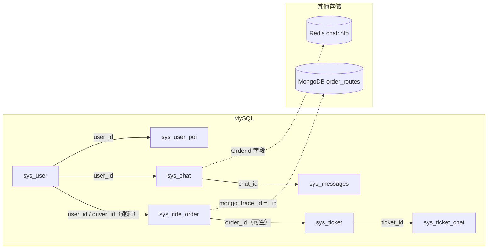

# 第 3 章 数据存在哪，事务管到哪

> 第 1 章跟完了一次下单，第 2 章讲清了请求怎么进入 Java。这一章回答两个更“底层”的问题：**一次业务操作到底改了哪些存储？其中哪些改动在同一个数据库事务里？**
>
> 本章只读源码、SQL 与相关测试声明，不启动服务；所有“运行时会怎样”的判断都标注为静态推导或测试阅读，不是实测。

## 学习目标

读完本章，你应该能：

1. 从一次订单操作指出用户、订单、轨迹、会话、工单之间的**逻辑关联**，并说清哪些关系有 SQL 约束、哪些只是字段同名。
2. 在 `createOrder` 与 `driverAcceptOrder` 两个真实方法上标出本地事务边界，解释提交、回滚与传播设置在调用链里的作用。
3. 用“两名司机接同一单”的时间线解释**条件更新、影响行数、数据库最终裁决**，并说明这个结论的适用前提。
4. 区分数据库行锁、订单分布式锁、Redis 占位各自保护什么，以及它们和 MySQL 事务的关系。
5. 说明 `afterCommit` / `afterCompletion` 与跨库补偿分别能解决什么、不能保证什么。

## 前置知识与阅读时间

- 需要：读完[第 1 章](01-project-map.md)与[第 2 章](02-request-path-and-config.md)；会读 Java 方法、注解和 SQL 的 `WHERE` 条件。
- 不需要：事务理论、隔离级别、行锁、索引的预先知识。本章第一次出现时会给最小解释。
- 阅读时间：约 90～110 分钟（含两个练习与自测）。
- **路径约定**：Java 类使用简写，基准是 `src/main/java/com/fancy/rideagenthub/`；SQL 与配置写完整仓库相对路径。
- **证据约定**：“框架行为”指 Spring / MySQL 的规则（注明精确版本或手册）；“仓库实现”指本项目代码；“版本源码规则 + 项目配置的静态推导”会写明适用前提；“测试阅读”指读过测试声明与断言但未运行；“静态推导，未实测”指没有启动服务、没有发请求或执行 SQL。

---

## 一、两条路径与两个问题

先看两个具体场景（虚构人物）：

**场景 A：下单。** 林小雨从“文三路地铁站”叫车去萧山机场，点了“呼叫车辆”。系统算了价、生成订单号，并在地图上画了一条预估路线。

**场景 B：接单。** 老陈和小赵同时看到这单，几乎同时点了“接单”。另外，老陈自己手机上还开着另一个订单页面，也可能同时点两单。

这两个场景对应两条真实调用链：

```text
POST /order
  → RideOrderController#create
  → RideOrderService#createOrder（实现：RideOrderServiceImpl）
      → 高德算路 → MongoDB 写轨迹 → MySQL 插订单 → Redis 副作用

POST /order/driver/accept
  → RideOrderController#driverAccept
  → RideOrderService#driverAcceptOrder（实现：RideOrderServiceImpl）
      → Redisson 订单锁 → OrderGrabService#tryGrab（司机行锁 + Redis 原子预检）
      → MySQL 条件更新 → 提交后同步
```

本章要回答：

1. **“一次操作”的边界是什么？** 哪些步骤在同一个 MySQL 事务里，哪些根本不在？
2. **两个人同时点，谁说了算？** 是 Redis、锁，还是数据库？

---

## 二、数据关系：主键、业务 ID 和“没有外键”

### 2.1 先看真实建表

`src/main/resources/sql/init.sql` 定义了主要表。先看订单表的关键部分（省略了金额分项等列）：

```sql
-- src/main/resources/sql/init.sql（节选）
CREATE TABLE `sys_ride_order` (
    `id` BIGINT NOT NULL AUTO_INCREMENT COMMENT '主键ID',
    `order_id` BIGINT NOT NULL COMMENT '订单ID',
    `user_id` BIGINT NOT NULL COMMENT '乘客用户ID',
    `driver_id` BIGINT DEFAULT NULL COMMENT '司机ID (接单后回填)',
    `mongo_trace_id` VARCHAR(64) DEFAULT NULL COMMENT '关联MongoDB的轨迹ID',
    `order_status` TINYINT NOT NULL DEFAULT 10 COMMENT '状态: 10-创建, 20-司机接单...',
    `create_time` DATETIME NOT NULL DEFAULT CURRENT_TIMESTAMP,
    `driver_accept_time` DATETIME DEFAULT NULL,
    -- ……起终点、金额等
    `update_time` DATETIME DEFAULT CURRENT_TIMESTAMP ON UPDATE CURRENT_TIMESTAMP,
    `is_deleted` TINYINT(1) DEFAULT 0,
    PRIMARY KEY (`id`),
    UNIQUE KEY `uk_order_id` (`order_id`),
    KEY `idx_user_create_time` (`user_id`, `create_time`),
    KEY `idx_driver_create_time` (`driver_id`, `create_time`),
    KEY `idx_status_create_time` (`order_status`, `create_time`)
) ENGINE=InnoDB DEFAULT CHARSET=utf8mb4;
```

用户表同样有两个“身份”：

```sql
-- src/main/resources/sql/init.sql（节选）
CREATE TABLE `sys_user` (
  `id` BIGINT UNSIGNED NOT NULL AUTO_INCREMENT COMMENT '自增主键',
  `user_id` BIGINT NOT NULL COMMENT '用户唯一标识(业务 雪花ID)',
  `username` VARCHAR(50) NOT NULL,
  `role` VARCHAR(20),
  `status` TINYINT(1) DEFAULT '1',
  `is_deleted` TINYINT(1) DEFAULT '0',
  `active_username` VARCHAR(50) GENERATED ALWAYS AS (IF(is_deleted = 0, username, NULL)) STORED,
  `active_email` VARCHAR(100) GENERATED ALWAYS AS (IF(is_deleted = 0, email, NULL)) STORED,
  -- ……邮箱、密码、时间
  UNIQUE KEY `uk_user_id` (`user_id`),
  UNIQUE KEY `uk_active_username_role` (`active_username`, `role`),
  UNIQUE KEY `uk_active_email_role` (`active_email`, `role`),
  PRIMARY KEY (`id`)
) ENGINE=InnoDB;
```

### 2.2 主键不等于业务 ID

| 表 | 数据库主键 | 业务标识（代码里到处传的那个） | SQL 约束 |
|---|---|---|---|
| `sys_user` | `id` 自增 | `user_id`（雪花 ID） | `uk_user_id` 唯一 |
| `sys_ride_order` | `id` 自增 | `order_id`（雪花 ID） | `uk_order_id` 唯一 |
| `sys_ticket` | `id` 自增 | `ticket_id`（字符串编号） | `uk_ticket_id` 唯一 |
| `sys_chat` | `id` 自增 | `chat_id`（UUID 字符串） | `uk_chat_id` 唯一 |
| `sys_messages` | `id` 自增 | 无独立业务号，靠 `chat_id` 归属 | 非唯一索引 |

代码里查询订单用的是 `order_id`，不是 `id`。例如：

```java
// mapper/RideOrderMapper.java 继承 BaseMapper，Service 里这样查
new LambdaQueryWrapper<RideOrder>()
        .eq(RideOrder::getOrderId, orderId)   // 对应 order_id
        .eq(RideOrder::getIsDeleted, 0)
```

实体上的 `@TableId` 标在 `id` 上（`RideOrder` 用 `IdType.AUTO`），`orderId` 只是普通字段。**“主键”是数据库的行标识，“业务 ID”是对外和对日志的标识**，两者不能混用；用业务 ID 查询时，唯一索引（不是主键）保证最多一行。Redis 的 key 也用业务 ID（`order:status:{orderId}`、`order:lock:{orderId}`），不会出现数据库自增 `id`。

### 2.3 逻辑关联不是物理外键

在 `init.sql` 里检索 `FOREIGN KEY`，结果为空。数据库内的关系都靠**字段**维持（其中一部分字段带索引），数据库不会禁止你插入一个不存在的 `user_id`。

| 逻辑关系 | 关联字段 | SQL 约束 | 代码入口 |
|---|---|---|---|
| 用户 1—N 订单（乘客） | `sys_ride_order.user_id` → `sys_user.user_id` | 无外键；有 `idx_user_create_time` | `RideOrderServiceImpl#getPassengerOrdersByTime` |
| 司机 1—N 订单 | `sys_ride_order.driver_id` → `sys_user.user_id` | 无外键；有 `idx_driver_create_time` | 接单条件更新、司机任务查询 |
| 订单 1—N 工单 | `sys_ticket.order_id` → `sys_ride_order.order_id`（可空） | 无外键；有 `idx_order_id` | `TicketServiceImpl#submitTicket` |
| 工单 1—N 沟通 | `sys_ticket_chat.ticket_id` → `sys_ticket.ticket_id` | 无外键；有 `idx_ticket_id` | `TicketServiceImpl` 追加消息 |
| 用户 1—N 会话 | `sys_chat.user_id` → `sys_user.user_id` | 无外键 | `ChatManager`、`ChatServiceImpl` |
| 会话 1—N 消息 | `sys_messages.chat_id` → `sys_chat.chat_id` | 无外键；索引 `(chat_id, id DESC)` | `MysqlMemory` |
| 用户 1—N 常用地点 | `sys_user_poi.user_id` | 无外键；普通索引 | `UserPOIService` |
| 订单 1—0..1 轨迹（跨库） | `sys_ride_order.mongo_trace_id` → MongoDB `order_routes._id` | 跨库，无任何约束 | `OrderRouteService` |
| 会话 1—? 订单 | Redis `chat:info:{chatId}` 的 `OrderId` 字段 | **不是数据库关系** | `OrderTool#createOrder` 写回 |



读图要点：

- 实线表示“有对应字段（部分字段带索引）”，**不表示有外键**；虚线表示跨存储的逻辑引用。
- 一个订单可以有**多张**工单（`ticket.order_id` 不唯一），业务是否限制要看 Service，本章不展开。
- **订单和会话在 MySQL 里没有关联列**。Agent 下单后把订单号写进 Redis 的 `chat:info`，这是流程状态，不是数据库关系。
- `mongo_trace_id` 是字符串，Mongo 文档删了或没写成，MySQL 不会知道。

> 迁移脚本 `sql/migrations/20261113_security_consistency.sql` 给已有库补了 `sys_user` 的唯一键和 `sys_chat` 的 `uk_chat_id`。**仓库里有脚本不等于某个环境已经执行过**；本教材按“脚本声明的约束”讲解，不假设生产库一定如此。
>
> `src/main/resources/sql/bus_citycode.sql` 只是“城市名 → 高德城市编码”的字典表，与本章两条路径无关，正文不引用。

---

## 三、最少概念：事务、隔离级别、行锁与提交后回调

### 3.1 事务是什么边界

事务是**对某一个资源**的一组操作，要么一起提交、要么一起回滚。本章说的“本地事务”，指**一个 MySQL 数据源上的事务**：

- 开始：从连接池借一条连接，关闭自动提交；
- 结束：`COMMIT` 或 `ROLLBACK`，连接归还；
- **MongoDB、Redis 不在这条连接里**，它们不会因为 MySQL 回滚而回滚。

Spring 的 `@Transactional` 是**代理**机制。一次经过代理的调用要按下面顺序读（框架行为，Spring Framework 6.2.15）：

1. 代理**开启新事务**，或按传播设置**加入已有事务**；
2. 进入方法体；`withOrderLock` 的 lambda 只是方法体内部的一段代码，lambda 返回不等于事务结束；
3. 方法正常返回或抛出异常，控制权回到代理；
4. **如果此代理新建并拥有物理事务**，它根据异常规则、rollback-only 标记和资源状态决定提交或回滚，并执行相应回调与资源清理，然后调用者才拿到正常结果或异常；
5. **如果此代理只是加入外层事务**，它完成本次参与调用后即可把结果或异常交还外层方法；物理事务的最终提交/回滚、回调和清理由最外层事务边界负责。

所以“方法体返回 `true`”只表示业务方法执行完了；“这次物理事务已提交”要等负责该事务的代理完成提交。当前控制器注入的是接口 `RideOrderService`，调用经过代理；调用前没有外层事务，因此这里会新建事务，控制器拿到结果前完成提交（见 5.1）。

自调用（同一个类里 `this.method()`）不经过代理，方法上的 `@Transactional` 不生效，但**结果取决于调用前有没有既有外层事务**：

- 原本没有事务：不会新建事务；`tryGrab` 的 `MANDATORY` 代理又检查到没有事务，会抛 `IllegalTransactionStateException`。
- 原本已有外层事务：方法体仍在那条连接和事务同步器里执行，只是这个方法的注解不会新建事务、也不会重新设置隔离级别。不能一概说“自调用就一定没有事务”。

### 3.2 默认回滚规则与“捕获异常后能不能提交”

Spring `@Transactional` 的默认规则（Spring Framework 6.2.15，`Transactional` 注解）：

- **回滚**：`RuntimeException` 及其子类、`Error`；
- **不回滚**：受检异常（checked exception）。

`BusinessException` 与 `IllegalArgumentException` 都是运行时异常，抛出时默认回滚。但“异常被 `catch` 掉了”不等于“事务一定能提交”，要分三种情况：

1. **同一方法内捕获，且没有内层事务代理、事务仍可提交**：catch 后正常返回，代理按正常返回尝试提交；已经执行的 SQL 可能保留。只有显式 `setRollbackOnly()` 才会改判为回滚。
2. **异常经过了另一个 `@Transactional(REQUIRED)` 代理**：内层代理在异常符合回滚规则时会回滚这个参与中的逻辑事务；默认 `globalRollbackOnParticipationFailure=true`，它把**共享的物理事务标记为 rollback-only**，再把异常抛给外层。外层即使 catch 掉并正常返回，最外层代理 `commit` 时发现全局 rollback-only，会执行回滚并抛 `UnexpectedRollbackException`。默认 `failEarlyOnGlobalRollbackOnly=false`，所以这个异常通常出现在最外层事务边界，而不是内层抛异常时。
3. **数据库自身错误让事务不可继续**：连接断开、死锁、语句超时或 `COMMIT` 失败都可能使提交抛异常或回滚；Spring 可能触发 `STATUS_UNKNOWN`/回滚回调并向上抛 `TransactionException`。这种情况下不存在“捕获后照常提交”的前提。

第 2、3 点的版本依据是 Spring Framework v6.2.15 `AbstractPlatformTransactionManager` 的 `commit` / `processCommit` / `processRollback` / `doRollbackOnCommitException`（见本节末的资料链接）。若把 `globalRollbackOnParticipationFailure` 设为 false，框架行为会改变——**默认配置**才是上面的结论。

一个教学假设（不是当前代码）：如果 `driverAcceptOrder` 把条件更新包在 `try { ... } catch (RuntimeException e) { return false; }` 里，只有在“异常没有经过内层事务代理、共享事务没有被标记 rollback-only、数据库仍可提交”时，事务才可能按正常返回提交；其余情况会回滚或抛 `UnexpectedRollbackException` / 提交失败异常。当前代码没有这个 catch。要避免歧义，要么继续抛出异常，要么显式标记回滚，并把 `false` 与“失败”区分开。

`@Transactional` 默认 `propagation = REQUIRED`：没有事务就新建，有事务就加入。`OrderGrabService#tryGrab` 用的是 `MANDATORY`：**通过代理调用时必须在已有事务里**，否则在进入方法体前抛 `IllegalTransactionStateException`；直接 `new` 出来的对象没有代理，注解不会触发这项检查。

### 3.3 READ_COMMITTED 的最小含义

`driverAcceptOrder` 声明了 `isolation = Isolation.READ_COMMITTED`。在 MySQL InnoDB 下（以 MySQL 8.4 手册为准）：

- **普通一致性读**：每条不带锁的 `SELECT` 在 RC 下建立自己的新快照，读取其他事务已提交的数据，同时能看到本事务自己的修改；同一事务里两次查询可能看到不同结果（不可重复读）。别的事务未提交的修改不会进入这个快照。
- **锁定读 / 当前读**：`SELECT ... FOR UPDATE` 与 `UPDATE` 在需要时等待其他事务释放锁，并基于当前可用的最新已提交记录及本事务自己的修改处理；这是 InnoDB 锁定语句的当前读语义，**不是 RC 普通快照读带来的效果**。在 REPEATABLE READ 下，锁定读同样做当前读。本项目 6.2 的时间线要靠这一点解释，不能简单说成“因为 RC 所以后到者看到了新状态”。
- RC 下通常**不加间隙锁**（外键检查和唯一键重复检查除外），因此普通范围读可能出现幻读；这也不等于“所有读都能看到未提交数据”。

这不是“并发问题的万能解”：它只约束**同一数据源内**的可见性与加锁行为，管不到 Redis 占位、也管不到“先查再改”的应用逻辑。

> 部署的 MySQL 版本与默认隔离级别，静态阅读无法确认。Spring 为新事务设置 RC 属于框架行为；如果该方法加入了一个已存在、隔离级别不同的事务，默认会**静默忽略**这里的声明（`@Transactional` 的 `isolation` 只对新建事务生效）。当前调用方没有外层事务，所以这里会新建。

### 3.4 行锁、`FOR UPDATE` 与条件更新

`SELECT ... FOR UPDATE` 是“锁定读”：对**扫描到的索引记录**加排他锁，效果类似对这些行执行 `UPDATE`。三个前提必须记住：

1. **必须在事务里**（自动提交关闭）；否则语句结束锁就释放，失去意义。
2. 锁的范围取决于**索引与执行计划**：脚本声明了 `uk_user_id` 唯一键和 `idx_driver_create_time(driver_id, create_time)` 等索引（见 2.1、2.3）；唯一索引等值命中通常收敛到一行，但优化器是否使用该索引、是否扫描更多记录，取决于部署库的实际表结构与执行计划。不要脱离这些前提承诺“只锁一行”。
3. 锁在**事务提交或回滚**时释放。

条件更新是另一种“数据库裁决”：

```sql
UPDATE sys_ride_order
SET driver_id = ?, order_status = 20, ...
WHERE order_id = ? AND is_deleted = 0 AND order_status = 10 AND driver_id IS NULL;
```

它把“旧状态”写进 `WHERE`，用**影响行数**判断是否抢到：

- 返回 1：条件成立，这次修改生效；
- 返回 0：状态已被别人改过（或订单不存在/已删除），本次不算成功。

应用层不需要“先查再判断再改”，也就少了一个“查完到改之间被别人插队”的窗口。

### 3.5 提交后回调

Spring 允许把动作注册到事务同步器上（`TransactionSynchronization`）：

- `afterCommit()`：**只有提交成功路径**才执行；`beforeCommit`/`beforeCompletion` 在提交前触发，本章只在时间线里出现；
- `afterCompletion(status)`：事务完成后执行，`status` 可为 `STATUS_COMMITTED`、`STATUS_ROLLED_BACK` 或 `STATUS_UNKNOWN`（提交/回滚失败时可能是未知状态）。本项目只判断“是否等于 COMMITTED”，其它状态都会释放占位。

本仓库的用法：

- `syncOrderStatus`、`orderGeoPool.remove`、`orderDelayQueue.schedule` 用 `afterCommit`；
- `tryGrab` 的“未提交就释放 Redis 占位”和 `withOrderLock` 的“释放订单锁”用 `afterCompletion`。

两个容易误解的点：

- `afterCommit` 里抛异常**不会**让已提交的事务回滚；本仓库的回调大多自己 `catch` 并记日志，避免把接口变成失败。
- 没有事务同步时（`createOrder` 的当前调用链就是如此），这些检查同步器的方法会**立即执行**，不是“等提交”；但 HTTP/Mongo/直接 Redis 命令从来不由这三个方法决定是否延后。

> 本节与下一节的框架/数据库依据（2026-11-14 查阅）：Spring Framework v6.2.15 `Transactional`（`https://github.com/spring-projects/spring-framework/blob/v6.2.15/spring-tx/src/main/java/org/springframework/transaction/annotation/Transactional.java`）、`TransactionSynchronization`（`.../support/TransactionSynchronization.java`）、`Propagation`，以及 `AbstractPlatformTransactionManager`（`https://github.com/spring-projects/spring-framework/blob/v6.2.15/spring-tx/src/main/java/org/springframework/transaction/support/AbstractPlatformTransactionManager.java`，本轮返工据其 `commit`/`processRollback` 核对 rollback-only 与 `UnexpectedRollbackException`）；MySQL 8.4 手册 17.7.2.1（隔离级别）与 17.7.2.4（锁定读）。项目依赖版本来自 `pom.xml` 的 Spring Boot 3.5.9 parent，其管理的 Spring Framework 为 6.2.15。

---

## 四、创建订单：当前调用链上没有本地事务

### 4.1 谁在调用

`RideOrderService#createOrder` 目前有两个调用方：

```java
// controller/RideOrderController.java（节选）
@PostMapping
@RequirePermission
public Result create(@RequestBody CreateOrderDTO req) {
    req.setUserId(UserTokenContext.getUserIdInString());
    String orderId = rideOrderService.createOrder(req);
    return Result.ok(orderId);
}
```

```java
// agentbase/tool/OrderTool.java#createOrder（节选）
orderConfirmation.consume(...);
String orderId = rideOrderService.createOrder(orderDTO);
try { orderRouteService.deleteByTraceId(orderDTO.getMongoTraceId()); }
catch (RuntimeException e) { log.warn("订单预览轨迹清理失败", e); }
```

两个调用方都没有 `@Transactional`，Agent 的工具循环也不在事务里；`createOrder` 自身也没有注解（见 4.2）。因此**就当前调用链而言**，没有 Spring 事务同步，下面的副作用按“无事务分支”立即执行。这个结论只覆盖当前调用方，不能推广成“任何调用方都不可能有事务”。

教学假设：如果未来由某个 `@Transactional` 方法调用 `createOrder`，只有实际检查 `TransactionSynchronizationManager.isSynchronizationActive()` 的三个入口会改为注册提交后回调：

| 入口 | 有事务同步时 | 无事务同步时 |
|---|---|---|
| `OrderGrabService#syncOrderStatus` → `#afterCommit` | 注册 `afterCommit`，提交成功后写状态缓存 | 立即执行并吞掉运行时异常 |
| `OrderDelayQueue#schedule` → `#afterCommit` | 注册 `afterCommit`，提交成功后写 ZSet | 立即写 ZSet |
| `OrderGeoPool#add` → `#remove` | 注册 `afterCommit`，提交成功后失效整池 | 立即 `invalidate()` |

**不会因为这个外层事务自动加入 MySQL 事务、也不会自动延后**的有：高德 HTTP 调用、`OrderRouteService#addOrder` 的 MongoDB 写入、`OrderTool` 里对预览轨迹的删除、以及任何直接 Redis 命令。MySQL 的 Mapper 调用在 Spring 管理的事务连接下会随外层事务提交/回滚，但这不等于 Mongo/Redis/HTTP 也一起原子。外层事务只改变“这三个方法注册回调的时机”，不把跨资源变成分布式事务。

### 4.2 方法本身没有注解

`RideOrderServiceImpl` 只在两个方法上标了 `@Transactional`：

```java
@Transactional(isolation = Isolation.READ_COMMITTED)
public Boolean driverAcceptOrder(...) { ... }

@Transactional(isolation = Isolation.READ_COMMITTED)
public void handleTimeoutOrder(...) { ... }
```

`createOrder` 不在其中，类上也没有类级事务。结合 4.1 的调用方核对，**当前调用链**没有 Spring 事务上下文，因此它执行时：

- 每条 Mapper SQL 在自己的数据库会话里提交；
- `syncOrderStatus` / `schedule` / `add` 这三个检查事务同步的方法走“立即执行”分支；
- MongoDB 写入与其它外部 HTTP/Redis 调用按各自语义立即生效，不因 MySQL 事务而延后。

如果未来出现外层事务，只有上一节表格中的三个方法会切换成提交后执行；不能把“当前无事务”写成方法本身永远不受外层事务影响。

### 4.3 顺序与边界

```java
// service/impl/RideOrderServiceImpl.java#createOrder（真实节选；省略前半段的高德算路、Mongo 写入、定价与大部分实体字段，且省略原注释，不是可直接编译的完整方法）
RideOrder order = RideOrder.builder()
        .orderId(orderId)
        // ……服务端补全的字段
        .build();

try {
    rideOrderMapper.insert(order);
} catch (RuntimeException failure) {
    try { orderRouteService.deleteByTraceId(order.getMongoTraceId()); }
    catch (RuntimeException cleanup) { failure.addSuppressed(cleanup); }
    throw failure;
}
if (order.getOrderId() == null) {
    throw new BusinessException(500, "订单创建失败");
}
String createdOrderId = order.getOrderId().toString();
orderGrabService.syncOrderStatus(createdOrderId, RideOrderStatus.CREATED.getCode());
orderDelayQueue.schedule(createdOrderId, Duration.ofMinutes(timeoutProperties.getAcceptTimeoutMinutes()));
orderGeoPool.add(createdOrderId, order.getStartLng(), order.getStartLat());
return createdOrderId;
```

把每一步放进“资源/事务”视角：

| 步骤 | 资源 | 当前调用链在 MySQL 事务里吗 | 失败会怎样 |
|---|---|---|---|
| 高德算路 | 外部 HTTP | 否 | 不是一律 502：`amap.key` 缺失为 `BusinessException(500)`；起终点/扩展参数为空为 400；API HTTP、网络异常或响应/路线/折线不满足业务要求，重试后为 502。`createOrder` 对里程/时间为空或格式异常也抛 502。`GlobalExceptionHandler#response` 把 400～599 的 `code` 当 HTTP 状态 |
| `orderRouteService.addOrder` | MongoDB | 否 | 写入失败在当前调用链上不会被 MySQL 事务回滚，异常继续向上抛 |
| `rideOrderMapper.insert` | MySQL | 当前无 Spring 事务时，单条语句自行提交 | catch 中**尝试**删 Mongo 轨迹，删除失败只 `addSuppressed`，然后重抛；HTTP 状态按具体异常类型：`DuplicateKeyException` → 409，未专门列出的运行时异常 → 兜底 500，不能写成“所有数据库异常都是 500” |
| `syncOrderStatus` | Redis | 否 | 无事务同步时立即执行；内部 catch，只告警 |
| `orderDelayQueue.schedule` | Redis | 否 | 无事务同步时立即写 ZSet；内部 catch，只告警；漏入队可由数据库扫描在条件下部分兜底（见 8） |
| `orderGeoPool.add` | Redis | 否 | 无事务同步时立即失效整池；内部 catch，只告警 |

结论：**当前调用链上没有“多步一起成功/失败”的本地事务**。MySQL 只有一条 `INSERT` 是原子的；Mongo 与 Redis 都是独立提交，跨库不可能一起回滚。外部 HTTP、Mongo 与 Redis 不会因为将来多了一层 MySQL 事务就自动原子化。

### 4.4 四个残留窗口（回顾）

第 1 章已经按场景拆过，这里换成事务视角再看一次：

| 场景 | MySQL | MongoDB | 说明 |
|---|---|---|---|
| A. insert 失败，删轨迹成功 | 无订单 | 已删除 | 补偿成功 |
| B. insert 失败，删轨迹也失败 | 无订单 | **残留** | 只 `addSuppressed`，没有重试或扫描 |
| C. Mongo 写成功，insert 前进程退出 | 无订单 | **残留** | 没有 catch 机会 |
| D. insert 成功，Redis 副作用前退出 | 订单存在 | 轨迹存在 | 缓存/队列/池可能未更新 |

不存在“数据库扫描自动清 Mongo 孤儿”的机制。`OrderTimeoutJob#recoverOverdueOrders` 扫的是**已存在的 MySQL 订单**：`is_deleted=0`、处于 `CREATED`/`DRIVER_ACCEPTED`/`FINISHED_WAIT_PAY` 之一、满足各自的时间阈值，并受 `enabled`、批次上限和本轮执行成功等条件约束。因此：

- **延迟队列**漏入队、或任务被领取后进程退出，只要订单仍在 MySQL 且满足上述条件，就有机会被扫描重新交给 `handleTimeoutOrder` 处理——这是**部分兜底**，不是把 ZSet 完整恢复；
- **Mongo 孤儿轨迹**没有对应 MySQL 订单行，扫描不到；
- **订单状态缓存、GEO 池、登录态、会话槽位等其它 Redis 状态**不由这个扫描恢复；
- 扫描关闭、批次没轮到、查询或处理失败时，也不能承诺“一定最终恢复”。

所以跨库这里最多做到“尽力补偿 + 有条件的部分兜底”，不是原子性，也不是强一致。细节见第八节。

---

## 五、司机接单：一个本地事务覆盖了什么

### 5.1 入口

```java
// controller/RideOrderController.java（节选）
@PostMapping("/driver/accept")
@RequirePermission({"DRIVER"})
public Result driverAccept(@RequestBody DriverAcceptReqDTO req) {
    Long driverId = UserTokenContext.getUserIdInLong();
    Boolean ok = rideOrderService.driverAcceptOrder(
            req.getOrderId(), String.valueOf(driverId), req.getCurrentLat(), req.getCurrentLng()
    );
    return Result.ok(ok);
}
```

控制器注入的是接口 `RideOrderService`，所以调用会经过 Spring 的事务代理。

### 5.2 方法骨架

```java
// service/impl/RideOrderServiceImpl.java#driverAcceptOrder
@Transactional(isolation = Isolation.READ_COMMITTED)
public Boolean driverAcceptOrder(String rawOrderId, String rawDriverId,
        BigDecimal currentLat, BigDecimal currentLng) {
    // ……参数校验、ID 规范化
    return withOrderLock(orderId, () -> {
        OrderGrabService.GrabResult grabResult = orderGrabService.tryGrab(orderId, driverId);
        if (grabResult != OrderGrabService.GrabResult.SUCCESS) {
            throw new BusinessException(409, grabFailureMessage(grabResult));
        }

        LocalDateTime now = com.fancy.rideagenthub.util.BusinessTime.now();
        int updated = rideOrderMapper.update(null,
                new LambdaUpdateWrapper<RideOrder>()
                        .eq(RideOrder::getOrderId, orderId)
                        .eq(RideOrder::getIsDeleted, 0)
                        .eq(RideOrder::getOrderStatus, RideOrderStatus.CREATED.getCode())
                        .isNull(RideOrder::getDriverId)
                        .set(RideOrder::getDriverId, driverIdLong)
                        .set(RideOrder::getOrderStatus, RideOrderStatus.DRIVER_ACCEPTED.getCode())
                        .set(RideOrder::getDriverAcceptTime, now)
                        .set(RideOrder::getUpdateTime, now));

        if (updated <= 0) {
            orderGrabService.rollbackGrab(driverId, orderId);
            orderGrabService.refreshOrderStatus(orderId);
            return false;
        }

        orderGrabService.syncOrderStatus(orderId, RideOrderStatus.DRIVER_ACCEPTED.getCode());
        orderGeoPool.remove(orderId);
        if (currentLng != null && currentLat != null) {
            driverGeoIndex.refreshIfExist(driverId, currentLng, currentLat);
        }
        orderDelayQueue.schedule(orderId, Duration.ofMinutes(timeoutProperties.getArriveTimeoutMinutes()));
        return true;
    });
}
```

（原文有逐行注释与参数校验，这里只保留与事务相关的骨架。）

当前控制器调用没有外层事务，事务边界按 3.1 的新建事务分支读：代理开启事务 → 进入方法体 → `withOrderLock` 执行 lambda（`tryGrab`、条件更新、注册回调都在方法体内）→ lambda 返回后方法返回/抛异常 → 代理提交或回滚 → 同步回调、锁释放与资源清理 → 控制器才拿到结果。若加入外层事务，最终提交由外层事务边界负责。

所以 **lambda 返回不是事务结束**：它只让 `withOrderLock` 的 `finally` 注册一个 `afterCompletion` 回调；事务提交与回调由外层代理继续完成。MongoDB 不在（接单路径不写 Mongo）；Redis 占位与可选位置刷新也不在 MySQL 事务里（见 5.6）。

### 5.3 订单锁：不是数据库事务的一部分

```java
// service/impl/RideOrderServiceImpl.java#withOrderLock（节选）
private <T> T withOrderLock(String orderId, Supplier<T> action) {
    RLock lock = redissonClient.getLock(RedisKeyConstants.orderLockKey(orderId));
    boolean acquired;
    try {
        acquired = lock.tryLock(ORDER_LOCK_WAIT_SECONDS, TimeUnit.SECONDS);
    } catch (InterruptedException e) { ... }

    if (!acquired) {
        throw new BusinessException(409, "订单正在处理中，请稍后重试");
    }
    try {
        return action.get();
    } finally {
        if (TransactionSynchronizationManager.isSynchronizationActive()) {
            TransactionSynchronizationManager.registerSynchronization(new TransactionSynchronization() {
                @Override
                public void afterCompletion(int status) {
                    releaseOrderLock(lock, orderId);
                }
            });
        } else {
            releaseOrderLock(lock, orderId);
        }
    }
}
```

读法：

- `tryLock(3, TimeUnit.SECONDS)` 没有传 `leaseTime`，Redisson 用**看门狗**续期。测试 `OrderGrabIntegrationTest#slowTransactionRenewsOrderLockBeyondWatchdogTimeout` 把看门狗超时设为 1500ms、在锁内睡眠 2200ms，验证锁仍被持有——这是**测试配置**，不代表生产默认值。
- 锁是 **Redis 的锁**，不是 MySQL 行锁；它不参与数据库事务，但因为注册在 `afterCompletion` 上，**释放时机被绑定到事务结束**（提交或回滚之后）。
- 如果调用方没有事务（例如本类里 `cancelOrder`、`payOrder` 没有 `@Transactional`），`isSynchronizationActive()` 为 false，锁会在 `finally` 里**立即释放**，不会等到“提交”。本章只对接单路径下结论；其它方法要单独核对。

### 5.4 `tryGrab`：司机行锁 + Redis 原子预检

下面是核对过的**真实源码节选**：`tryGrab` 方法体完整，省略了类声明、import 和同类的其它方法；没有改写变量、没有省略 `result == null` 分支。它也不能单独编译，因为省略了类上下文。

```java
// service/base/OrderGrabService.java#tryGrab（真实节选；方法体完整）
    /** 在接单事务内锁定司机账号，使缓存过期或丢失时仍满足一人一单。 */
    @Transactional(propagation = Propagation.MANDATORY)
    public GrabResult tryGrab(String orderId, String driverId) {
        orderId = normalizeId(orderId);
        driverId = normalizeId(driverId);
        UserAuth driver = userAuthMapper.selectOne(new LambdaQueryWrapper<UserAuth>()
                .eq(UserAuth::getUserId, Long.valueOf(driverId))
                .eq(UserAuth::getIsDeleted, 0)
                .eq(UserAuth::getStatus, 1)
                .eq(UserAuth::getRole, "DRIVER")
                .last("FOR UPDATE"));
        if (driver == null) {
            throw new BusinessException(403, "司机账号不可用");
        }

        // 同一司机的上一个接单事务已经结束，依据数据库修复过期或残留的占位。
        RideOrder active = rideOrderMapper.selectOne(new LambdaQueryWrapper<RideOrder>()
                .eq(RideOrder::getDriverId, Long.valueOf(driverId))
                .eq(RideOrder::getIsDeleted, 0)
                .notIn(RideOrder::getOrderStatus, List.of(
                        RideOrderStatus.FINISHED_WAIT_PAY.getCode(),
                        RideOrderStatus.PAID.getCode(), RideOrderStatus.CANCELLED.getCode()))
                .last("LIMIT 1 FOR UPDATE"));
        redisTemplate.opsForValue().set(RedisKeyConstants.driverActiveKey(driverId),
                active == null ? IDLE : active.getOrderId().toString(), CACHE_TTL);

        String statusKey = RedisKeyConstants.orderStatusKey(orderId);
        if (redisTemplate.opsForValue().get(statusKey) == null) {
            RideOrder order = rideOrderMapper.selectOne(new LambdaQueryWrapper<RideOrder>()
                    .eq(RideOrder::getOrderId, Long.valueOf(orderId))
                    .eq(RideOrder::getIsDeleted, 0));
            if (order == null) {
                return GrabResult.ORDER_NOT_FOUND;
            }
            redisTemplate.opsForValue().setIfAbsent(statusKey, String.valueOf(order.getOrderStatus()), CACHE_TTL);
        }

        Long result = redisTemplate.execute(RedisScripts.GRAB_ORDER_ATOMIC,
                List.of(statusKey, RedisKeyConstants.driverActiveKey(driverId)),
                String.valueOf(RideOrderStatus.CREATED.getCode()), IDLE, orderId,
                String.valueOf(CACHE_TTL.toSeconds()));
        if (result == null) {
            throw new IllegalStateException("抢单预检未返回结果");
        }
        if (result == 1L) {
            String claimedOrderId = orderId;
            String claimedDriverId = driverId;
            TransactionSynchronizationManager.registerSynchronization(new TransactionSynchronization() {
                @Override
                public void afterCompletion(int status) {
                    if (status != STATUS_COMMITTED) {
                        rollbackGrab(claimedDriverId, claimedOrderId);
                    }
                }
            });
            return GrabResult.SUCCESS;
        }
        return result == -2L ? GrabResult.DRIVER_BUSY : GrabResult.ORDER_NOT_GRABBABLE;
    }
```

按执行顺序读这段，不要把 Redis 说成“访问数据库前的统一拦截器”：

1. **先查数据库并锁司机账号行**：`sys_user` 按 `user_id` 等值 `FOR UPDATE`，司机不存在或不可用时抛 403。脚本声明了 `uk_user_id`，但实际锁范围取决于执行计划（见 6.3）。
2. **再查数据库里的进行中订单**：同一司机非终态订单 `LIMIT 1 FOR UPDATE`；结果用来写 Redis 的 `driver:active`（缓存丢失/过期时修复）。
3. **状态缓存缺失时还会再读一次数据库**：按 `order_id` 查订单；不存在直接返回 `ORDER_NOT_FOUND`，存在则 `setIfAbsent` 写 5 分钟 TTL 的状态缓存。
4. **然后才执行 Redis Lua**：`GRAB_ORDER_ATOMIC` 检查 `order:status` 是否为 `10`、`driver:active` 是否为 `__IDLE__`，成功则把占位改为当前订单号；`result == null` 会抛 `IllegalStateException`，`-1`/`-2` 分别映射为订单不可抢/司机忙。Lua 语法与完整机制留 O2；这里只需知道它**把“Redis 检查 + 占位”做成一个原子步骤**，不写 MySQL。
5. **成功后注册 `afterCompletion`**：只有事务最终不是 `STATUS_COMMITTED` 才用 `claimedDriverId`/`claimedOrderId` 释放该订单的占位；提交时不释放。`String claimed...` 是真实源码里的局部副本，不是教学改写。
6. **回到上层 `driverAcceptOrder` 再做条件更新**：5.5 的 `UPDATE ... WHERE status=10 AND driver_id IS NULL` 才是数据库层面的最终裁决。

所以预检顺序是「数据库行锁/读取 → Redis 状态处理/原子预检 → 上层数据库条件更新」。Redis 预检不能挡在数据库之前拦截所有无效请求；无效司机、已有进行中订单、订单不存在都可能已经触发数据库查询。

### 5.5 条件更新：数据库的最终裁决

`UPDATE ... WHERE order_status = 10 AND driver_id IS NULL` 返回 `updated`：

- `updated == 1`：抢到。
- `updated == 0`：预检通过但数据库已经不是待接单（被另一个人抢走、被取消、缓存过期等）。此时：
  - `rollbackGrab` **立即**释放 Redis 占位（因为事务会正常提交，`afterCompletion` 的“回滚才释放”不会触发）；
  - `refreshOrderStatus` 在提交后删掉状态缓存；
  - 返回 `false`，控制器返回 `Result.ok(false)`（HTTP 200，`data=false`）。

**这就是“数据库才是最终裁决者”**：Redis 预检是在两次数据库查询之后做的原子占位与快速拒绝，真正决定订单归属的是这条带条件 `UPDATE` 的影响行数；`tryGrab` 的司机行锁则负责约束同一司机跨不同订单的情况。两者不能互相替代。

反过来看“无条件更新”的风险：如果 SQL 只写 `UPDATE ... SET driver_id = ? WHERE order_id = ?`，T1、T2 都会影响 1 行，后提交者覆盖前者的 `driver_id`，两个人却都收到成功——接口返回与最终数据不一致。条件更新把“旧状态”放进 `WHERE`，让第二次更新影响 0 行，才能把“谁赢了”变成可判定的事实。

### 5.6 提交与回调的完整顺序

按时间顺序（正常成功；关键是区分**方法体结束**与**代理完成事务**）：

```text
1. 代理开启事务（当前调用链无外层事务，RC）。
2. 方法体：withOrderLock 获取 order:lock:{id}。
3. 方法体：tryGrab（同一个 MySQL 事务）
   3.1 先查数据库并锁司机账号行；
   3.2 再查数据库里的进行中订单，修复 driver:active；
   3.3 状态缓存缺失时再读数据库；随后执行 Redis Lua 原子预检并占位（Redis 不在 MySQL 事务里）。
4. 方法体：MySQL 条件更新影响 1 行——此刻是 T1 事务内的未提交修改。
5. 方法体：注册提交后动作 syncOrderStatus / geoPool.remove。
6. 方法体（可选）：若 currentLat/currentLng 非空，driverGeoIndex.refreshIfExist
   在 MySQL 提交前直接执行 Redis Lua UPDATE_DRIVER_LOCATION。
   DriverGeoIndex#update 捕获 RuntimeException，只记 warn 并返回 false；
   driverAcceptOrder 忽略这个布尔值。这个 Redis 副作用不参加 MySQL 事务，
   后续若回滚也不会自动撤销。
7. 方法体：delayQueue.schedule 注册提交后登记到达超时的动作。
8. lambda 返回 true；withOrderLock 的 finally 注册 afterCompletion 释放锁；
   driverAcceptOrder 方法返回 true。到这里只完成方法体，事务尚未提交。
9. 代理提交 MySQL。
10. afterCommit：更新订单状态缓存、失效 GEO 池、登记到达超时。
11. afterCompletion：tryGrab 的回滚补偿（已提交→不动作）→ 释放订单锁；
    随后资源清理，调用者才拿到 true。
```

失败时（以条件更新抛运行时异常为例；HTTP 状态取决于具体异常类型）：

```text
1~3 同上
4. UPDATE 抛异常：若是 DuplicateKeyException，GlobalExceptionHandler 映射 409；
   普通未列出的运行时异常走兜底 500；连接断开等数据库错误还可能让事务本身不可继续。
   不能写成"所有数据库异常都是 500"，也不能假设捕获后仍能提交。
5. 异常离开 lambda 与业务方法；代理回滚 MySQL（若数据库在提交阶段失败，
   回调状态可能是 STATUS_UNKNOWN）。
6. afterCompletion(ROLLED_BACK 或 STATUS_UNKNOWN)：
   6.1 tryGrab 注册的补偿释放 driver:active 占位；
   6.2 释放订单锁。
   此例 UPDATE 抛异常发生在位置刷新之前，因此位置刷新尚未执行；
   Redis 占位不由 MySQL 自动撤销，由上面的回调尽力补偿。
7. afterCommit 动作不执行；异常继续向上，由 GlobalExceptionHandler 按类型映射。
```

> 顺序依据：`tryGrab` 先注册同步器，`withOrderLock` 在返回前注册；`afterCompletion` 按注册顺序执行。测试 `OrderLockRegressionTest#failedAcceptanceKeepsLockUntilRollbackCleanupCompletes` 用 `inOrder` 验证了“先释放占位、再解锁”。

---

## 六、两种并发：同单多司机、同司机多单

### 6.1 场景一：两个司机接同一订单

T1（老陈）与 T2（小赵）几乎同时请求 `POST /order/driver/accept`，订单 100。

| 时刻 | T1（老陈） | T2（小赵） | T1 自己 / 其他事务普通读 / Redis 的状态 |
|---|---|---|---|
| t0 | 请求进入 | 请求进入 | MySQL 已提交的是订单 `status=10`；两个司机都空闲；`order:status:100` 若有缓存也是 10 |
| t1 | 拿到 `order:lock:100` | 等锁（最多 3 秒） | T2 尚未进入 `tryGrab` |
| t2 | `tryGrab` 先查数据库并锁司机 1 账号行、查进行中订单 | 尚未拿到订单锁 | 都已提交的订单仍是 10 |
| t3 | 状态缓存检查后执行 Lua：订单 10、司机 1 空闲 → 占位成功 | 仍在等锁 | Redis `driver:active:1=100`；MySQL 订单行还没改；`order:status:100` 仍是 10 |
| t4 | `UPDATE ... WHERE status=10` 影响 1 行 | 仍在等锁 | **T1 事务内的未提交修改**：T1 自己能读到 `status=20, driver_id=1`；其它事务的普通一致性读只能看到已提交的 10；Redis 状态缓存仍是 10 |
| t5 | lambda 返回、`driverAcceptOrder` 方法返回 true，控制权回到代理 | 仍在等锁 | MySQL 还没提交；T1 的订单锁仍持有 |
| t6 | 代理提交 MySQL → `afterCommit` 写 `order:status:100=20` → `afterCompletion` 释放订单锁 | 等锁 | 提交后其它事务普通读才可能看到 20；表中把提交/回调/释放压缩在同一时刻，不代表 T2 在提交前读到 20 |
| t7 | — | 锁释放后拿到 `order:lock:100`，`tryGrab` 做数据库查询后 Lua 看到 20 → 返回 -1 | 已是 T1 的订单 |
| t8 | — | 抛 `BusinessException(409)`，事务回滚（无自己的 MySQL 写入） | — |

读表的关键：t4 的 20 只属于 T1 的未提交事务，**不能写成“T2 普通读已经看到 20”**。T2 在这里甚至还被 Redisson 锁挡着；即使它当时做普通一致性读，RC 下也只能读已提交的 10。第 3.3 节说过，`FOR UPDATE` 锁定读的当前读是另一套语义，不能用来解释这里的普通读可见性。

结果：T1 成功，T2 收到 409。三层防线各司其职：

1. **订单锁**：让同一订单的请求串行，减少无谓竞争；
2. **状态预检**：T2 先完成司机账号行锁与进行中订单查询，再在 Lua 处因状态缓存 20 快速失败；它不是“访问 DB 前的统一拦截器”；
3. **条件更新**：即使前两层失效（锁过期、缓存旧值），`WHERE status=10` 仍然只允许一个人成功。

如果 T2 等锁超过 3 秒，会在 `withOrderLock` 处直接 409（“订单正在处理中”），根本没进入业务。

**缓存旧值的极端情况**：如果 afterCommit 写状态缓存失败，`order:status:100` 仍是 10。T2 的 Lua 会通过，条件更新返回 0，走 5.5 的失败分支：释放自己的占位、删状态缓存、返回 false。数据库仍然是唯一裁决者。

### 6.2 场景二：同一个司机接两个不同订单

老陈同时点订单 100 和 101。两单的 `order:lock` 不同，所以**订单锁不冲突**，两个请求都能进入 `tryGrab`。

| 时刻 | T1（订单 100） | T2（订单 101） | 数据库/Redis 状态（注明是否已提交） |
|---|---|---|---|
| t0 | 拿到 `order:lock:100` | 拿到 `order:lock:101` | MySQL 已提交：司机无进行中订单 |
| t1 | `SELECT ... sys_user ... FOR UPDATE` 拿到司机账号行锁 | 在同一司机账号行锁上等待 | — |
| t2 | 查进行中订单 → 无；`driver:active=__IDLE__` | 仍在等待 | 此时 T1 还没有订单行修改 |
| t3 | Lua 占位 100 成功 | 仍在等待 | Redis `driver:active:1=100` |
| t4 | `UPDATE` 订单 100 → 1 行 | 仍在等待司机账号行锁 | **T1 事务内未提交**：T1 自己看到 100 归老陈；其它事务普通一致性读仍只能看到已提交的旧状态 |
| t5 | 方法返回后代理提交，释放司机账号行锁 | 等到行锁后继续 | 100 的修改成为已提交状态 |
| t6 | — | `LIMIT 1 FOR UPDATE` 锁定读查“进行中订单” → 100；`driver:active=100` | 这是**锁定读在等待行锁释放后的当前读**，读到最新已提交版本；不是 RC 普通一致性读的快照语义，也不能简单归因于隔离级别 |
| t7 | — | Lua 看到占位不是 IDLE → 返回 -2 | — |
| t8 | — | 409 `DRIVER_BUSY`，事务回滚（无自己的 MySQL 写入） | — |

这里 T2 的可见性来自两点：它先因 `sys_user` 的 `FOR UPDATE` 行锁等待，到 T1 提交后才继续；随后查询进行中订单用的也是 `FOR UPDATE` 锁定读，会做当前读。若把它写成“RC 所以普通读立刻看到”，会把快照读与当前读混为一谈。

**为什么只靠订单条件更新不够**：订单 100 和 101 是两行不同的数据，各自的 `WHERE status=10` 都会成功；如果不锁司机行、也不查“该司机是否已有进行中订单”，同一个人就能接两单。防线是：

1. `sys_user` 司机行的 `FOR UPDATE`（同一司机的接单事务串行）；
2. 在该事务里查“进行中订单”并修复 Redis 占位；
3. Lua 的 `driver:active == __IDLE__` 判断。

### 6.3 前提与边界

这些结论成立需要几个前提，读代码时不要忽略：

- **所有接单入口都走同一个 Service 事务**。目前只有 `driverAcceptOrder` 一条路径；若新增入口绕开它，行锁与条件更新都不会生效。
- **只按脚本声明的索引谈锁**：`init.sql` 为 `sys_user.user_id` 声明 `uk_user_id` 唯一键，为 `sys_ride_order(driver_id, create_time)` 声明 `idx_driver_create_time`，为 `order_id` 声明 `uk_order_id`。这些是脚本中的定义，不保证某个环境已经执行迁移；优化器是否使用这些索引、扫描到多少索引记录，须看实际执行计划与数据库版本。不能据此承诺“只锁一行”或固定的物理锁范围。
- **MySQL 的锁范围以实际版本、隔离级别、执行计划为准**。本章引用 MySQL 8.4 手册说明通用语义，不承诺某个部署环境的物理锁行数；`FOR UPDATE` 的当前读语义也不同于普通一致性读（见 3.3）。
- **Redis 不是权威，而且不在 DB 之前拦截一切**。`tryGrab` 先做数据库司机行锁与进行中订单查询，再用数据库结果修复 `driver:active`，然后才执行 Lua 预检；状态缓存缺失时还会再读一次订单表。占位可能丢失、过期或被手工清理，但这些都不改变“最后还要看条件更新影响行数”的结论。
- **进程在事务中途退出**：MySQL 连接断开后事务回滚；Redis 占位没有 `afterCompletion` 可执行，只能等 5 分钟 TTL，或等下一次该司机接单时被数据库修复。

---

## 七、提交之后：回调、锁释放与“失败了会怎样”

### 7.1 三个动作，三种失败语义

接单成功后，方法体内注册了三类“提交后”动作：

| 动作 | 注册方式 | 失败时 | 后续可能怎样，前提是什么 |
|---|---|---|---|
| 更新 `order:status` | `orderGrabService.syncOrderStatus` → `afterCommit` | 内部 `catch` 记日志 | 旧值若未过期仍可能被后续预检命中，**不能保证下次读取就回源**；只有 key 缺失/过期时，`tryGrab` 才按 `get(statusKey) == null` 回表并 `setIfAbsent`，且写回还依赖 Redis 可用。5 分钟 TTL、`refreshOrderStatus` 删除、下一次成功同步都可能让它恢复；条件更新仍可拒绝旧缓存放行的抢单 |
| 失效附近订单 GEO 池 | `orderGeoPool.remove` → `afterCommit` | 内部 `catch` 记日志 | 池有固定 2 小时 TTL；后续查询在 Redis/MySQL 可用、版本与锁匹配时可能整池重建，不是立刻、也不是无条件 |
| 登记到达超时 | `orderDelayQueue.schedule` → `afterCommit` | 内部 `catch` 记日志 | 漏入队或领取后丢失时，`OrderTimeoutJob#recoverOverdueOrders` 只在扫描开关打开、订单仍在 MySQL 且满足状态/时间/批次、本轮执行成功时部分兜底；它不把 ZSet 原样恢复 |

这些失败**不会**让接单接口报错，也**不会**回滚已经提交的 MySQL。它们造成的是“缓存/队列短暂不一致”，不是“订单归属错误”。

#### 按“丢了什么”区分恢复范围

| 类别 | `OrderTimeoutJob` 是否覆盖 | 说明 |
|---|---|---|
| MongoDB 孤儿轨迹 | **否** | 没有对应 MySQL 订单行；扫描 SQL 看不到它，当前代码未发现 Mongo 孤儿扫描 |
| Redis 延迟队列待办 | **部分** | 订单仍在 MySQL、处于三种可超时状态并达到各自时间阈值时，扫描可把订单号交给 `handleTimeoutOrder`；受 `enabled`、批次、`update_time` 排序、查询/处理成功与 Redis 可用性影响，不能承诺所有待办最终恢复 |
| `order:status` 状态缓存 | **不作通用重建** | 缓存缺失/过期后可由 `tryGrab` 回表 `setIfAbsent`；旧值未过期时仍可能命中。扫描触发的超时状态变更还可能间接调用 `syncOrderStatus` 或 `refreshOrderStatus`，但不保证修复任意丢失或旧缓存 |
| 其它 Redis 状态（GEO 池、`driver:active`、登录态、会话槽位、用户位置等） | **不作通用重建** | 超时状态变更可能间接失效 GEO 池或条件释放司机占位，但不会恢复所有状态；登录态、会话槽位和位置有各自的恢复限制 |

所以准确说法是：**数据库扫描能按状态和时间对部分漏掉的超时处理兜底，但不扫描 Mongo 孤儿，也不保证恢复所有 Redis 数据或最终一致**。

### 7.2 没有事务时，回调立即执行

`createOrder` 的**当前调用链**没有事务，所以：

- `syncOrderStatus` 调用 `OrderGrabService#afterCommit(...)` 时没有同步器可注册，直接执行 `guarded.run()`；
- `orderGeoPool.add → remove` 直接执行 `invalidate()`；
- `orderDelayQueue.schedule` 直接写 ZSet。

准确的条件不是“这个方法没加注解”，而是这三个方法内部检查到 `TransactionSynchronizationManager.isSynchronizationActive() == false`。若未来有外层事务让同步器激活，这三个动作会延后；高德 HTTP、Mongo 写入和直接 Redis 命令不会由这个分支自动延后（见 4.1）。

### 7.3 已提交但 HTTP 返回失败

还有一种失败不在事务模型里：**MySQL 已提交、Redis 副作用也执行了，但响应在网络上丢了**（客户端超时、连接断开）。此时：

- 订单真实存在；
- 客户端可能重试 `POST /order`，而接口没有幂等键，重试会**再创建一单**（新的雪花 ID）；
- 服务端不会因为“客户端没收到”而回滚。

这既不是“事务回滚”，也不是“自动重试”，读教材时不要把它们混成“最终一致”。

### 7.4 回滚能撤销什么

| 已发生的事 | 事务回滚后会怎样 |
|---|---|
| MySQL `UPDATE` | 撤销 |
| `tryGrab` 写入的 Redis 占位 | 不会自动撤销；靠 `afterCompletion` 补偿，进程退出则靠 TTL/下次接单时按数据库修复 |
| `driverGeoIndex.refreshIfExist`（有坐标时才调用） | 在方法体内、MySQL 提交前直接写 Redis；**回滚不会撤销它**。`DriverGeoIndex#update` 对无效坐标返回 false，对 `RuntimeException` 记 warn 并返回 false，`driverAcceptOrder` 忽略返回值，不抛异常、不回滚 |
| `orderGeoPool` / `orderDelayQueue` 的提交后动作 | 回滚时 `afterCommit` 不执行；漏入队的超时待办只能在前提条件满足时由数据库扫描部分兜底（见 7.1、8） |
| MongoDB 轨迹 | 与本章接单路径无关；创建订单的**当前调用链**没有事务，也谈不上回滚 |

---

## 八、跨库与崩溃：四个场景与扫描边界

创建订单的**当前调用链**没有本地事务，跨库只能补偿。四个场景在第 1 章已给出，这里只补充“事务视角”的结论：

1. **A：insert 失败、清理成功** —— MySQL 没有订单，Mongo 轨迹被删；没有事务，靠 catch。
2. **B：insert 失败、清理失败** —— MySQL 没有订单，Mongo 残留；异常被 `addSuppressed`，没有重试。
3. **C：Mongo 成功、insert 前进程退出** —— 没有任何 catch，Mongo 残留；没有扫描 Mongo 的机制。
4. **D：insert 成功、副作用前进程退出** —— 订单在 MySQL；`order:status`、延迟队列、GEO 池可能未更新。延迟队列漏入队时可由数据库扫描按条件部分兜底；扫描触发的超时状态变更可能间接更新状态缓存或失效 GEO 池，但不保证修复这些缓存，各自还有 TTL 或后续读路径。

`OrderTimeoutJob#recoverOverdueOrders` 的覆盖范围（详见第 1 章 9.2）：

- 只扫 MySQL 里**已存在**的订单；
- 只处理 `CREATED`（超过接单超时）、`DRIVER_ACCEPTED`（超过到达超时）、`FINISHED_WAIT_PAY`（超过支付超时）三种状态，并各有时间/预约条件；
- `ride-order.timeout.enabled` 为 false 时直接返回；
- 每批最多 `batch-size` 条，按 `update_time` 升序；查询失败或单条 `handleTimeoutOrder` 失败也不能保证本轮成功；
- **不扫 MongoDB**，不处理“从未插入 MySQL 的订单”；
- 它按订单状态/时间重新触发超时处理，**不会把 Redis ZSet、状态缓存、GEO 池或其它 Redis 状态原样恢复**。

所以不能说“跨库最终一致”：**在开关、状态、时间、批次与执行都满足条件时，部分漏掉的超时处理有机会被数据库扫描推进**；它不扫描 Mongo 孤儿，也不提供针对任意旧缓存或其它 Redis 状态的通用恢复保证。

---

## 九、设计取舍

1. **用数据库条件更新做最终裁决**：正确性集中在一个地方，缓存和锁都可以失效；代价是每次竞争都要打到数据库，且要求 `WHERE` 条件写全（状态、逻辑删除、归属）。
2. **用 Redis 预检减少后续写入竞争**：Lua 把状态检查与司机占位合成一个原子步骤，但 `tryGrab` 在此之前已经查过数据库并加了司机行锁；它不能让所有无效请求“不触库”。代价是多一份状态要维护（占位、状态缓存），以及缓存与数据库短暂不一致的窗口。
3. **用 Redisson 订单锁串行化同一订单**：减少并发冲突、覆盖“查—改”之间的窗口；代价是锁释放要绑定事务完成，且锁本身不保证数据库正确性。
4. **一人一单靠司机行锁 + 查询 + 占位**：没有用数据库唯一约束来表达“每个司机只能有一条进行中订单”——状态是动态的，普通唯一键做不到，MySQL 也没有“部分唯一索引”；代价是逻辑分散在 `OrderGrabService` 里，改入口时容易漏。
5. **不做 XA/分布式事务**：Mongo、Redis 与 MySQL 各自提交，改用“提交后回调 + 尽力补偿 + 有范围的定时兜底”；代价是 Mongo 孤儿、旧缓存与其它 Redis 状态可能没有自动恢复途径，需要监控和人工兜底。不能把“部分超时兜底”概括成“全部最终一致”。

---

## 十、动手验证

### 练习 A：给两条路径标事务与外部副作用（纯阅读，约 20 分钟）

目标：不看运行结果，判断每一步在不在 MySQL 事务里、失败后谁负责。

| 步骤 | 打开/搜索 | 预期发现 | 判断依据 |
|---|---|---|---|
| 1 | `RideOrderController#create`、`OrderTool#createOrder` | 两个当前调用方都没有 `@Transactional` | 当前调用链核对，不推广到未来调用方 |
| 2 | `RideOrderServiceImpl#createOrder` 方法头 | 没有 `@Transactional`；类上也没有 | 方法级注解 |
| 3 | 同方法 `orderRouteService.addOrder` | `mongoTemplate.save` | Mongo 不在 MySQL 事务 |
| 4 | 同方法 `rideOrderMapper.insert` 的 try/catch | 失败时 `deleteByTraceId`，失败只 `addSuppressed` | 补偿，不是回滚 |
| 5 | 同方法结尾三个副作用 | `syncOrderStatus`、`schedule`、`add` 检查事务同步；当前无同步时立即执行 | 看 `TransactionSynchronizationManager` 分支；HTTP/Mongo/直接 Redis 不会因此自动延后 |
| 6 | `RideOrderController#driverAccept` → `RideOrderServiceImpl#driverAcceptOrder` | 方法上有 `@Transactional(isolation = READ_COMMITTED)` | 代理开启/加入事务；方法/lambda 返回不等于提交 |
| 7 | `OrderGrabService#tryGrab` | 先两条数据库 `FOR UPDATE` 查询，再状态缓存处理与 Lua 预检 | 方法体真实顺序，不是 Redis 先拦截一切 |
| 8 | `withOrderLock` 的 `finally` | 有同步器时注册 `afterCompletion`，否则立即释放 | 锁释放绑定事务完成 |
| 9 | `DriverGeoIndex#refreshIfExist` | 有坐标时在提交前直接写 Redis；异常被吞掉返回 false | Redis 副作用不随 MySQL 回滚自动撤销 |

追问（写下来，再看答案）：

- 如果 `createOrder` 的 `insert` 成功、`syncOrderStatus` 内部的 Redis 命令抛异常，当前调用链上订单会回滚吗？
- 如果把 `driverAcceptOrder` 改成从同类另一个方法内部调用，且调用前**没有**外层事务，`tryGrab` 会怎样？如果调用前**已有**外层事务呢？
- 为什么“内层事务代理把共享事务标记 rollback-only 后，外层 catch 掉异常”仍可能提交失败？

<details>
<summary>练习 A 参考答案</summary>

1. 不会。当前调用链没有 Spring 事务，`insert` 已自动提交；`syncOrderStatus` 的 `guarded` 捕获运行时异常，只记日志。订单保留；状态缓存可能缺失或保持旧值。只有 key 缺失/过期且 Redis 可用时，后续 `tryGrab` 才回表 `setIfAbsent`，不是“下次读取必然回源”。
2. 调用前**没有**外层事务：自调用不经过代理，`@Transactional` 不会新建事务；`tryGrab` 经过自己的代理时检查到没有事务，`MANDATORY` 在进入方法体前抛 `IllegalTransactionStateException`。调用前**已有**外层事务：方法体仍在该事务的连接与同步器中执行，`tryGrab` 可以加入它；只是被自调用方法的注解不会新建或重新设置隔离级别。不能一概说“自调用就没有事务”。
3. 内层 `REQUIRED` 代理遇到符合回滚规则的异常，默认把共享物理事务标记为 rollback-only；外层 catch 掉并正常返回后，最外层代理在提交时检测到这个标记，会回滚并抛 `UnexpectedRollbackException`（Spring Framework 6.2.15 默认 `globalRollbackOnParticipationFailure=true`、`failEarlyOnGlobalRollbackOnly=false`）。捕获异常只消除了“异常继续向上抛”，没有解除事务状态。
</details>

### 练习 B：推演两种并发（纯阅读，约 20 分钟）

目标：给定时间线，判断哪一层拒绝、返回什么、留下什么状态。

| 步骤 | 场景 | 你的判断 |
|---|---|---|
| 1 | 老陈、小赵同时接订单 100，服务都正常 | 谁成功？失败者收到什么？哪一层拒绝？ |
| 2 | 老陈同时接 100、101，Redis 正常 | 为什么订单锁挡不住？谁挡住？ |
| 3 | 场景 2 中 `driver:active:1` 被手工删掉 | 还能挡住吗？靠什么？ |
| 4 | 订单 100 已被接，`order:status:100` 被改成 10 | 小赵的请求会成功吗？返回什么？ |
| 5 | 接单事务提交后，`syncOrderStatus` 写 Redis 失败 | 订单归属会变吗？缓存何时恢复？ |

<details>
<summary>练习 B 参考答案</summary>

1. 同一订单锁先串行。T1 的 `UPDATE` 在提交前只是**自己事务内的未提交修改**，T1 自己能看到 20，T2 的普通一致性读仍只能看到已提交的 10；T2 也还被锁挡着。T1 提交并释放锁后，T2 才进入 `tryGrab`，先做数据库查询，再在 Lua 处看到 `order:status:100=20`，抛 409（若等锁超过 3 秒，也在 `withOrderLock` 处 409）。若缓存是旧值、Lua 通过，则条件更新影响 0 行，返回 `false`（HTTP 200），不是 409。成功者只有一人。
2. 两单的 `order:lock` 不同，订单锁不冲突；`tryGrab` 先对同一司机账号行 `FOR UPDATE`，T2 等在行锁上。T1 提交释放行锁后，T2 的 `LIMIT 1 FOR UPDATE` 做当前读，查到进行中订单 100，把它写入 `driver:active`，Lua 返回 -2，得到 409 `DRIVER_BUSY`。这里不是 RC 普通快照读让他看到新数据。
3. 仍能挡住：`tryGrab` 在 Lua 之前就先用数据库查询“该司机进行中订单”，把 `driver:active` 修复成该订单号，再让 Lua 判断。前提是数据库里已有已提交的进行中订单、脚本声明的索引与执行计划符合预期。
4. 不会成功。Lua 会通过（状态缓存是 10），但条件更新 `WHERE status=10` 影响 0 行；服务释放小赵的占位、注册删除状态缓存的动作、返回 `false`（HTTP 200，`data=false`）。
5. 不会。MySQL 已提交；失败只影响 `order:status` 缓存。旧值未过期时后续抢单仍可能命中它，不能承诺“下次读取即回源”；只有 key 缺失/过期且 Redis 可用时，`tryGrab` 才回表 `setIfAbsent`。TTL 到期、`refreshOrderStatus` 删除或后续成功同步都可能让它恢复，但都不是无条件、立即的。即使命中旧缓存，数据库条件更新仍会拒绝过期抢单。

</details>

### 测试阅读（不是本章必做）

仓库里有与本章直接相关的测试，**本轮没有运行**：

- `src/test/java/com/fancy/rideagenthub/OrderGrabRegressionTest.java`：用 mock 的 `RideOrderMapper`/`UserAuthMapper`/`StringRedisTemplate`，手工 `TransactionSynchronizationManager.initSynchronization()` 模拟事务回调。断言：回滚时释放占位；`syncOrderStatus`/`releaseDriver` 在提交前不碰 Redis；缓存同步抛异常不影响已提交操作；条件更新 0 行时释放占位并刷新状态。
- `src/test/java/com/fancy/rideagenthub/OrderLockRegressionTest.java`：mock Redisson `RLock`，断言锁在 `afterCommit` 后仍持有、`afterCompletion` 才释放；回滚时先补偿占位再解锁；中断返回 409 且不执行业务。
- `src/test/java/com/fancy/rideagenthub/OrderGrabIntegrationTest.java`：类上**唯一的 JUnit 启用门控**是 `@EnabledIfSystemProperty(named = "test.mysql.port", matches = "\\d+")`；只有设了 `test.mysql.port` 才会启用。`test.redis.port` 不是第二个门控，它在 `setupServices()` 里被直接 `Integer.parseInt(System.getProperty("test.redis.port"))` 用于 Lettuce 与 Redisson，未设置会让 setup 失败而不是自动跳过。测试只连 `127.0.0.1` 上显式给出的本地测试端口：MySQL 端用随机名字建一次性 schema（结束后 `DROP DATABASE`），Redis 端则使用固定测试 ID（订单 100/101、司机 1/2、四个固定状态/占位 key）并在 `@BeforeEach`/`@AfterEach` 删除。因此 **Redis 也必须隔离**；不要拿业务实例运行它。它用 `TransactionTemplate` 真实开事务，断言包括：冷缓存接单成功后第二单 409；同一司机并发只成功一单；同一订单并发只有一个赢家；外层事务回滚后不发布接单结果；数据库异常释放占位；锁覆盖外层事务；把看门狗超时调到 1500ms 后，睡眠 2200ms 锁仍未丢。

这些测试能证明“代码在测试设定下的行为”，**不能**替代生产验证：单元测试的 Mapper/Redis 是 mock；集成测试需要两个显式本地端口、一次性 MySQL schema 与隔离 Redis。本轮只读了测试声明与断言，**没有运行该集成测试、没有连接任何业务实例**，也没有验证真实网络、死锁或 MySQL 版本的锁范围。教材不给针对现有实例的执行命令；若以后在隔离环境运行，应由读者按测试 setup 自行准备并清理。

---

## 十一、一页复习

**数据关系**

- `sys_user.id` / `sys_ride_order.id` 是自增主键；`user_id` / `order_id` 是业务 ID（雪花），各有唯一索引。
- 数据库内的关系靠字段（部分带索引）；**没有物理外键**。订单↔会话只存在于 Redis `chat:info`；订单↔轨迹靠 `mongo_trace_id = _id`。
- 一个订单可对应多张工单（SQL 允许），`ticket.order_id` 可空。

**两条路径与事务顺序**

- `createOrder`：**当前调用链没有本地事务**。高德、Mongo、Redis 都是外部资源；只有单条 `INSERT` 原子。失败靠 catch 尝试删轨迹 + 日志。将来若有外层事务，只有 `syncOrderStatus`/`schedule`/`add` 这三个检查同步器的方法会改为提交后执行。
- `driverAcceptOrder`：**当前控制器调用新建一个 MySQL 事务（RC）**。正确顺序是代理开启 → 方法体（含 `withOrderLock` 的 lambda、`tryGrab`、条件更新）→ 方法返回/异常 → 代理提交或回滚 → `afterCommit`/`afterCompletion` 与清理 → 控制器拿到结果。若加入外层事务，最终提交由外层负责。**lambda 返回不是事务结束**。
- 捕获异常不保证提交：内层事务代理可能已把共享事务标记 rollback-only，外层正常返回时提交会抛 `UnexpectedRollbackException`；数据库错误也可能让事务不可继续。

**三层并发防线（接单）**

1. Redisson `order:lock:{id}`：同一订单串行，`afterCompletion` 释放；
2. `tryGrab`：**先**数据库司机账号行 `FOR UPDATE` 与进行中订单查询，再状态缓存处理与 Redis Lua 原子占位（`MANDATORY` 强制在事务内）；它不是 DB 之前的统一拦截器；
3. `UPDATE ... WHERE status=10 AND driver_id IS NULL`：影响行数是同一订单归属的最终裁决；同一司机跨订单还要靠司机账号行锁与进行中订单查询。

**失败语义**

- T1 的 `UPDATE` 在提交前是未提交修改，只对自己可见；其它事务的普通一致性读仍看已提交状态，`FOR UPDATE` 的当前读是另一套语义。
- 回滚只撤销 MySQL；Redis 占位靠 `afterCompletion` 补偿，进程退出靠 TTL/下次修复；有坐标时的 `refreshIfExist` 在提交前直接写 Redis，回滚不会自动撤销。
- `afterCommit` 失败不回滚已提交事务；`createOrder` 当前无事务时这三个检查同步器的方法立即执行。旧状态缓存未过期时不一定下次读取就回源。
- `OrderTimeoutJob` 不扫 Mongo 孤儿；对延迟队列漏入队/领取后丢失仅在开关、状态、时间、批次与执行成功等前提下按 MySQL 订单部分兜底。后续状态变更可能间接更新部分 Redis 状态，但它不是通用恢复器，不能承诺最终一致。
- “已提交但响应丢失”是另一种情况：可能重复下单，没有幂等键。

---

## 十二、自测与答案

**1. `sys_ride_order` 的主键和“订单号”分别是什么？代码按哪个字段查订单？如果只建了主键、没有 `uk_order_id`，会有什么影响？**

<details>
<summary>参考答案</summary>

主键是自增 `id`；订单号是雪花 `order_id`，脚本声明了 `uk_order_id` 唯一索引。代码按 `order_id` 查（`LambdaQueryWrapper.eq(RideOrder::getOrderId, ...)`）。

没有唯一索引时，`order_id` 理论上可重复，按订单号查询可能返回多行（`selectOne` 会报错或取到意外行），条件更新的 `WHERE order_id = ?` 也可能命中多行。这属于脚本/迁移问题，不能靠“字段同名”假定约束存在。
</details>

**2. 创建订单时，MySQL 插入成功后 Redis 同步失败，订单会回滚吗？为什么？**

<details>
<summary>参考答案</summary>

不会，但要说清前提：**当前两个调用方**与 `createOrder` 自身都没有事务，`INSERT` 已自动提交；`syncOrderStatus` 在无事务同步时立即执行，内部 `guarded` 捕获 Redis 运行时异常，只记日志。订单保留；`order:status` 可能缺失或保持旧值。旧值未过期时后续抢单仍可能命中它；只有 key 缺失/过期且 Redis 可用时，`tryGrab` 才回表并 `setIfAbsent`，所以不能承诺“下次读取必然回源”。

如果将来由外层事务调用，变化的是三个检查事务同步的方法（`syncOrderStatus`、`schedule`、`add/remove`）会注册 `afterCommit`；高德 HTTP、Mongo 写入、直接 Redis 命令不会自动加入 MySQL 事务。MySQL 的 `insert` 会随外层事务提交/回滚；若外层回滚，`afterCommit` 不会执行，且已发生的跨资源副作用不会自动撤销。
</details>

**3. `driverAcceptOrder` 的事务从哪里开始、到哪里结束？`tryGrab` 的 `MANDATORY` 起什么作用？**

<details>
<summary>参考答案</summary>

当前控制器调用没有外层事务，顺序是：① 代理开启事务；② 进入方法体，`withOrderLock` 执行 lambda（里面包含 `tryGrab` 与条件更新）；③ lambda 返回、业务方法返回或抛异常；④ 代理决定提交或回滚；⑤ 执行 `afterCommit`/`afterCompletion`、释放订单锁与清理资源；⑥ 控制器才拿到结果。若只是加入已有外层事务，当前调用返回给外层方法时物理事务尚未必结束，最终提交由外层负责。**方法体或 lambda 返回都不等于提交**；捕获异常能否提交还取决于回滚标记和数据库状态（见 3.2）。

`tryGrab` 的 `MANDATORY` 表示“通过代理调用时必须加入已有事务”；当前调用链里它加入 `driverAcceptOrder` 新建的事务，使司机行锁、进行中订单查询与条件更新共享同一 MySQL 连接与提交结果。若调用 `tryGrab` 时确实没有事务，代理在进入方法体前抛 `IllegalTransactionStateException`；但若是自调用且外层已有事务，`tryGrab` 仍能加入那个既有事务，不能一概说“没有事务”。
</details>

**4. 两名司机同时接订单 100，Redis 和数据库都正常。请说出至少两层拒绝后到者的机制，以及后到者最终收到什么。**

<details>
<summary>参考答案</summary>

第一层：同一 `order:lock:100`，后到者等锁；若 3 秒内拿不到，直接 409。T1 的 `UPDATE` 在提交前是**未提交修改**，T1 自己可见；其它事务的普通一致性读只看已提交的 10，不能写成“T2 已经看到 20”。
第二层：T1 提交、运行 `afterCommit` 写状态缓存、在 `afterCompletion` 释放锁之后，T2 才能拿到锁。它先完成 `tryGrab` 的数据库行锁/查询，再由 Lua 看到 `order:status:100=20`，返回 -1，抛 `BusinessException(409)`。
第三层：即使缓存是旧的 10，条件更新 `WHERE status=10` 影响 0 行，服务返回 `false`（HTTP 200，`data=false`），并释放占位、注册删除状态缓存的动作。

正常竞争下后到者通常是 409；只有“缓存旧值且条件更新 0 行”的路径返回 `false`。
</details>

**5. 为什么“订单条件更新”挡不住同一个司机接两个不同订单？本项目靠什么挡住？**

<details>
<summary>参考答案</summary>

因为 100 和 101 是两行不同数据，各自的 `WHERE status=10` 都可能成功；订单条件只约束“这一单是否还是待接单”，不约束“这个司机是否已有进行中订单”。

本项目靠 `tryGrab` 里的司机账号行 `FOR UPDATE`（同一司机的接单事务串行）+ `LIMIT 1 FOR UPDATE` 查该司机进行中订单 + Redis `driver:active` 占位（Lua 要求 `__IDLE__`）。T1 提交释放司机行锁后，T2 的这条**锁定读**做当前读，查到最新已提交订单 100；这不是 RC 普通一致性读的快照语义。查询还顺带在缓存丢失时修复 `driver:active`。脚本声明了相关索引，但实际锁范围仍取决于执行计划。
</details>

**6. 接单事务提交后，`syncOrderStatus` 写 Redis 失败会怎样？会回滚 MySQL 吗？**

<details>
<summary>参考答案</summary>

不会回滚。`afterCommit` 在提交成功后执行，异常不会改变事务结果；`OrderGrabService#afterCommit` 内部 `catch` 掉并记日志。影响是 `order:status` 可能仍旧值：旧值未过期时下一次抢单仍会命中它，不能承诺“下次读取即回源”。只有 key 缺失/过期且 Redis 可用时，`tryGrab` 才按 `get(statusKey) == null` 回表并 `setIfAbsent`；5 分钟 TTL、`refreshOrderStatus` 删除或后续成功同步也可能让它恢复，但都不是无条件、立即的。后续抢单即使命中旧缓存，数据库条件更新仍会拒绝过期抢单。
</details>

**7. 接单成功但进程在 `afterCompletion` 之前退出，Redis 里的 `driver:active` 会怎样？**

<details>
<summary>参考答案</summary>

MySQL 事务由数据库回滚或提交（取决于退出时是否已提交）；Redis 占位没有回调可执行，会保留到 5 分钟 TTL 过期。该司机下一次接单时，`tryGrab` 会用数据库查询修复 `driver:active`（没有进行中订单就写回 `__IDLE__`），所以不会被永久锁住。这是“TTL + 读时修复”，不是强一致。
</details>

**8. 创建订单时 MongoDB 写成功、MySQL 插入前进程退出。谁会清理这条 Mongo 轨迹？**

<details>
<summary>参考答案</summary>

没有自动清理。`insert` 的 try/catch 还没执行，进程就退出了；`OrderTimeoutJob` 只扫 MySQL 里已存在的订单，不扫 Mongo。结果是一条孤儿轨迹，除非人工清理或未来新增扫描机制。这正是“跨库补偿有边界”的具体例子。
</details>

**9. “MySQL 已提交但 HTTP 返回失败”和“MySQL 回滚”有什么区别？对客户端意味着什么？**

<details>
<summary>参考答案</summary>

回滚是数据库里的修改被撤销；已提交但响应丢失是数据已经生效、只是客户端不知道。后者客户端重试 `POST /order` 会再创建一单（没有幂等键），因此不能用“重试即安全”来描述。服务端也无法从“没发出去的响应”推断客户端状态。
</details>

---

## 十三、导航

- **上一章**：[第 2 章 请求路径与配置](02-request-path-and-config.md)。
- **下一章**：[第 4 章 Redis 与流式响应基础](04-redis-flux-and-sse-basics.md)——本章出现的 Redis 结构、Lua、TTL 与 SSE 在那里系统展开。
- **相关专题**：
  - 抢单完整机制与失败分支 → `02-orders/02-grab-and-concurrency.md`（计划）
  - 超时、延迟队列与补偿 → `02-orders/04-timeouts-and-recovery.md`（计划）
  - 缓存竞态与双删 → `03-support-and-cache/03-cache-races.md`（计划）
  - 记忆三层与回填租约 → `04-chat-and-agent/04-memory-and-tool-results.md`（计划）

### 本章源码核验入口

路径基准：Java 类相对 `src/main/java/com/fancy/rideagenthub/`；SQL 写完整仓库相对路径。

| 结论 | 源码位置 |
|---|---|
| 表结构、主键、唯一键、索引 | `src/main/resources/sql/init.sql`（`sys_user`、`sys_ride_order`、`sys_ticket`、`sys_ticket_chat`、`sys_chat`、`sys_messages`）、`src/main/resources/sql/migrations/20261113_security_consistency.sql` |
| 没有物理外键 | 全文件检索 `FOREIGN KEY` 无结果 |
| 创建订单（当前调用链无事务、外部副作用边界） | `controller/RideOrderController#create`、`agentbase/tool/OrderTool#createOrder`、`service/impl/RideOrderServiceImpl#createOrder` |
| Mongo 轨迹写入/删除 | `service/base/OrderRouteService#addOrder`、`#deleteByTraceId` |
| 接单事务 | `RideOrderController#driverAccept`、`RideOrderServiceImpl#driverAcceptOrder` |
| 订单锁与释放 | `RideOrderServiceImpl#withOrderLock`、`#releaseOrderLock` |
| 司机行锁、进行中订单查询与 Redis 预检的真实顺序 | `service/base/OrderGrabService#tryGrab`（方法体完整节选在 5.4） |
| 条件更新与影响行数 | `RideOrderServiceImpl#driverAcceptOrder` |
| 提交后同步/失效/排队、提交前位置刷新 | `OrderGrabService#syncOrderStatus`、`OrderGeoPool#remove`、`OrderDelayQueue#schedule`、`DriverGeoIndex#refreshIfExist` |
| Redis 原子脚本 | `util/RedisScripts` 的 `GRAB_ORDER_ATOMIC`、`SYNC_ORDER_STATUS`、`INVALIDATE_ORDER_GEO_POOL` |
| 事务回调与 rollback-only 规则 | `OrderGrabService#afterCommit`、`RideOrderServiceImpl#withOrderLock`；Spring Framework v6.2.15 `AbstractPlatformTransactionManager`（正文 3.2 给出链接） |
| 高德/数据库异常的状态码 | `agentbase/amap/service/AmapRouteService#fetchDrivingRouteResponse`、`#getDrivingRouteEst`、`exception/GlobalExceptionHandler` |
| 超时扫描范围 | `service/base/OrderTimeoutJob#recoverOverdueOrders`、`#processOrders` |
| 测试（只读、未运行） | `src/test/java/com/fancy/rideagenthub/OrderGrabRegressionTest.java`、`OrderLockRegressionTest.java`、`OrderGrabIntegrationTest.java`（类注解与 setup） |
