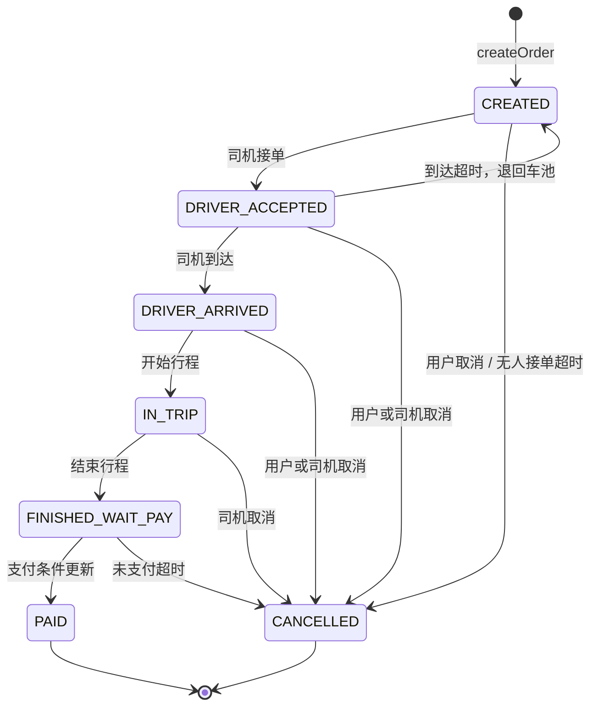

# 第 7 章 订单生命周期：从报价、接单到支付或取消

> A2 讲的是"谁能调用、能看哪条数据"；本章把一条订单真正走完：报价 → 创建 → 司机接单/到达/开始/结束 → 支付或取消。重点不是背状态名，而是能指出**每一步是谁触发、过了哪些守卫、改了哪一行、失败了会怎样**。
>
> 继续使用虚构人物：乘客林小雨（`USER`，userId 占位 `9001001`）、司机陈师傅（`DRIVER`，`7002002`）。订单号、坐标、金额和响应均为虚构占位；本章**没有运行服务、测试或真实地图/支付调用**，所有结果都是源码静态推导，未实测。

## 学习目标

读完本章，你应该能：

1. 沿着 `POST /order/estimate` → `POST /order` → 司机接单/到达/开始/结束 → `POST /order/{id}/pay` 或 `POST /order/{id}/cancel` 的真实端点，指出每步的身份、输入、状态变化、数据库写入和主要外部副作用。
2. 画出 `RideOrderStatus` 的七个状态及实际迁移，说明每个迁移的触发者、前置状态、守卫和失败分支；不从枚举声明顺序推断迁移。
3. 解释乘客、司机、管理员/客服在订单上的能力边界，特别是取消：谁能取消、在哪些状态、违约金何时产生、金额单位与上限。
4. 区分"支付接口把订单改成已支付"与"外部支付渠道完成清算"；说清当前仓库的支付门禁到底做到哪一步。
5. 用一条时间线说明 `@Transactional` 代理、`order:lock`、数据库条件更新、Redis 状态/占位/队列、Mongo 轨迹的先后，以及哪些失败不能一起回滚。
6. 对比 HTTP 下单与 Agent 下单：身份从哪里来、报价/确认约束、最终共享的 Service 路径，以及提示词为什么不是鉴权。

## 前置知识与阅读时间

- 必读：[第 3 章 数据与事务](../00-foundations/03-data-and-transactions.md)——主键/业务 ID、无外键、`@Transactional` 代理、`FOR UPDATE`、条件更新、提交后回调；本章会反复用到这些结论。
- 必读：[第 5 章 登录与会话](../01-auth/01-login-and-session.md)——token 如何变成 `UserTokenContext`，以及为什么服务端身份可信。
- 必读：[第 6 章 权限、归属与防护](../01-auth/02-authorization-and-defense.md)——`@RequirePermission`、`assertCanViewOrder`、401/403/400 的差异；本章不再重复全部权限细节。
- 可选：[第 4 章 Redis 与流式响应基础](../00-foundations/04-redis-flux-and-sse-basics.md)——Lua、TTL、Flux/SSE；Agent 下单的流式外壳在 C1，本章只看工具调用。
- 阅读时间：约 100～120 分钟（含两组练习与自测）。
- **路径约定**：Java 类相对 `src/main/java/com/fancy/rideagenthub/`；配置与 SQL 写完整仓库相对路径。
- **证据约定**："仓库实现"是当前源码；"测试阅读"是读过测试声明/断言但未运行；"未实测"表示没有启动服务、连接 Redis/MySQL/Mongo、调用高德或支付渠道。

---

## 零、先记住四个事实

1. **MySQL 的 `sys_ride_order.order_status` 是订单状态的最终事实来源**。Redis 里的 `order:status:{orderId}`、`driver:active:{driverId}`、`delay:order:timeout` 和 GEO 池都是加速/协调结构，不能替代数据库。
2. **状态码是显式整数，不是"枚举第几个"**：10、20、30、40、50、60、90。代码会用 `<`、`>`、`>=` 做区间判断，因此必须按这些数值和真实迁移理解，不能写"下一个状态就是 code+10"。
3. **创建、结束、支付、取消没有本地事务注解；接单和超时处理有 `@Transactional`**。当前 HTTP/Agent 调用链也没有外层事务，但不是"未来所有调用方都绝无事务"。
4. **订单锁 `order:lock:{orderId}` 串行化同一订单的状态操作；数据库条件更新仍是最终裁决**。Redis 预检、缓存和延迟队列都可能失败，失败后靠数据库条件更新、超时扫描和后续回源部分兜底，不是强一致。

---

## 一、业务故事：林小雨的一单

### 1.1 人物与目标

林小雨从 A 点到 B 点，选择快车、不加急。她先用 App 估价，再下单；陈师傅在附近看到订单后接单，按到达、开始、结束的顺序推进。到达支付阶段时，当前仓库没有可信支付渠道实现，订单会停在"完成待支付"。这是一个**真实的代码路径**，不是"支付失败"的故事。

所有数字都是虚构：

- 起终点：A `(lat=31.200000, lng=121.400000)`，B `(lat=31.230000, lng=121.470000)`。
- 高德返回的假设值：预估 `5.0 km`、`600 s`（外部调用未发生，仅用于手算）。
- 车型 `vehicleType=1`（快车），`isExpedited=0`。
- 订单号占位：`2026111400000001`（实际是雪花 ID 的十进制字符串）。

### 1.2 成功路径（到"待支付"为止）

| 步骤 | 端点 / 触发者 | 输入与身份 | 前后状态 | 主要写入 / 副作用 | 预期响应（未实测） |
|---|---|---|---|---|---|
| 1 报价 | `POST /order/estimate`，林小雨 | Bearer token；起终点经纬度、车型、加急标记 | 无订单状态 | 调高德路径规划；`RidePricing` 计算；不写订单表 | 200，`data` 为 `PriceEstimateVO` |
| 2 创建 | `POST /order`，林小雨 | token；起终点/地址/车型/预约标记；客户端 `userId` 会被覆盖 | 插入 `CREATED(10)` | 生成雪花 `orderId`；调用 Mongo `save`（异常时结果可能未知）；插 MySQL；Redis 状态缓存；延迟队列登记无人接单；GEO 池失效 | 200，`data` 为订单号字符串 |
| 3 看池/接单 | `GET /order/driver/pool/page` → `POST /order/driver/accept`，陈师傅 | `DRIVER` token；`orderId`、可选当前坐标 | `10 → 20` | 订单锁；Redis 司机占位与状态预检；MySQL 条件更新 `status=10 AND driver_id IS NULL`；提交后状态缓存/GEO 池/到达超时 | 200，`data=true` |
| 4 到达 | `POST /order/driver/arrive`，陈师傅 | `DRIVER` token；`orderId` | `20 → 30` | 条件更新 `status=20 AND driver_id=当前`；写 `driver_arrive_time`；撤掉到达超时 | 200，`data=true` |
| 5 开始 | `POST /order/driver/start`，陈师傅 | `DRIVER` token；`orderId` | `30 → 40` | 条件更新 `status=30 AND driver_id=当前`；写 `pickup_time`（计费开始） | 200，`data=true` |
| 6 结束 | `POST /order/driver/finish`，陈师傅 | `DRIVER` token；`orderId`、真实轨迹、可选终点/到达时间 | `40 → 50` | 先调用 Mongo `updateFirst`（不保证匹配/修改）；按实际里程/时长重算账单；条件更新 `status=40 AND driver_id=当前`；释放司机；登记支付超时 | 200，`data` 为 `OrderBillVO` |
| 7 支付 | `POST /order/{orderId}/pay`，林小雨 | token；`payChannel`、`tradeNo` | 目标 `50 → 60` | 订单锁；查订单；本人；状态 50；调用 `PaymentVerifier`；条件更新 | 默认 `503`（未接入可信渠道）；无并发/外部写入时订单保持 50 |

### 1.3 两个分支

- **接单前取消**：在 `CREATED(10)`，林小雨 `POST /order/{id}/cancel`，`cancelRole` 可省略（Controller 会按当前角色算出 1）；前提是订单存在、锁可用、状态可取消、她是订单本人；满足后条件更新 `10 → 90`，没有司机，违约金为 `0`。如果她不是本人，则先 403。
- **接单后取消**：假设陈师傅在 8 分钟前接单，订单仍为 `20`，林小雨是订单本人且锁可用；Service 先通过状态/归属检查，再计算违约金：`5.00 + (8-5)×0.50 = 6.50` 元，写 `realPrice=6.50`，把四项计价字段清零，`20 → 90`。如果订单已经 `40`（行程中），林小雨本人会先通过归属检查，再在 `status > USER_MAX_CANCEL_STATUS(30)` 处得到 400；非本人会先得到 403。司机陈师傅作为本单司机、以 `cancelRole=2` 取消 `40` 才会通过（且司机取消不算违约金）；不是本单司机则先 403。
- **支付门禁**：当前仓库的默认 `PaymentVerifier` 直接抛 503，所以第 7 步通常停在 50；这不是"外部支付失败"，而是"没有可信验单能力"。若部署方提供真实 `PaymentVerifier`，才可能完成 50→60，且外部清算仍需另行对账。

### 1.4 实际 HTTP 形状

以下只给关键请求，全部是示意；`Authorization: Bearer <token>` 是占位，不能当真实凭据。

```http
POST /order/estimate
Authorization: Bearer <USER_TOKEN>
Content-Type: application/json

{
  "startLat": 31.200000,
  "startLng": 121.400000,
  "endLat": 31.230000,
  "endLng": 121.470000,
  "vehicleType": 1,
  "isExpedited": 0
}
```

按 `RidePricing` 手算（假设高德返回 5.0 km / 600 s）：

- 基础里程费：`8.00 + (5.0 - 2.0) × 2.20 = 14.60`
- 时长费：`ceil(600 / 60) × 0.50 = 5.00`
- 远途费：未超过 20 km，`0`
- 加急费：`0`
- 车型倍率：快车 `1.0`；最终 `(14.60 + 5.00 + 0) × 1.0 = 19.60`

所以示意响应中的 `estPrice` 为 `19.60`，`estPriceRadio` 为 `1.00`；实际金额取决于高德返回值，未实测。`estimate` 只算价，不创建订单、不写 Mongo 轨迹。

```http
POST /order
Authorization: Bearer <USER_TOKEN>
Content-Type: application/json

{
  "vehicleType": 1,
  "isReservation": 0,
  "isExpedited": 0,
  "startAddress": "虚构起点 A",
  "startLat": 31.200000,
  "startLng": 121.400000,
  "endAddress": "虚构终点 B",
  "endLat": 31.230000,
  "endLng": 121.470000
}
```

`CreateOrderDTO.userId` 即使被客户端填了也会被 Controller 覆盖为 token 中的 userId；`estPrice`、`mongoTraceId`、`radio` 等服务端会重新生成/计算。成功响应示意：

```json
{
  "code": 200,
  "message": "success",
  "data": "2026111400000001",
  "total": 0
}
```

`Result` 的字段是 `code/message/data/total`；HTTP 200 与 `Result.code=200` 在成功时一致，异常时由 `GlobalExceptionHandler` 把业务码映射为 HTTP 状态（A2 已讲）。

---

## 二、最少概念

### 2.1 订单 ID、状态与时间轴

- `id`：`sys_ride_order` 的自增主键，内部使用。
- `order_id`：雪花 ID，业务唯一标识，DDL 有 `uk_order_id`；API 传入/返回的是它的十进制字符串。
- `order_status`：见状态表；数据库默认 10。
- 时间轴：`create_time`、`driver_accept_time`、`driver_arrive_time`、`pickup_time`（计费开始）、`finish_time`（计费结束）、`pay_time`、`update_time`。
- 取消：`cancel_role` 1-用户、2-司机、3-系统；`cancel_reason` 文本。
- 金额字段：`est_price`、`real_price`、`price_base`、`price_time`、`price_distance`、`price_expedited`、`price_radio`。数据库是 `DECIMAL(10,2)`（`real_distance` 是 `DECIMAL(10,3)`），单位是**元**，不是分；代码用 `BigDecimal`，展示/响应中的字符串可能是 `"0"`、`"6.50"` 这样的形态。

### 2.2 订单状态表

| code | 枚举 | 含义 | 进入方式 | 是否终态 |
|---:|---|---|---|---|
| 10 | `CREATED` | 已创建、待接单 | `createOrder` 插入 | 否 |
| 20 | `DRIVER_ACCEPTED` | 司机已接单 | 司机接单条件更新 | 否 |
| 30 | `DRIVER_ARRIVED` | 司机已到达起点 | 司机到达条件更新 | 否 |
| 40 | `IN_TRIP` | 行程中，已开始计费 | 司机开始行程条件更新 | 否 |
| 50 | `FINISHED_WAIT_PAY` | 行程结束、账单已生成、待支付 | 结束行程条件更新 | 否（可超时取消） |
| 60 | `PAID` | 已支付 | 支付条件更新 | 是 |
| 90 | `CANCELLED` | 已取消 | 用户/司机取消或系统超时 | 是 |

`RideOrderStatus.fromCode` 只接受这七个值；未知 code 抛 `IllegalArgumentException`。超时处理遇到未知状态只记日志并跳过，不会"猜"一个迁移。

### 2.3 报价、订单与支付不是同一件事

- **报价**：`POST /order/estimate` 调高德得到里程/时长，再由 `RidePricing` 计算；返回 `PriceEstimateVO`，没有订单号。
- **创建**：`POST /order` 重新调高德、重新算价、调用 Mongo `save`、插 MySQL，得到 `CREATED(10)`；客户端的 `estPrice` 不是可信价格来源。
- **支付**：只对 `FINISHED_WAIT_PAY(50)` 的订单，由订单本人发起；`PaymentVerifier` 负责"向渠道核对"，默认实现是 503。支付成功只代表本系统把 `order_status` 从 50 改成 60，不代表银行/渠道已经清算。

### 2.4 事务、订单锁与外部副作用

- 方法层面的 `@Transactional` 只在 `driverAcceptOrder` 和 `handleTimeoutOrder` 上；其余生命周期方法没有**本地注解**。
- 当前 HTTP/Agent 调用链没有外层事务，所以 `createOrder/finishRide/payOrder/cancelOrder` 实际也不在 Spring 事务同步中；不能把这一点推广成"未来任何调用方都绝无事务"。若外层 `@Transactional` 调用它们，Mapper 会加入外层，`OrderGrabService/OrderDelayQueue/OrderGeoPool` 的 `afterCommit` 会改为延后执行；高德 HTTP、Mongo 驱动和直接 Redis 命令不会自动加入。
- `withOrderLock` 用 Redisson `order:lock:{orderId}`，最多等 3 秒；拿不到抛 409。它**不是** MySQL 事务的一部分；有事务同步时在 `afterCompletion` 释放，没有时在 `finally` 释放。
- 订单状态缓存、司机占位、延迟队列、GEO 池是 Redis；轨迹是 MongoDB；订单关系/状态是 MySQL。三者没有共同事务，MySQL 也不能重建全部 Mongo 轨迹。

---

## 三、报价与创建

### 3.1 报价：高德给里程/时长，Java 给价格

入口：

```java
// controller/RideOrderController.java（真实节选）
@PostMapping("/estimate")
@RequirePermission
public Result estimate(@RequestBody PriceEstimateReqDTO req) {
    Point startPoint = new Point(req.getStartLat(), req.getStartLng());
    Point endPoint = new Point(req.getEndLat(), req.getEndLng());
    PriceEstimateVO vo = rideOrderService.estimatePrice(
            startPoint, endPoint, req.getVehicleType(), req.getIsExpedited());
    return Result.ok(vo);
}
```

`estimatePrice` 先校验起终点与经纬度范围，再调用 `AmapRouteService#getDrivingRouteEst`。该方法内部最多重试 3 次，取第一条路径的 `distance/1000` 作为 km、`duration` 作为秒；失败会抛 502/500 类业务异常，不是"返回 0 元"。

最低限度公式（详细拆解留 O5）：

```text
base     = 8.00 + max(0, km - 2.0) * 2.20
time     = ceil(sec / 60) * 0.50
distance = max(0, km - 20.0) * (2.20 * 0.50)
expedited= 加急 ? 5.00 : 0
multiplier = 车型倍率(1->1.0, 2->1.6, 3->2.5) + (加急 ? 0.20 : 0)
total    = (base + time + distance + expedited) * multiplier
```

金额统一 `setScale(2, HALF_UP)`；`priceRadio` 是最终乘算倍率。车型默认 1，加急默认 0；`vehicleType` 不在 1～3、`isExpedited` 不在 0/1 会抛 400。不要把 `time` 的分钟向上取整误写成"按秒计价"。

### 3.2 创建：服务端重算，Mongo 与 MySQL 分开写

```java
// controller/RideOrderController.java#create（真实节选）
@PostMapping
@RequirePermission
public Result create(@RequestBody CreateOrderDTO req) {
    req.setUserId(UserTokenContext.getUserIdInString());
    String orderId = rideOrderService.createOrder(req);
    return Result.ok(orderId);
}
```

Service 的关键顺序（省略地址补全/字段构造）：

```java
// service/impl/RideOrderServiceImpl.java#createOrder（教学节选：省略地址补全、局部变量与部分字段）
String traceId = UUID.randomUUID().toString();
validatedDto.setMongoTraceId(traceId);
validatedDto.setEstDistance(new BigDecimal(estRoute.getEstKm()));
PriceEstimateVO estPrice = calculatePrice(estRoute.getEstKm(), estRoute.getEstTime(),
        validatedDto.getVehicleType(), validatedDto.getIsExpedited());
validatedDto.setEstPrice(estPrice.getEstPrice());
validatedDto.setRadio(estPrice.getEstPriceRadio());
orderRouteService.addOrder(traceId, estRoute);       // MongoDB
RideOrder order = RideOrder.builder()
        .orderId(orderId)
        .userId(convertToLong(validatedDto.getUserId()))
        .mongoTraceId(traceId)
        .orderStatus(RideOrderStatus.CREATED.getCode())
        // ……地址、坐标、车型、预估字段
        .build();
rideOrderMapper.insert(order);                       // MySQL
String createdOrderId = order.getOrderId().toString();
orderGrabService.syncOrderStatus(createdOrderId, RideOrderStatus.CREATED.getCode());
orderDelayQueue.schedule(createdOrderId,
        Duration.ofMinutes(timeoutProperties.getAcceptTimeoutMinutes()));
orderGeoPool.add(createdOrderId, order.getStartLng(), order.getStartLat());
```

关键事实：

- **价格来源**：高德返回的 `estKm`/`estTime` + `RidePricing`；`CreateOrderDTO` 里的 `estPrice`、`estDistance`、`radio` 不会被信任（Service 会覆盖）。HTTP 客户端即使不先调用 `estimate` 也能创建，服务端会重新算。
- **订单号**：`snowflakeIdWorker.nextId()`；数据库唯一键 `uk_order_id` 兜底；重复创建同一业务请求会生成不同订单（当前没有 HTTP 幂等键）。
- **Mongo**：`orderRouteService.addOrder` 先于 MySQL insert；它内部是 `mongoTemplate.save`，正常返回才可认为调用完成，抛异常时保存结果未知（可能已写入，也可能没有）。`OrderRoute` 只持久化 `mongoTraceId/estRoute/estPolyline/realPolyline`，`estKm/estTime` 不是 Mongo 字段（`BeanUtils.copyProperties` 只复制同名属性；源码注释里的 "estKm" 不能当成实体字段）。
- **MySQL**：一条 `INSERT`；写 `order_status=10`、`driver_id=null`、`create_time`、预估字段、四项计价字段为 0；不写真实价格。
- **Redis**：`syncOrderStatus` 写 `order:status:{id}=10`；`orderDelayQueue.schedule` 写 `delay:order:timeout` 成员；`orderGeoPool.add` 实际调用 `remove`/`invalidate`，**失效整池**而不是把单个订单加进 GEO 成员；下次搜索从 MySQL `CREATED` 订单重建。
- **没有事务**：`createOrder` 方法没有 `@Transactional`，当前 HTTP/Agent 调用方也没有外层事务；Mongo、MySQL、Redis 各自提交。

### 3.3 创建失败与残留窗口

| 失败点 | 已发生的调用/写入 | 代码行为 | 不能保证什么 |
|---|---|---|---|
| 高德算路失败/返回空 | 无 | 502/500 类异常；创建不继续 | 不会创建订单；错误信息取决于外部返回 |
| `orderRouteService.addOrder` 抛异常 | Mongo `save` 已调用，但**保存结果未知**；无 MySQL | 异常向上；没有 catch/清理 | 网络异常时可能已写入也可能没有；不会自动重试/清理 |
| Mongo 调用返回后、`insert` 的 try 之前抛异常 | Mongo 可能已保存；无 MySQL | 例如 `convertToLong(validatedDto.getUserId())` 抛 400；这一步在 insert try/catch **之外**，不会执行 `deleteByTraceId` | Mongo 可能残留孤儿轨迹；不是“所有 Mongo 后失败都会清理” |
| MySQL insert 抛异常 | Mongo 可能已保存；MySQL 结果有两种可能：①数据库明确拒绝插入，无订单；②请求/应答或连接故障，调用方收到异常但**不能确定服务端是否已提交** | catch 中尝试 `deleteByTraceId`；删除失败 `addSuppressed` 后重抛 | 不能凭调用方异常断定“MySQL 无订单”。若插入实际已提交而响应丢失，可能出现“订单已存在 + 轨迹被清理”的静态窗口；需实际查询订单与轨迹判断，本章未做故障注入。删除也可能失败/网络结果未知；Mongo 可能残留；进程在 insert 前退出也无人清理 |
| insert 成功、后续 Redis 动作失败 | MySQL 订单存在；Mongo 轨迹可能已保存 | `syncOrderStatus`/`geoPool.add` 内部多数 catch；`orderDelayQueue.schedule` 的 **deadline 计算在 guarded callback 之前**，`Math.addExact` 溢出会在注册前抛异常；异常可能让后面的 GEO 失效不执行 | 订单仍存在；状态缓存/ZSet/GEO 可能不一致；延迟队列靠 O4 的数据库扫描部分兜底；不能整体回滚 |
| 地址补全失败 | 无 | `validateAndSupplement` 只警告，地址可能为 null；DDL 地址 NOT NULL 仍可能让 INSERT 失败 | 逆地理编码是 best-effort，不保证地址一定补齐 |

`orderRouteService.deleteByTraceId` 的清理是**尽力而为**，不是事务补偿；它只覆盖 `rideOrderMapper.insert` 的 catch，不覆盖 Mongo 后、insert 前的其它异常，也不覆盖 delete 自身的网络失败。insert 异常不等于 MySQL 一定没有订单：可能是明确拒绝，也可能是请求/应答故障导致调用方无法判断服务端是否已提交。若插入实际已提交，随后的删轨迹可能与已提交订单并存；这只是静态可能性，未经故障注入，实际必须查询订单与轨迹。Mongo 孤儿和 Redis 缺口都没有统一的自动清理机制。

---

## 四、状态机：实际迁移与守卫

### 4.1 状态图



图中没有"CREATED 直接到 DRIVER_ARRIVED"、"PAID 回到 CANCELLED"、"任意状态管理员强制取消"这类边；没有画出的迁移就是当前代码没有实现的。

### 4.2 迁移表

| # | 迁移 | 触发者 / 入口 | 守卫（进入目标状态的条件） | 数据库写入 | 失败分支 |
|---:|---|---|---|---|---|
| 1 | `10 → 20` | 司机；`POST /order/driver/accept` | `DRIVER` role；订单存在；司机账号 `role=DRIVER/status=1` 且行锁；司机无进行中订单；Redis 状态缓存=10、司机占位空；DB `status=10 AND driver_id IS NULL` | `driver_id`、`status=20`、`driver_accept_time`、`update_time` | 锁 409；司机账号 403；预检 409；DB 0 行返回 false（200）并回滚占位/刷新状态 |
| 2 | `20 → 30` | 司机；`POST /order/driver/arrive` | `DRIVER` role；DB `status=20 AND driver_id=当前` | `status=30`、`driver_arrive_time`、`update_time`；撤到达超时 | 锁 409；DB 0 行返回 false（200）；不返回 403 |
| 3 | `30 → 40` | 司机；`POST /order/driver/start` | `DRIVER` role；DB `status=30 AND driver_id=当前` | `status=40`、`pickup_time`、`update_time` | 锁 409；DB 0 行返回 false（200） |
| 4 | `40 → 50` | 司机；`POST /order/driver/finish` | `DRIVER` role；订单存在；`driver_id=当前`（否则 403）；`status=40`（否则 400）；`realPolyline` 非空；`mongo_trace_id` 存在 | 先调用 Mongo `updateFirst`（不检查 matched/modified，不 upsert）；再写 `status=50`、`finish_time`、`real_price`、五项计价字段（`price_base/price_time/price_distance/price_expedited/price_radio`）、`real_distance`、可选终点 | 锁 409；403/400/502；DB 0 行 409；只有目标文档存在且实际修改时才可谈“轨迹已改且不回滚”；文档缺失/未修改时本来没写 |
| 5 | `50 → 60` | 订单本人；`POST /order/{id}/pay` | 登录；订单存在；`order.user_id=当前`（否则 403）；`status=50`（否则 409）；`payChannel/tradeNo` 非空；`PaymentVerifier` 通过；DB `status=50` | `status=60`、`pay_time`、`update_time`；撤支付超时 | 锁 409；400/404/403/409；默认 verifier 503；DB 0 行返回 false（200） |
| 6 | `10 → 90` | 用户或系统；`POST /order/{id}/cancel` 或无人接单超时 | 用户：`status<=30` 且本人；系统：`CREATED` 且超过接单阈值 + 快照条件 | `status=90`、`cancel_role/reason`、`update_time`；用户取消写 `real_price=fee`、四项金额清零；系统取消保留账单字段 | 锁 409；404/400/403；DB 0 行 409（用户）；系统 0 行静默让位 |
| 7 | `20 → 90` | 用户或司机；取消接口 | 用户：本人、`status<=30`；司机：本单司机、`status>=20`；两者都须 `status<50` | 同 #6；用户按分钟计费，司机费用为 0 | 同上；用户超过 30 先 400；司机未接单 400 |
| 8 | `30 → 90` | 用户或司机；取消接口 | 用户：本人、`status<=30`；司机：本单司机、`status>=20` | 同 #6；用户可能产生违约金 | 同上 |
| 9 | `40 → 90` | 司机；取消接口 | 本单司机；`status>=20` 且 `<50`；用户不能取消（`status>30` 先 400） | 同 #6；司机取消费用 0 | 锁 409；非本单司机 403；用户 400 |
| 10 | `50 → 90` | 系统；支付超时 | 只由 `systemCancel` 私有方法触发；`status=50`、超过支付阈值 + 快照条件 | `status=90`、`cancel_role=3`、`cancel_reason`、`update_time`；**保留** `real_price` 和计价字段 | 条件不满足则 0 行，静默返回；无 HTTP |
| 11 | `20 → 10` | 系统；到达超时 | `status=20`；`driver_id` 与 `driver_accept_time` 仍等于快照；超过到达阈值 | `driver_id=null`、`driver_accept_time=null`、`status=10`、`update_time`；释放 driver 占位；删除状态缓存；GEO 池失效；重新登记接单超时 | 0 行则不做任何释放；没有通知渠道 |

**注意 #10 和 #11 的区别**：支付超时是"取消"，到达超时是"退回待接单"，不是取消。`handleArriveTimeout` 不会把订单改成 90，也不会调用 `systemCancel`。

### 4.3 为什么不能直接从枚举顺序推断

- `RideOrderStatus` 的声明顺序是 `CREATED, DRIVER_ACCEPTED, DRIVER_ARRIVED, IN_TRIP, FINISHED_WAIT_PAY, PAID, CANCELLED`，但 `CANCELLED(90)` 是终态，不是"50 后面的正常下一步"。
- 代码使用 `status > USER_MAX_CANCEL_STATUS`（30）、`status >= FINISHED_WAIT_PAY`（50）等区间判断；这些常量是业务边界，不是数组下标。
- `DRIVER_ACCEPTED(20)` 有一条回到 `CREATED(10)` 的超时边，说明状态不是单调递进的；`PAID(60)` 和 `CANCELLED(90)` 没有出边。
- 任何"新增状态"都要同时检查：枚举、DDL 注释/默认值、所有数值比较、条件更新、超时分支、前端/工具文本；只加枚举不会自动获得迁移。

---

## 五、司机接单、到达、开始

### 5.1 接单：带本地事务的状态迁移

入口（A2 已讲权限）：

```java
// controller/RideOrderController.java#driverAccept（真实节选）
@PostMapping("/driver/accept")
@RequirePermission({"DRIVER"})
public Result driverAccept(@RequestBody DriverAcceptReqDTO req) {
    Long driverId = UserTokenContext.getUserIdInLong();
    Boolean ok = rideOrderService.driverAcceptOrder(
            req.getOrderId(), String.valueOf(driverId), req.getCurrentLat(), req.getCurrentLng());
    return Result.ok(ok);
}
```

Service 方法本身有本地事务注解，但**这不是"整个项目唯一的事务状态迁移"**：`handleTimeoutOrder` 也有 `@Transactional(READ_COMMITTED)`。方法签名：

```java
@Transactional(isolation = Isolation.READ_COMMITTED)
public Boolean driverAcceptOrder(...) {
    // 参数校验、ID 规范化
    return withOrderLock(orderId, () -> {
        OrderGrabService.GrabResult grabResult = orderGrabService.tryGrab(orderId, driverId);
        if (grabResult != OrderGrabService.GrabResult.SUCCESS) {
            throw new BusinessException(409, grabFailureMessage(grabResult));
        }
        int updated = rideOrderMapper.update(null,
                new LambdaUpdateWrapper<RideOrder>()
                        .eq(RideOrder::getOrderId, orderId)
                        .eq(RideOrder::getIsDeleted, 0)
                        .eq(RideOrder::getOrderStatus, RideOrderStatus.CREATED.getCode())
                        .isNull(RideOrder::getDriverId)
                        .set(RideOrder::getDriverId, driverIdLong)
                        .set(RideOrder::getOrderStatus, RideOrderStatus.DRIVER_ACCEPTED.getCode())
                        .set(RideOrder::getDriverAcceptTime, now)
                        .set(RideOrder::getUpdateTime, now));
        if (updated <= 0) {
            orderGrabService.rollbackGrab(driverId, orderId);
            orderGrabService.refreshOrderStatus(orderId);
            return false;
        }
        orderGrabService.syncOrderStatus(orderId, RideOrderStatus.DRIVER_ACCEPTED.getCode());
        orderGeoPool.remove(orderId);
        if (currentLng != null && currentLat != null) {
            driverGeoIndex.refreshIfExist(driverId, currentLng, currentLat);
        }
        orderDelayQueue.schedule(orderId,
                Duration.ofMinutes(timeoutProperties.getArriveTimeoutMinutes()));
        return true;
    });
}
```

**真实注册/执行顺序（当前 Controller 调用，代理新建事务）**：

```text
t0  代理开启 READ_COMMITTED 事务（当前调用链没有外层事务；见下方“外层事务”）
t1  withOrderLock 获取 order:lock:{id}（最多 3 秒）
t2  tryGrab：
      - MySQL 锁司机账号行（role=DRIVER/status=1）
      - MySQL 查该司机未结束订单（排除 50/60/90），修复/设置 driver:active
      - 状态缓存缺失时回源 MySQL 补 order:status
      - Redis 直接写 driver:active、必要时 setIfAbsent order:status，然后 Lua 原子检查/占位
      - 注册 afterCompletion：事务未提交则“尽力”释放占位
t3  MySQL 条件更新 status=10, driver_id IS NULL → 20，写 accept_time（事务内未提交）
t4  syncOrderStatus 调用：只“登记”afterCommit 状态缓存 20，尚未写 Redis
t5  orderGeoPool.remove 调用：只“登记”afterCommit 失效 GEO 池，尚未写 Redis
t6  可选 refreshIfExist：在事务提交前“直接”写 Redis 司机位置；内部异常被捕获，返回 false 也不抛
t7  orderDelayQueue.schedule 调用：先计算 deadline，再“登记”afterCommit 写 ZSet（最后登记）
t8  方法返回 true；withOrderLock 注册 afterCompletion 释放订单锁；代理提交 MySQL
t9  afterCommit：按登记顺序执行 状态缓存 20 / GEO 池失效 / ZSet 到达超时
t10 afterCompletion：tryGrab 的回滚补偿（已提交→不动作）→ 释放 order:lock
```

**外层事务的差别**：如果未来由另一个 `@Transactional` 方法调用 `driverAcceptOrder`，默认 `REQUIRED` 会加入外层事务，而不是新建。此时 t8 的“方法返回”只代表方法体结束，物理提交、afterCommit、afterCompletion 都可能推迟到外层事务边界；调用方在方法返回时拿到的 `true` 不能证明外层已提交。当前 HTTP Controller 没有外层事务，代理在返回前完成提交；不能把“每次返回”都写成“紧接着物理提交”。

**DB 结果与失败分支**（必须分开）：

| 情况 | DB 更新 | Redis/GEO/队列 | 返回/异常 | 能保证/不能保证 |
|---|---|---|---|---|
| 条件更新抛异常 | 事务回滚 | 尚未执行 t4～t7；`tryGrab` 的占位由 afterCompletion **尽力**释放 | 按异常类型映射；连接断裂可能让事务不可继续 | 不能断言占位一定释放；状态/GEO/到达超时都不会 afterCommit |
| 条件更新 0 行 | 未修改 | `rollbackGrab` **立即**尽力删除占位；`refreshOrderStatus` 在事务同步活跃时登记 afterCommit 删除状态缓存；条件更新本身不写 DB | 返回 `false`（HTTP 200，`data=false`） | 删除和占位补偿都可能失败；事务提交后删除才执行；旧缓存可能保留到 TTL/下一次回源 |
| 更新 1 行，t4～t7 之间抛异常（如 `schedule` 的 `Math.addExact` 溢出） | 事务回滚 | t4/t5 已登记但 afterCommit 不执行；t6 若已执行，位置刷新**不回滚**；t7 尚未登记或已登记都不执行 | 异常向上 | 已登记的 afterCommit 不执行；位置刷新是独立副作用；不能把“有 afterCommit”当成已写入 |
| 更新 1 行，提交成功 | 提交 20 | t9 afterCommit 依次执行；每个动作内部 catch，失败只告警；t6 位置刷新已在提交前执行 | 正常 `true` | 状态缓存/GEO/到达超时可能失败；MySQL 仍是 20，缓存/队列可能旧/缺失 |
| 提交结果未知（`STATUS_UNKNOWN`） | 可能已提交、也可能回滚 | afterCommit 不执行；afterCompletion 因 `status != COMMITTED` 会尝试释放占位 | 异常/不确定 | 可能把已提交订单的占位释放；下一次接单按 DB 修复；不能断言最终缓存/队列状态 |

补充：

- **`rollbackGrab` 是 best-effort**：`RELEASE_LOCK_IF_MATCH` 只删除值等于本订单的占位；实现 catch `RuntimeException` 并只记日志，失败不抛、不重试。
- **`refreshOrderStatus` 的删除时机**：它调用 `OrderGrabService#afterCommit`；当前接单事务有同步器，所以是**提交后删除**，不是 0 行分支内立即删除。若未来在没有同步器的调用链中，才会立即 `delete`；删除失败只告警。
- **`schedule` 的 deadline 在注册回调之前计算**：`OrderDelayQueue#schedule` 先 `Math.addExact(System.currentTimeMillis(), delay.toMillis())`，再 `afterCommit(() -> zadd(deadline))`。所以截止时间基准是“调用 `schedule` 的时刻”，不是“事务提交时刻”；提交越慢，实际剩余延迟越短。`Math.addExact` 溢出会在注册前抛异常，不能被“内部 catch”覆盖；ZSet 写入失败才由 guarded catch 记录，数据库扫描只能部分兜底。
- **`refreshIfExist` 是直接副作用**：在 MySQL 提交前执行，`DriverGeoIndex#update` 捕获 RuntimeException 返回 false；`driverAcceptOrder` 忽略返回值，因此它不会让事务回滚，也不会因回滚而撤销。
- `tryGrab` 的 `driver:active` 写入、状态缓存 `setIfAbsent` 和 Lua 占位也都是直接 Redis 操作，不属于 MySQL 事务；失败/回滚由 afterCompletion 与 TTL/下一次 DB 修复处理，不保证立即一致。

`OrderGrabService#tryGrab` 是 `@Transactional(propagation = MANDATORY)`，必须运行在接单事务里；它先锁司机账号行，再查该司机的未结束订单，最后才做 Redis Lua。**不是"先 Redis 拦所有请求"**，也不是"Redis 成功就算接单成功"；数据库条件更新是最终裁决。

### 5.2 到达与开始：没有事务，返回 false 而不是异常

`driverArriveStart` 和 `startRide` 都没有 `@Transactional`；它们只做参数校验、拿订单锁、条件更新：

```java
int updated = rideOrderMapper.update(null,
        new LambdaUpdateWrapper<RideOrder>()
                .eq(RideOrder::getOrderId, orderId)
                .eq(RideOrder::getIsDeleted, 0)
                .eq(RideOrder::getDriverId, driverIdLong)
                .eq(RideOrder::getOrderStatus, RideOrderStatus.DRIVER_ACCEPTED.getCode())
                .set(RideOrder::getOrderStatus, RideOrderStatus.DRIVER_ARRIVED.getCode())
                .set(RideOrder::getDriverArriveTime, now)
                .set(RideOrder::getUpdateTime, now));
return updated > 0;
```

- 订单不存在、司机不是本单司机、状态不是 20/30，都会让 `updated=0`，接口返回 `Result.ok(false)`（HTTP 200），不是 404/403/409。
- 只有锁等待超时才是 409；参数为空是 400。
- 到达成功后：条件更新后会撤掉到达超时（`orderDelayQueue.cancel`）并同步状态缓存 30；开始成功后：同步状态缓存 40，不再有行程中超时任务。
- 因为没有事务，DB 条件更新提交后，Redis 同步动作立即执行；Redis 同步失败由 `OrderGrabService#afterCommit` 捕获告警，不回滚 DB。

### 5.3 角色边界

| 操作 | 注解要求 | Service 的实际边界 |
|---|---|---|
| 报价、创建 | 仅登录 | `createOrder` 把 userId 覆盖为当前 token；不要求 USER，任何登录角色都可创建"自己的"订单 |
| 详情、分页 | 仅登录 | USER 只看自己创建；DRIVER 只看自己承运；ADMIN/SUPPORT 可看全部（A2） |
| 支付 | 仅登录 | 只允许 `order.user_id` 本人；ADMIN/SUPPORT 不是例外 |
| 取消 | 仅登录 | Controller 算 role（DRIVER=2，其它=1）；Service 再按角色/归属/状态检查；ADMIN/SUPPORT 只能作为乘客取消自己的订单 |
| 接单、到达、开始、结束 | DRIVER | 切面先拒非 DRIVER；接单还要求数据库账号 role=DRIVER/status=1；到达/开始/结束的条件更新带 driver_id |
| 系统超时 | 无 HTTP | 调度任务调用 `handleTimeoutOrder`；`systemCancel` 私有写 `cancel_role=3` |

- `POST /order/driver/accept|arrive|start|finish` 都有 `@RequirePermission({"DRIVER"})`；非 DRIVER 在切面 403，方法体不进入。
- 接单入口不检查司机是否"已上线"；`GET /order/driver/pool/page` 才会按在线状态决定池/空池。直接调用接单接口时，`OrderGrabService` 只校验数据库司机账号与进行中订单，不校验心跳。不要把 UI 的"先上线"当成后端强制条件。
- 到达/开始/结束的条件更新都带 `driver_id=当前`；但到达/开始的 DB 0 行只返回 false，结束则先做 403/400 预检。异常语义不同，不能统一写成"司机越权一定 403"。

---

## 六、结束行程与账单

`finishRide` 没有 `@Transactional`，但在订单锁内执行。顺序很关键：

```java
// service/impl/RideOrderServiceImpl.java#finishRide（教学节选：省略 withOrderLock 包装、
// 局部变量 realDistance/durationSec/now 及完整 OrderBillVO 构造）
public OrderBillVO finishRide(...) {
    // 参数校验、ID 规范化
    return withOrderLock(orderId, () -> finishRideUnderLock(...));
}

private OrderBillVO finishRideUnderLock(...) {
    RideOrder order = getRequiredOrder(orderId);             // 404
    if (order.getDriverId() == null || !order.getDriverId().equals(driverIdLong))
        throw new BusinessException(403, "无权限操作该订单");
    if (order.getOrderStatus() == null || order.getOrderStatus() != RideOrderStatus.IN_TRIP.getCode())
        throw new BusinessException(400, "订单状态不允许结束行程");
    String normalizedPolyline = normalizeText(realPolyline);
    if (normalizedPolyline == null) throw new IllegalArgumentException("realPolyline不能为空");
    String traceId = order.getMongoTraceId();
    if (traceId == null || traceId.isBlank()) throw new BusinessException(400, "订单未关联轨迹会话");

    orderRouteService.updateRealPolyline(traceId, normalizedPolyline); // updateFirst，不保证匹配/修改

    // 实际里程：polyline 逐段 Haversine；没有线段则起终点直线；仍为空则 null
    // 实际时长：pickup_time → finish_time（arriveTime 非空就用它，否则 now）
    PriceEstimateVO priceVO = calculatePrice(
            realDistance == null ? null : realDistance.toPlainString(),
            String.valueOf(durationSec), order.getVehicleType(), order.getIsExpedited());
    int updated = rideOrderMapper.update(null, new LambdaUpdateWrapper<RideOrder>()
        .eq(RideOrder::getOrderId, orderId)
        .eq(RideOrder::getIsDeleted, 0)
        .eq(RideOrder::getDriverId, driverIdLong)
        .eq(RideOrder::getOrderStatus, RideOrderStatus.IN_TRIP.getCode())
        .set(RideOrder::getOrderStatus, RideOrderStatus.FINISHED_WAIT_PAY.getCode())
        .set(RideOrder::getFinishTime, finishTime)
        .set(RideOrder::getRealPrice, priceVO.getEstPrice())
        .set(RideOrder::getPriceBase, priceVO.getEstPriceBase())
        .set(RideOrder::getPriceTime, priceVO.getEstPriceTime())
        .set(RideOrder::getPriceDistance, priceVO.getEstPriceDistance())
        .set(RideOrder::getPriceExpedited, priceVO.getEstPriceExpedited())
        .set(RideOrder::getRealDistance, realDistance)
        .set(RideOrder::getUpdateTime, now));
    if (updated <= 0) throw new BusinessException(409, "订单状态已变化，请刷新后重试");

    orderGrabService.syncOrderStatus(orderId, RideOrderStatus.FINISHED_WAIT_PAY.getCode());
    orderGrabService.releaseDriver(driverId, orderId);
    orderDelayQueue.schedule(orderId, Duration.ofMinutes(timeoutProperties.getPayTimeoutMinutes()));
    // 省略 OrderBillVO 的构造与返回
}
```

要点：

- **计费口径是实际值**：`realDistance` 来自 `realPolyline`（格式 `lng,lat;lng,lat;...`）逐段 Haversine；没有有效线段时用起终点直线距离兜底；`durationSec` 从 `pickup_time` 到 `finish_time`。`arriveTime` 是可选请求参数，不校验是否晚于 `pickup_time`；如果导致负时长/无效距离，`RidePricing` 会抛 502。实际里程/时长可能与服务端当前时间不同，取决于调用方传入的轨迹和 `arriveTime`。
- **Mongo 调用先于 MySQL，但“已写”不是无条件**：`updateRealPolyline` 使用 `updateFirst`，不检查 matched/modified，也不 upsert。`mongoTraceId` 非空只说明能找到查询键，不说明文档存在。调用可能：①目标文档不存在，matched=0，没有写入，但方法正常返回；②文档存在且值相同，modified=0，也无实际变化；③文档存在且实际修改；④网络/驱动异常，结果未知。只有 ③ 才能说“真实轨迹已改且 DB 0 行不能回滚它”；①/② 根本不需要回滚。代码不检查返回值，因此后续订单仍可能进入 50。
- **账单字段**：`realPrice` 和五项金额/倍率（`price_base`、`price_time`、`price_distance`、`price_expedited`、`price_radio`）写入订单；`estPrice` 仍是下单时预估，不会自动改成实际值。`OrderBillVO` 返回同一组金额。
- **释放司机**：结束行程后订单进入 50，`finishRide` 调用 `releaseDriver`；司机不再被这单占用，`driver:active` 释放；支付超时/支付不再占用司机。
- **支付超时**：结束成功后登记 30 分钟（默认）未支付兜底；支付成功才撤销。
- **没有事务**：Mongo、MySQL、Redis 各自提交。`releaseDriver`/`syncOrderStatus`/GEO 失效的 guarded 回调会捕获异常；`orderDelayQueue#schedule` 的 deadline 计算在 guarded callback 之前，`Math.addExact` 等计算异常不被“ZSet 写入 catch”覆盖，ZSet 写入异常才会被捕获；锁在 `finally` 释放。

---

## 七、取消：用户、司机与系统

### 7.1 入口与角色：Controller 传的是"算出来的角色"

```java
// controller/RideOrderController.java#cancel（真实节选）
int role = UserTokenContext.hasAnyRole("DRIVER") ? 2 : 1;
if (req.getCancelRole() != null && req.getCancelRole() != role) {
    throw new ForbiddenException("取消身份与当前登录角色不符");
}
String fee = rideOrderService.cancelOrder(orderId, UserTokenContext.getUserIdInString(), role,
        req.getCancelReason());
return Result.ok(fee);
```

- `role` **不是直接取请求体**：DRIVER token → 2，其它角色（USER/ADMIN/SUPPORT）→ 1；请求体的 `cancelRole` 只在非空时做一致性校验。缺失时使用计算出的 1/2，不因缺失 403。
- 请求体 `cancelRole=3` 或与当前角色不符 → 403；但系统取消不是从这个接口进入的。
- Service 入口还会独立检查 `cancelRole` 必须在 `{1,2}`（直接调用传入 null/3 会 403）；`case 3` 在 switch 里存在，但公共 `cancelOrder` 的初始检查让外部走不到它；`systemCancel` 私有方法直接写 3。
- ADMIN/SUPPORT 没有"订单取消超级权限"：它们被算成 role 1，只能取消自己作为乘客的订单；要看全部订单是详情/分页的读能力（A2），不是写能力。

### 7.2 Service 的真实顺序

```java
// service/impl/RideOrderServiceImpl.java#cancelOrderUnderLock（教学节选：省略部分链式调用/局部变量）
RideOrder order = getRequiredOrder(orderId);                 // 1. 404
Integer status = order.getOrderStatus();
if (status == null) throw new BusinessException(400, "订单状态异常");
if (RideOrderStatus.PAID.getCode() == status || RideOrderStatus.CANCELLED.getCode() == status)
    throw new BusinessException(400, "当前订单状态不允许取消");
if (status >= RideOrderStatus.FINISHED_WAIT_PAY.getCode())
    throw new BusinessException(400, "当前订单状态不允许取消");
Long operatorIdLong = convertToLong(operatorId);
switch (cancelRole) {
    case 1 -> {                                              // 用户
        if (order.getUserId() == null || !order.getUserId().equals(operatorIdLong))
            throw new BusinessException(403, "只能取消自己的订单");
        if (status > RideOrderStatus.USER_MAX_CANCEL_STATUS)
            throw new BusinessException(400, "行程已开始，无法取消");
    }
    case 2 -> {                                              // 司机
        if (order.getDriverId() == null || !order.getDriverId().equals(operatorIdLong))
            throw new BusinessException(403, "只能取消自己接单的订单");
        if (status < RideOrderStatus.DRIVER_MIN_CANCEL_STATUS)
            throw new BusinessException(400, "还未接单，无法取消");
    }
    case 3 -> { }                                            // 系统（公共入口不可达）
    default -> throw new BusinessException(400, "无效的取消角色");
}
BigDecimal cancelFee = BigDecimal.ZERO;
if (cancelRole == 1 && order.getDriverId() != null) {
    LocalDateTime acceptTime = order.getDriverAcceptTime();
    if (acceptTime != null) {
        long minutes = Duration.between(acceptTime, BusinessTime.now()).toMinutes();
        if (minutes > 5) cancelFee = calcCancelFee(minutes);
    }
}
int updated = rideOrderMapper.update(null,
        new LambdaUpdateWrapper<RideOrder>()
                .eq(RideOrder::getOrderId, orderId)
                .eq(RideOrder::getIsDeleted, 0)
                .eq(RideOrder::getOrderStatus, status)
                .set(RideOrder::getOrderStatus, RideOrderStatus.CANCELLED.getCode())
                .set(RideOrder::getCancelRole, cancelRole)
                .set(RideOrder::getCancelReason, normalizedReason)
                .set(RideOrder::getRealPrice, cancelFee)
                .set(RideOrder::getPriceBase, BigDecimal.ZERO)
                .set(RideOrder::getPriceTime, BigDecimal.ZERO)
                .set(RideOrder::getPriceDistance, BigDecimal.ZERO)
                .set(RideOrder::getPriceExpedited, BigDecimal.ZERO)
                .set(RideOrder::getUpdateTime, now));
if (updated <= 0) throw new BusinessException(409, "订单状态已变化，请刷新后重试");
```

完整的先后是：

```text
Controller：算 role（DRIVER=2，其它=1）；body.cancelRole 非空不一致→403
Service：
  1. cancelRole 不在 {1,2} → 403（直接调用 null/3 的独立防线）
  2. orderId 空白 → 400；operatorId 空白 → 400
  3. withOrderLock(order:lock:{id})：最多 3 秒；中断/超时 → 409
  4. getRequiredOrder → 404
  5. status null / PAID / CANCELLED / >=50 → 400
  6. 按 cancelRole 校验归属 → 403；**归属通过后**，USER 的 status>30 → 400，DRIVER 的 status<20 → 400
  7. 计算违约金（仅 role=1 且 driverId/acceptTime 非空且 minutes>5）
  8. 条件 UPDATE（WHERE status=读到的 status）→ 0 行 409
  9. 成功后：状态缓存 90、GEO 池失效、释放司机、撤延迟队列
```

**顺序后果**：同一笔"别人的订单"，如果状态已经是 50，会先在 #5 得到 400，不会走到 #6 的 403；如果订单不存在，先 404；如果锁竞争，先 409。只有"订单存在、状态可取消、锁拿到、身份不匹配"才是 403。A2 已经用这个例子讲过，本章把它放回订单生命周期。

### 7.3 违约金：条件、公式和例子

`calcCancelFee` 的规则是硬编码：

```java
long over = Math.max(0, acceptedMinutes - 5);
BigDecimal fee = new BigDecimal("5.00")
        .add(new BigDecimal(over).multiply(new BigDecimal("0.50")));
if (fee.compareTo(new BigDecimal("20.00")) > 0) fee = new BigDecimal("20.00");
return fee.setScale(2, RoundingMode.HALF_UP);
```

- 只有 `cancelRole=1`（用户）且订单已有 `driverId`、`driverAcceptTime != null`、`minutes > 5` 才计费；司机取消、用户接单前取消、接单不超过 5 分钟都是 0。
- `minutes = Duration.toMinutes()`，向下取整；5 分 59 秒仍是 5 分钟，不计费；6 分钟开始 `over=1`。
- 结果写入 `real_price`；`price_base`、`price_time`、`price_distance`、`price_expedited` 被置 0；`price_radio` 不在该 UPDATE 的 set 列表中（保留原值）。
- 初始 `BigDecimal.ZERO` 响应字符串是 `"0"`；计费结果带两位小数，如 `"6.50"`。响应是 `Result.ok(feeString)`，不是账单对象。

| 场景（虚构） | 接单后经过 | 费用 | 说明 |
|---|---:|---:|---|
| 接单前用户取消 | — | 0 | 没有 driverId/acceptTime |
| 接单后 3 分钟 | 3 分 | 0 | `minutes > 5` 不成立 |
| 接单后 8 分钟 | 8 分 | 6.50 | `5 + (8-5)×0.5` |
| 接单后 12 分钟 | 12 分 | 8.50 | `5 + 7×0.5` |
| 接单后 40 分钟 | 40 分 | 20.00 | 计算超过 20，封顶 |
| 司机取消 | 任意 | 0 | 计费分支只针对 role=1 |

### 7.4 谁能取消哪个状态

**表的前提**：订单存在、锁可获得、请求体/参数合法；`USER` 列是"订单本人"，`DRIVER` 列是"本单司机"。非本人/非本单司机在角色分支会先得到 403；`PAID/CANCELLED/>=50` 的全局状态拒绝又先于归属，所以这些格子不能简单按列理解。

| 当前状态 | USER（订单本人） | DRIVER（本单司机） | 系统超时 |
|---|---|---|---|
| `CREATED(10)` | 允许，费用 0；非本人 403 | 正常 `driverId=null` → **403**；只有特制数据 `driverId=本司机` 且 `status=10` 才会走到 `status<20` 的 400 | 无人接单超时：10→90，role=3 |
| `DRIVER_ACCEPTED(20)` | 允许，>5 分钟计费；非本人 403 | 允许，费用 0；非本单司机 403 | 到达超时：20→**10**，不是取消 |
| `DRIVER_ARRIVED(30)` | 允许，>5 分钟计费；非本人 403 | 允许，费用 0；非本单司机 403 | 无系统取消分支 |
| `IN_TRIP(40)` | 本人：**400**（行程已开始）；非本人：**403** | 允许，费用 0；非本单司机 403 | 无系统取消分支 |
| `FINISHED_WAIT_PAY(50)` | 400（全局状态先于归属） | 400（全局状态先于归属） | 支付超时：50→90，role=3 |
| `PAID(60)` / `CANCELLED(90)` | 400（全局状态） | 400（全局状态） | 无 |

这张表是当前代码的边界，不是产品建议。"司机可以取消 IN_TRIP、用户不行"只对本单司机/订单本人成立：司机分支先查归属，归属通过后才看 `status>=20`；用户分支先查归属，归属通过后才看 `status>30`。正常 10 状态订单通常没有 `driverId`，司机取消会先在归属处 403，而不是因为 `status<20` 得到 400。

### 7.5 系统超时取消：没有 HTTP 入口

系统取消有两个入口，都是 `handleTimeoutOrder` 的内部：

- **无人接单超时**：`CREATED` 超过 `accept-timeout-minutes`（默认 15 分钟）→ `systemCancel(order, CREATED, "超时无人接单，系统自动取消")`。
- **未支付超时**：`FINISHED_WAIT_PAY` 超过 `pay-timeout-minutes`（默认 30 分钟）→ `systemCancel(order, FINISHED_WAIT_PAY, "超时未支付，系统自动关单")`。
- **到达超时**不是取消：`DRIVER_ACCEPTED` 超过 `arrive-timeout-minutes`（默认 10 分钟）→ 20→10，释放司机、删除状态缓存、GEO 池失效、重新登记接单超时；`handleArriveTimeout` 不调用 `systemCancel`。

预约单的接单超时另有一个锚点规则：`handleAcceptTimeout` 先取 `updateTime`（为空则 `createTime`）；如果 `isReservation=1` 且 `scheduledTime` 晚于这个锚点，就把锚点改为 `scheduledTime`，再计算 `+ accept-timeout-minutes`。因此"预约上车时间在未来"的订单不会被当成普通即时单提前取消；数据库补偿 SQL 也排除了未来预约。具体扫描/批次细节留 O4。

`systemCancel` 的数据库更新同时匹配：

```text
status = expectedStatus
AND (update_time = 读到的 update_time；若读到的为 null，则 update_time IS NULL)
```

这样，"超时判定后用户恰好支付/取消/推进"与系统取消只有一个能成功；0 行就静默让位。成功后：

- 写 `status=90`、`cancel_role=3`、`cancel_reason`、`update_time`；
- **不修改** `real_price`/计价字段（支付超时要保留账单；测试 `timeoutCancellationChecksSnapshotAndPreservesBill` 断言没有 `real_price` 的 set）；
- 提交后同步状态缓存、撤延迟队列、失效 GEO 池、释放仍占用的司机（如果有）。

系统取消没有 HTTP 状态码，也不代表已经通知用户/司机；`handleArriveTimeout` 源码里的通知是 `TODO`，当前没有订单通知设施。

### 7.6 取消的副作用与失败

`cancelOrder` 没有 `@Transactional`，因此：

1. 订单锁内完成条件 UPDATE；单条 SQL 在自动提交会话中生效。
2. 成功后立即调用 `syncOrderStatus(90)`、`orderGeoPool.remove`、`releaseDriver`、`orderDelayQueue.cancel`；这些方法各自捕获运行时异常/按提交后回调执行（无事务时立即）。
3. 即使 Redis 同步失败，MySQL 已经是 90；返回给用户的 fee 仍可能成功。缓存/队列/GEO 的修复靠 TTL、后续读取或 O4 的数据库扫描，不是回滚。
4. 条件 UPDATE 0 行 → 409，不执行副作用；如果事务性数据库异常，按异常类型映射，未专门列出的运行时异常走 500 兜底。

---

## 八、支付：门禁、条件更新与"没有真实渠道"

### 8.1 入口和前置条件

```java
@PostMapping("/{orderId}/pay")
@RequirePermission
public Result pay(@PathVariable String orderId, @RequestBody PayOrderReqDTO req) {
    Boolean ok = rideOrderService.payOrder(orderId, req.getPayChannel(), req.getTradeNo());
    return Result.ok(ok);
}
```

`payOrder` 的顺序：

```text
1. rawOrderId 空白 → 400；convertToLong 失败 → 400
2. userId = UserTokenContext.getUserIdInString()（无登录 → 401）
3. payChannel 为空 / tradeNo 空白 → BusinessException(400)
4. withOrderLock(order:lock:{id})：最多 3 秒；失败 409
5. getRequiredOrder → 404
6. order.user_id != 当前 userId → 403 "只能支付自己的订单"
7. order.status != FINISHED_WAIT_PAY(50) → 409
8. paymentVerifier == null → 503（防御性分支）
9. paymentVerifier.verifyPaid(orderId, userId, channel, tradeNo, order.realPrice)
10. 条件 UPDATE status=50 → 60，写 pay_time；0 行返回 false（HTTP 200）
11. 成功后 syncOrderStatus(60)、取消支付超时
```

关键边界：

- **所有权在前，状态在后**：非本人但订单不是 50，仍然先得到 403；这是 `payOrder` 与 `cancelOrder`（先状态后归属）不同的顺序。
- `payChannel`/`tradeNo` 只做非空校验；没有渠道枚举校验，渠道语义由 `PaymentVerifier` 负责。
- `payOrder` **没有 `@Transactional`**；`withOrderLock` 在 finally 释放；任一步异常都不会有本地事务回滚，但 verifier 之前没有 DB 写，verifier 抛异常时订单仍是 50。
- `payOrderUnderLock` 的条件 UPDATE 0 行返回 `false`，不是抛 409；如果两个支付请求串行化后第二个看到 60，它会在状态检查处 409，而不是走到 0 行 false（锁已串行化）。
- 支付成功只说明订单行变成 60；没有对账、退款、渠道回调、清算状态表；这些都不在仓库里。

### 8.2 当前仓库的支付门禁

`PaymentConfig` 在缺少 `PaymentVerifier` Bean 时提供一个默认实现：

```java
@Bean
@ConditionalOnMissingBean(PaymentVerifier.class)
PaymentVerifier unavailablePaymentVerifier() {
    return (orderId, userId, channel, tradeNo, amount) -> {
        throw new BusinessException(503, "支付渠道尚未接入，无法核验支付结果");
    };
}
```

因此：

- 在当前仓库中，正常 Spring 上下文会注入这个默认 Bean，`payOrder` 通常在 verifier 处得到 **503**；在没有并发支付/取消或其它外部写入的前提下，订单保持 50。它不是"支付成功"，也不是"订单被取消"；最终状态仍以数据库和并发结果为准。
- `paymentVerifier == null` 的 503 是防御性分支；它不能替代"默认 Bean 已存在"的事实。
- 仓库中没有 `implements PaymentVerifier` 的真实渠道实现；`PaymentVerifier` 接口注释要求核对商户、订单、币种、金额和支付终态，但这只是契约，不是已完成能力。
- 如果部署方自行提供实现，`payOrder` 才会进入 50→60；本教材不能据此声称任何真实支付渠道已接通，也不能把 `true` 当作外部清算完成。

### 8.3 支付失败/结果速查

| 情况 | 结果 | 订单状态 |
|---|---|---|
| 未登录 | 401（切面） | 不变 |
| payChannel/tradeNo 空 | 400 | 不变 |
| 订单不存在 | 404 | — |
| 非本人 | 403 | 不变 |
| 本人但状态不是 50 | 409 | 不变 |
| 默认 verifier | 503 "支付渠道尚未接入..." | 保持 50 |
| 自定义 verifier 抛异常 | 按异常映射；未列出的运行时异常 500 | 本方法尚未更新订单；无并发/外部写入时仍 50，最终以 DB 为准 |
| verifier 正常、条件更新 0 行 | 200 + `data=false` | 由并发状态决定，可能不是 60 |
| verifier 正常、更新 1 行 | 200 + `data=true` | 60，写 pay_time；撤支付超时 |

---

## 九、事务、订单锁与副作用总表

| 方法 | 本地事务？ | 订单锁 | DB 写入 | 主要外部副作用 | 提交/回滚边界 |
|---|---|---|---|---|---|
| `createOrder` | 否 | 无 | 一条 INSERT（10） | 高德 HTTP；Mongo `save` 调用；Redis 状态/ZSet/GEO 失效（当前无事务同步，立即执行） | 无共同事务；insert 异常时只尝试删 Mongo；Mongo 后、insert try 之前的异常不在清理范围 |
| `driverAcceptOrder` | 是（RC） | 是，事务内 | 条件 UPDATE 10→20 | 司机行锁/查询；Redis 占位/状态；afterCommit 缓存/GEO/到达超时；可选位置刷新 | DB 回滚可撤销更新；Redis 占位由 afterCompletion 尽力补偿；位置刷新不回滚 |
| `driverArriveStart` | 否 | 是，finally 释放 | 条件 UPDATE 20→30 | 状态缓存；撤到达超时 | 当前调用链无外层事务；DB 成功后 Redis 各自执行 |
| `startRide` | 否 | 是，finally 释放 | 条件 UPDATE 30→40 | 状态缓存 | 当前调用链无外层事务 |
| `finishRide` | 否 | 是，finally 释放 | 条件 UPDATE 40→50 + 账单 | 调用 Mongo `updateFirst`（不保证匹配/修改）；状态缓存；释放司机；支付超时 | 调用顺序上 Mongo 先于 DB；DB 0 行不能回滚 Mongo，但可能根本没有匹配文档 |
| `payOrder` | 否 | 是，finally 释放 | 条件 UPDATE 50→60 | 支付 verifier；状态缓存；撤支付超时 | verifier 在 DB 写前；DB 成功后 Redis 独立 |
| `cancelOrder` | 否 | 是，finally 释放 | 条件 UPDATE →90 | 状态缓存；GEO 失效；释放司机；撤延迟队列 | DB 成功后 Redis 独立；0 行 409 |
| `handleTimeoutOrder` | 是（RC） | 是，事务内 | 条件 UPDATE（10/50→90 或 20→10） | 提交后状态/GEO/司机/队列 | DB 回滚可撤销；Redis afterCommit；锁 afterCompletion |

> 表里的“否”只表示方法本身没有 `@Transactional`。当前 HTTP/Agent 调用链没有外层事务；若未来被外层事务调用，Mapper 会加入，`afterCommit` 型动作会延后，但 Mongo/HTTP/直接 Redis 不会自动加入。

### 9.1 接单的详细时间线（登记 ≠ 已执行）

```text
T0  代理开启事务（READ_COMMITTED；当前调用链没有外层事务）
T1  获取 order:lock:{orderId}（等待最多 3 秒）
T2  tryGrab：
      - 锁 sys_user 司机行（role=DRIVER、status=1、is_deleted=0）
      - 查该司机未结束订单（status NOT IN 50,60,90），修复 driver:active
      - 若 order:status 缺失，回源 MySQL 读订单状态
      - 直接 Redis：写 driver:active、必要时 setIfAbsent order:status
      - Redis Lua 原子检查 order:status=10、driver:active=__IDLE__，写入 driver:active=orderId
      - 注册 afterCompletion：事务未提交则尽力释放占位
T3  MySQL 条件 UPDATE：order_status=10 AND driver_id IS NULL → 20
      此时只是 T1 事务内未提交修改
T4  syncOrderStatus 调用：登记 afterCommit 状态缓存，尚未执行
T5  orderGeoPool.remove 调用：登记 afterCommit GEO 失效，尚未执行
T6  可选 refreshIfExist：事务提交前直接写 Redis 司机位置（失败被捕获，返回值被忽略）
T7  orderDelayQueue.schedule 调用：先计算 deadline，再登记 afterCommit ZSet 写入（最后登记）
T8  方法返回 true；withOrderLock 注册 afterCompletion 释放锁；代理提交 MySQL
T9  afterCommit：按登记顺序执行 状态缓存 20 / GEO 池失效 / ZSet 到达超时
T10 afterCompletion：tryGrab 的回滚补偿（已提交→不动作）→ 释放 order:lock
```

失败时（与 5.1 表一致）：

- T3 抛异常 → 回滚；T4～T7 尚未登记/执行；afterCompletion 尽力释放占位并解锁；T6 若尚未执行则无位置刷新。
- T3 影响 0 行 → `rollbackGrab` 立即尽力释放占位；`refreshOrderStatus` 在事务同步活跃时登记 afterCommit 删除状态缓存；返回 false；事务提交后删除才执行，删除可能失败；T6 不存在于该分支，T7 也不会登记。
- 更新 1 行后、提交前失败 → 事务回滚；已登记的 afterCommit 不执行；T6 若已执行则不回滚；afterCompletion 尽力释放占位/解锁。
- 提交成功 → afterCommit 三个动作各自 guarded；失败只告警，不回滚 MySQL；afterCompletion 不释放已提交占位，释放锁。
- 提交结果未知 → afterCommit 不执行；afterCompletion 因状态不是 COMMITTED 会尝试释放占位；数据库可能已提交，下一次接单按 DB 修复；不能断言缓存/队列状态。
- T8 的方法体 `true` 只表示业务 lambda 返回值。当前调用链由代理新建事务，提交失败会抛异常；若未来加入外层事务，方法返回只代表方法体结束，物理提交可能更晚。

### 9.2 没有本地事务的 finish/pay/cancel 时间线

```text
finish：
  锁 → 读订单/预检 → 调用 Mongo updateFirst（不检查 matched/modified）→ 计价
  → DB 条件 UPDATE 40→50
  → 状态缓存 50、releaseDriver、支付超时 → 锁释放
  若 DB 0 行：409；Mongo 调用可能没有匹配文档/没有修改，
  也可能已修改，不能无条件说“Mongo 已写”

pay：
  锁 → 读订单/预检 → verifier（可能 503/异常）→ DB 条件 UPDATE 50→60
  → 状态缓存 60、撤支付超时 → 锁释放
  若 verifier 失败：本方法尚未执行订单更新；无并发/外部写入时仍 50，
  最终状态仍以 DB 和并发结果为准

cancel：
  锁 → 读订单/状态/归属/费用 → DB 条件 UPDATE →90
  → 状态缓存 90、GEO 失效、releaseDriver、撤延迟队列 → 锁释放
  若 DB 0 行：409，无副作用
```

### 9.3 超时任务的时间线

`handleTimeoutOrder` 带 `@Transactional(RC)`，由 `OrderTimeoutJob` 调用：

```text
调度线程 claimDue（ZSet Lua 原子 ZREM）→ 对每个 orderId 调用 handleTimeoutOrder
  → 代理开启事务
  → withOrderLock
  → 重新读订单/状态/锚点；未到期则 reschedule，已到期则条件 UPDATE
  → 提交后：状态缓存/GEO/司机/队列
  → afterCompletion 释放订单锁
```

`OrderTimeoutJob` 本身不是事务；单条失败会 `schedule(orderId, pollInterval)` 重试，Redis 扫描失败本轮跳过；另有每 60 秒的数据库补偿扫描。细节留 O4。

---

## 十、HTTP 下单与 Agent 下单

### 10.1 对比

| 维度 | HTTP | Agent |
|---|---|---|
| 身份 | Bearer token → `UserTokenContext`；Controller 覆盖 `dto.userId`；`createOrder` 在已登录时再次覆盖 | `ToolContext` 的 `USER_ID`（由会话上下文注入）；工具把它写进 DTO；服务端没有 HTTP 登录上下文时信任该字段 |
| 入口 | `POST /order`，`@RequirePermission` 仅要求登录 | `OrderTool#createOrder`，由模型工具循环调用；没有 `@RequirePermission` |
| 报价 | `POST /order/estimate` 独立调用；创建时服务端重新调高德/重算 | `saveNewOrderParam` → `getEstRouteAndPrice`：调高德、写 Mongo 预览轨迹、`OrderConfirmation.quoted`；也可 `noRoute` 复用缓存里程/时长 |
| 确认 | 没有订单确认令牌；登录即可创建 | 用户确认报价后由 `ChatServiceImpl#resume` → `OrderConfirmation#confirm`（CONFIRM Lua）设置 `ReadyForCreate`；`markOrderReadyForCreate` **只检查**是否已确认，不签发权限；`createOrder` 组装完 DTO 后先 `consume` 再调用服务 |
| 输入可信度 | 客户端 `estPrice`/`mongoTraceId` 不被信任；服务端重算/新建 | 同样重算；工具预写的 `estPrice`/预览 trace 不是最终来源 |
| 共享路径 | `RideOrderService#createOrder` | 同一个 `RideOrderService#createOrder` |
| 创建后 | 直接返回订单号 | 服务成功后尝试删除预览轨迹；聊天锁定；若服务抛异常，预览轨迹清理代码不会执行，确认 token 已被 `consume` |
| 完整安全 | A2 的 token/角色/归属 | 确认令牌的完整机制留 C3；提示词不是鉴权 |

### 10.2 Agent 的关键顺序

```java
// agentbase/tool/OrderTool.java#createOrder（教学节选：chatId/chatInfoKey 为方法前部已取出的变量）
if (redisGetObj(chatInfoKey, "ReadyForCreate") == null) {
    return "订单非可创建态";
}
CreateOrderDTO orderDTO = CreateOrderDTO.builder()
        .userId(toolContext.getContext().get(ToolContextKeyConstants.USER_ID).toString())
        .mongoTraceId(redisGet(chatInfoKey, OrderInfoEnum.MONGO_TRACE_ID.name()))
        // ……车型、起终点、预估价格等
        .build();
orderConfirmation.consume(chatId);
String orderId = rideOrderService.createOrder(orderDTO);
try { orderRouteService.deleteByTraceId(orderDTO.getMongoTraceId()); }
catch (RuntimeException e) { log.warn("订单预览轨迹清理失败", e); }
chatManager.lockChat(chatId);
return "订单已创建...";
```

- `getEstRouteAndPrice` 在真实路径下已经写了一条 Mongo 预览轨迹；`RideOrderService#createOrder` 会生成**新的** `traceId` 并再写一条 Mongo 轨迹，然后工具尝试删除旧预览轨迹。这个 cleanup 是 best-effort；失败只告警。
- 如果 `rideOrderService.createOrder` 抛异常，`deleteByTraceId` 不会执行，预览轨迹可能残留；但 `consume` 已执行，用户需要重新确认（如果还能重新报价）。不要把它写成"失败自动回滚确认"。
- `OrderConfirmation.CONFIRM` 检查 `quoteId` 和 `break` 状态；只有 `accepted=yes` 分支才检查 15 分钟报价窗口（`quoteCreatedAt`），`no` 分支不检查这个窗口。`CONSUME` 则要求 `ReadyForCreate`/`confirmedQuote` 与当前 `quoteId` 一致，并检查 15 分钟窗口。完整令牌语义留 C3。
- `markOrderReadyForCreate` 只是 `isConfirmed` 的查询，不会设置 `ReadyForCreate`；`ReadyForCreate` 由确认环节写入。模型输出"已确认"不会改变 Redis 状态。

### 10.3 身份与提示词

- HTTP 身份来自服务端 token；Agent 身份来自 `ToolContext`，不是模型生成的文本。两者最终都把 userId 交给同一个 `createOrder`。
- `createOrder` 在**没有** `UserTokenContext` 时信任 DTO 的 `userId`；这是为工具/异步调用保留的契约，不意味着任何客户端都可以调用该 Service。非 HTTP 调用方必须自己保证 DTO 身份可信（A2 的"非 HTTP 调用"边界）。
- HTTP 没有订单确认令牌；Agent 有，但确认 token 的完整安全（重放、竞态、失效）是 C3 的主题。提示词、工具描述、模型输出都不能替代这些检查。

---

## 十一、失败、并发与边界

### 11.1 三层状态防线

| 层 | 接单例子 | 能保证什么 | 不能保证什么 |
|---|---|---|---|
| 订单锁 | `order:lock:{id}` 串行化同单操作 | 减少同单并发；锁等待超时明确 409 | 锁过期/释放失败时仍可能并发；不是数据库事务 |
| Redis 预检 | `GRAB_ORDER_ATOMIC` 看订单状态与司机占位 | 快速拒绝；司机占位原子 | 缓存旧值/丢失；DB 才是最终裁决 |
| DB 条件更新 | `WHERE status=10 AND driver_id IS NULL` | 只有一个事务能把 10 改成 20 | 不能阻止已经提交的后续状态被别处改写；不是全表约束 |

同单多司机、同司机多单的完整时间线在 F3/O2；本章只需记住：**不要把 Redis 预检当唯一防线，也不要把订单锁当数据库事务**。

### 11.2 跨资源失败

- **MySQL 成功、Redis 失败**：订单状态以 MySQL 为准；状态缓存可能旧，`syncOrderStatus`/`releaseDriver`/GEO 失效的 guarded 回调捕获异常；但 `OrderDelayQueue#schedule` 的 deadline 计算（`Math.addExact` 等）在 guarded callback 之前，计算异常不属于“写入被捕获”的范围。GEO 池固定 TTL/下次读重建；延迟队列有 DB 补偿扫描，但不是完整恢复。
- **Redis 预检成功、MySQL 失败**：接单事务回滚，`tryGrab` 的 afterCompletion **尽力**释放司机占位；该 Lua 只删除值等于本订单的占位，且释放失败只记日志、不重试，不能保证完成。状态缓存不推进；GEO/延迟队列 afterCommit 不执行。
- **Mongo 调用已匹配且实际修改、MySQL 失败**：`finishRide` 的 `realPolyline` 已实际写入，订单仍 40/或并发状态；没有补偿。注意“方法正常返回”本身不能证明匹配/修改，必须先假设或查证文档存在且实际修改。`createOrder` 的 insert 异常不等于 MySQL 一定无订单；若数据库实际已提交，随后的删轨迹可能与已提交订单并存，失败只 `addSuppressed`，未经故障注入。
- **支付 verifier 成功、DB 更新失败**：当前仓库没有真实 verifier；若未来接入，外部渠道结果与本地订单可能不一致，需要渠道对账/幂等，本章不提供实现。
- **系统超时与用户支付/取消同时发生**：`systemCancel` 的条件更新包含 `status` 和 `updateTime` 快照；谁先提交谁生效，另一个 0 行静默让位。用户支付/取消本身也有 DB 条件；结果可能是 409/false/400，取决于先后。

### 11.3 明确的当前边界

- `createOrder` 没有 HTTP 幂等键；重复提交会创建多个订单（订单号不同），不要承诺"同一请求只创建一单"。
- 支付没有真实渠道；默认 503；`true` 只代表本地状态更新，不代表清算。
- 系统超时没有通知渠道；到达超时退回车池没有次数上限（O4 讨论）。
- `finishRide` 的 `arriveTime` 没有先后校验；负时长/无效距离会让计价抛 502；`realPolyline` 是必填。
- 订单金额是元、两位小数；不要把数据库的 `DECIMAL(10,2)` 当分。
- `OrderGeoPool.add` 的名字容易误解：它实际是失效整池，不写入单个坐标；司机池的完整重建在 O3。
- `OrderTimeoutJob` 的数据库补偿扫描不是完整恢复；Redis 故障、进程退出、批次/开关都会影响。

---

## 十二、动手验证

### 练习 A：给创建和接单标资源与事务（只读）

目标：不启动服务，只读源码，填出两条路径的真实顺序。

| 步骤 | 路径 A：`createOrder` | 路径 B：`driverAcceptOrder` |
|---|---|---|
| 入口 | `RideOrderController#create` → Service | `RideOrderController#driverAccept` → Service |
| 本地事务 | ？ | ？ |
| 订单锁 | ？ | ？ |
| 外部调用 | ？ | ？ |
| MySQL 写 | ？ | ？ |
| Redis/队列/GEO | ？ | ？ |
| 提交后回调 | ？ | ？ |
| 失败补偿 | ？ | ？ |

<details>
<summary>练习 A 参考答案</summary>

路径 A：Controller 从 token 覆盖 userId；`createOrder` 没有 `@Transactional`，当前调用链也没有外层事务；无订单锁；调用高德算路，调用 Mongo `save`，再插 MySQL；Redis 状态缓存/ZSet/GEO 失效在当前调用链立即执行。但补偿不是“所有 Mongo 后失败都清理”：只有 `rideOrderMapper.insert` 的 catch 会尝试 `deleteByTraceId`；Mongo 后、insert try 之前的 `convertToLong(userId)` 等异常不会清理；Mongo 调用异常本身结果未知；删除失败只 `addSuppressed`；Redis 失败内部告警，不整体回滚。

路径 B：`driverAcceptOrder` 有 `@Transactional(READ_COMMITTED)`；先拿订单锁；在事务内 `tryGrab`（锁司机行、查未结束订单、Redis 占位）→ MySQL 条件更新 10→20；`syncOrderStatus`/`orderGeoPool.remove` 先登记 afterCommit，可选司机位置刷新直接写，最后 `orderDelayQueue.schedule` 计算 deadline 并登记 ZSet 写入；afterCommit 按登记顺序执行；afterCompletion 先做占位回滚检查再释放订单锁。可选位置刷新在提交前直接写 Redis，失败不回滚。DB 回滚时 afterCommit 不执行，afterCompletion 会**尽力**释放占位；该释放是 best-effort，失败只记日志，不能保证完成。`schedule` 的 deadline 计算异常不属于 ZSet 写入的内部 catch。
</details>

### 练习 B：六个状态迁移判断

对以下说法判断"合法 / 非法 / 取决于守卫"，并说明触发者和守卫：

1. `CREATED(10)` 直接变成 `DRIVER_ARRIVED(30)`，由司机到达接口完成。
2. `DRIVER_ACCEPTED(20)` 在司机超时未到达后变回 `CREATED(10)`。
3. USER 在 `IN_TRIP(40)` 调用取消接口。
4. DRIVER 在 `IN_TRIP(40)` 调用取消接口。
5. `FINISHED_WAIT_PAY(50)` 在用户支付超时后变成 `CANCELLED(90)`。
6. `PAID(60)` 可以通过取消接口变成 `CANCELLED(90)`。

<details>
<summary>练习 B 参考答案</summary>

1. 非法。没有 10→30 的条件更新；到达接口要求 `status=20`；10 的订单调用到达会 `updated=0`，返回 false（200）。
2. 合法，取决于守卫。`handleArriveTimeout` 在 `status=20`、超时且 `driver_id/driver_accept_time` 与快照一致时执行 20→10；不是取消，释放司机并重新登记接单超时；0 行不动。
3. 取决于归属与状态。USER **本人**在 40 会先通过归属，再被 `status > USER_MAX_CANCEL_STATUS(30)` 拒绝为 400；非本人会更早在归属处 403。不能只凭"USER + 40"断言 400。
4. 合法，取决于归属。DRIVER **本单司机**在 40 满足 `status>=20` 且 `<50`，可以取消，费用 0；非本单司机先 403；正常 `CREATED(10)` 若 `driverId=null` 也是先 403，只有特制 `driverId=本司机` 且 status=10 才走 `status<20` 的 400。
5. 合法，取决于守卫。支付超时 `systemCancel(order, FINISHED_WAIT_PAY, ...)` 在超时且 `status/update_time` 快照匹配时 50→90；保留 `real_price`/计价字段；没有 HTTP 响应。
6. 非法。`cancelOrderUnderLock` 先拒绝 `PAID`；`PAID` 是终态；系统超时也只处理 10/20/50，不处理 60。
</details>

### 练习 C：取消的有序推演

林小雨在订单 `20`、陈师傅接单 12 分钟后调用 `POST /order/{id}/cancel`，body 为 `{"cancelReason":"计划有变"}`（没有 `cancelRole`）。请按顺序写出：Controller 用什么角色、锁/查单/状态/归属的顺序、是否收费、数据库更新、失败分支。

<details>
<summary>练习 C 参考答案</summary>

Controller 先算 `role=1`（USER 非 DRIVER）；body 没有 `cancelRole`，不做一致性校验，把 1 传给 Service。Service 检查 `cancelRole∈{1,2}` 通过；输入非空；`withOrderLock(order:lock:{id})` 最多等 3 秒（失败 409）；`getRequiredOrder`（缺失 404）；状态 20 不是 PAID/CANCELLED，且 `<50`；用户分支先比较 `order.userId`（不匹配 403），归属通过后 `status(20) <= 30` 才继续；`driverId`/`acceptTime` 存在且 12>5，计费 `5 + (12-5)*0.5 = 8.50`；条件 UPDATE `WHERE status=20` 设 90、cancelRole=1、reason、realPrice=8.50、四项金额 0；0 行→409。成功后状态缓存 90、GEO 池失效、释放司机、撤延迟队列；返回 `Result.ok("8.50")`。如果同一请求是非本人，则在角色分支的归属检查处 403；如果订单已 50，则在全局状态检查处先 400；如果锁被占用超过 3 秒，409；如果数据库更新被并发推进，条件更新 0 行 409。
</details>

> 可选实验：只有在你拥有一次性隔离 MySQL/Redis/Mongo 且不接真实高德/支付时才可造数观察；不要对业务库执行批量更新、清空或真实支付。本章没有运行任何实验。

---

## 十三、一页复习

- **七状态**：10 创建 → 20 接单 → 30 到达 → 40 行程中 → 50 待支付 → 60 已支付；10/20/30/40/50 可进 90 取消（各有守卫）；20 还可以在到达超时后回到 10。
- **两条带事务的路径**：`driverAcceptOrder` 与 `handleTimeoutOrder`；`create/finish/pay/cancel/arrive/start` 没有本地事务。接单事务的锁在提交/回滚后释放；其他路径的锁在 finally 释放。
- **报价**：高德给 km/秒，`RidePricing` 给价格；金额元、两位小数；客户端/Agent 预估价不是最终来源，创建时重新算。
- **创建**：Mongo 轨迹先写，MySQL 订单后写；无共同事务。insert 异常后只尝试删轨迹，且不能凭异常断定 MySQL 一定没有订单：可能是明确拒绝，也可能是请求/应答故障；若实际已提交，删轨迹可能与订单并存（未故障注入）。Redis 状态/ZSet/GEO 失效失败不回滚。
- **取消**：Controller 计算 role（DRIVER=2，其它=1），body 只做一致性校验；Service 顺序是状态→归属→费用→条件更新；用户收费 >5 分钟，司机不收费；用户不能取消 40，司机可以；系统只在 10/50 超时取消，20 到达超时退回 10。
- **支付**：只对本人、50、参数合法；默认 `PaymentVerifier` 503；没有真实渠道；条件更新 50→60，0 行 false；成功不等于外部清算。
- **跨资源**：MySQL 是订单关系/状态的真值来源，Mongo 是轨迹真值来源；MySQL 不能重建全部轨迹，Redis 可旧/可失败。Mongo 轨迹与 MySQL 账单不能一起回滚；超时扫描只是部分兜底。
- **HTTP vs Agent**：HTTP 用 token、无订单确认令牌；Agent 用 ToolContext + 确认 token，最终共享 `RideOrderService#createOrder`；提示词不是鉴权。

---

## 十四、自测与答案

**1. 订单状态能否从 10 直接跳到 30？为什么？**

<details>
<summary>参考答案</summary>

不能。`driverArriveStart` 的条件更新要求 `order_status=20`；10 的订单更新 0 行，返回 false（200）。必须经过 `driverAcceptOrder` 的 10→20，再到 20→30。`RideOrderStatus` 的枚举声明顺序不是迁移图，不能据此写"下一个状态"。
</details>

**2. 乘客在 40 取消和司机在 40 取消分别怎样？**

<details>
<summary>参考答案</summary>

前提是订单存在、锁可获得、状态为 40。USER 本人（role=1）通过归属后遇到 `status > USER_MAX_CANCEL_STATUS(30)`，400 "行程已开始，无法取消"；USER 非本人先在归属处 403。DRIVER 本单司机（role=2）满足 `status>=20` 且 `<50`，条件更新 40→90，费用 0（违约金只对 role=1）；DRIVER 非本单司机先 403。两者都先经过 `status>=50` 的全局状态拒绝和订单存在检查。
</details>

**3. 订单 20、接单 12 分钟，乘客取消要付多少？接单前呢？**

<details>
<summary>参考答案</summary>

前提是订单存在、锁可获得、取消人是订单本人、状态为 20、`driverId/acceptTime` 已写入。接单 12 分钟：`minutes=12`，`over=7`，`5.00+7×0.50=8.50` 元；写入 `real_price=8.50`，四项计价字段清零，`price_radio` 不在该 UPDATE 的 set 中。接单前（无 driverId/acceptTime）为 0；接单不超过 5 分钟也为 0。司机取消不收费。金额是元，不是分。
</details>

**4. 当前支付接口把订单改成 60 了吗？为什么？**

<details>
<summary>参考答案</summary>

默认不会。`PaymentConfig` 在缺少真实 `PaymentVerifier` 时提供默认 Bean，直接抛 503；`payOrder` 在状态 50、本人检查之后调用 verifier。verifier 抛异常时，**本方法**还没有执行订单 UPDATE；在没有并发支付/取消、没有其它外部写入，且请求确实到达 verifier 的前提下，订单仍为 50。最终状态仍以数据库和并发结果为准，不能仅凭异常推断。只有部署方提供真实 verifier 并正常返回，`payOrderUnderLock` 才会条件更新 50→60；即使更新成功，也只代表本地订单状态，不代表外部渠道清算。
</details>

**5. 接单成功时，订单锁和数据库事务谁先结束？Redis 占位什么时候释放？**

<details>
<summary>参考答案</summary>

当前 Controller 调用没有外层事务，代理新建事务。业务方法体返回 `true` 时只是 lambda/方法体结束，MySQL 尚未提交，订单锁也仍在；代理提交后先执行 afterCommit（状态缓存、GEO、到达超时），再执行 afterCompletion（`tryGrab` 的占位回滚检查、释放订单锁），调用方才拿到结果。正常提交时占位回滚不动作；回滚时尽力释放占位。订单锁不是 MySQL 事务的一部分，但被设计为覆盖到提交/回滚回调完成。若未来加入外层事务，方法体返回只代表加入的方法结束，物理提交/回调可能更晚。
</details>

**6. 结束行程为什么可能出现"轨迹更新未确认、订单仍是 40"？**

<details>
<summary>参考答案</summary>

`finishRide` 没有本地事务，顺序是：订单预检 → 调用 `orderRouteService.updateRealPolyline` → 计价 → MySQL 条件更新 40→50。该方法使用 `updateFirst`，代码不检查 matched/modified，也不 upsert；所以要先区分：①目标文档不存在：matched=0，没有写入，但方法正常返回；②文档存在且值与原来相同：modified=0，没有实际变化；③文档存在且实际修改；④驱动/网络异常，结果未知。只有 ③ 才能在“随后 DB 条件更新 0 行（并发状态变化）→ 409”时说 Mongo 轨迹已改且没有回滚；①/② 根本不存在“已写”。计价失败发生在 Mongo 调用之后，若调用已实际修改，也没有回滚。
</details>

**7. 三个超时场景分别做什么？**

<details>
<summary>参考答案</summary>

- `CREATED` 无人接单：超过 15 分钟（默认）→ `systemCancel` 10→90，role=3，保留/清零规则按系统取消（不写计价字段）。
- `DRIVER_ACCEPTED` 未到达：超过 10 分钟 → 20→10，释放司机、删除状态缓存、GEO 失效、重新登记接单超时；不是取消。
- `FINISHED_WAIT_PAY` 未支付：超过 30 分钟 → 50→90，role=3，保留 `real_price` 与计价字段。
三种都由 `OrderTimeoutJob` 触发，`handleTimeoutOrder` 有事务；没有 HTTP 响应，也没有通知渠道。
</details>

**8. HTTP 下单和 Agent 下单的确认/身份差异是什么？**

<details>
<summary>参考答案</summary>

HTTP 用 Bearer token 得到 userId，Controller/Service 覆盖 DTO 的 userId；没有订单确认令牌，登录即可创建，服务端重新算价。Agent 用 ToolContext 的 USER_ID；先 `getEstRouteAndPrice` 写预览轨迹和 `OrderConfirmation.quoted`，用户确认后 Redis 才有 `ReadyForCreate`，`createOrder` 先 `consume` 再调用同一个 `RideOrderService#createOrder`，服务成功后尝试删除预览轨迹；服务失败时确认已消费、预览可能残留。提示词不是鉴权；完整确认令牌安全在 C3。
</details>

**9. 为什么说"Redis 不是订单真值"？**

<details>
<summary>参考答案</summary>

订单状态、司机、金额、时间戳存储在 MySQL `sys_ride_order`；Redis 的 `order:status` 是带 TTL 的缓存，`driver:active` 是司机占位（5 分钟 TTL），`delay:order:timeout` 是待办队列，GEO 池是查询加速。数据库条件更新才是最终裁决；缓存可能旧/丢/失败，接单时还会回源数据库并修复占位。不能把 Redis 的 20 当作已提交订单状态，也不能把 GEO 池的候选当作仍可接单。
</details>

---

## 十五、导航与源码入口

- **上一章**：[第 6 章 权限、归属与防护](../01-auth/02-authorization-and-defense.md)——订单详情/支付/取消的 403、工单 400、系统取消的非 HTTP 边界都在 A2 建立了基础。
- **下一章**：[第 8 章 抢单与并发](02-grab-and-concurrency.md)——同单多司机、同司机多单、订单锁/Redis 占位/数据库条件更新的完整竞态。
- **相关专题**：
  - 位置发现与 GEO 池 → [第 9 章 位置与发现](03-location-and-discovery.md)
  - 延迟队列、超时迁移与数据库补偿 → [第 10 章 超时与恢复](04-timeouts-and-recovery.md)
  - 计价公式、金额来源与支付门禁 → [第 11 章 计价与支付](05-pricing-and-payment.md)
  - Agent 确认令牌与工具授权 → [第 18 章 订单确认](../04-chat-and-agent/03-order-confirmation.md)
  - 客服取消预检（Agent 取消为何先校验、5 分钟令牌窗口与直接 HTTP 取消的差别）→ [第 18 章 §十五 客服取消预检](../04-chat-and-agent/03-order-confirmation.md#十五客服取消预检)

### 本章源码核验入口

路径基准：Java 类相对 `src/main/java/com/fancy/rideagenthub/`；配置与 SQL 写完整仓库相对路径。

| 结论 | 源码位置 |
|---|---|
| 订单端点与 DTO | `controller/RideOrderController.java`（estimate/create/detail/page/pay/cancel/driver accept/arrive/start/finish/current） |
| 状态枚举与取消边界 | `domain/enums/RideOrderStatus.java`（CREATED/DRIVER_ACCEPTED/DRIVER_ARRIVED/IN_TRIP/FINISHED_WAIT_PAY/PAID/CANCELLED；`USER_MAX_CANCEL_STATUS`、`DRIVER_MIN_CANCEL_STATUS`） |
| 状态迁移与守卫 | `service/impl/RideOrderServiceImpl.java#createOrder/#driverAcceptOrder/#driverArriveStart/#startRide/#finishRide/#payOrder/#cancelOrder/#cancelOrderUnderLock/#handleTimeoutOrder` |
| 接单事务/订单锁/状态缓存 | `service/base/OrderGrabService.java#tryGrab/#syncOrderStatus/#releaseDriver/#refreshOrderStatus`；`util/RedisScripts.java#GRAB_ORDER_ATOMIC/#SYNC_ORDER_STATUS/#RELEASE_LOCK_IF_MATCH`；`constant/RedisKeyConstants.java`（`order:lock:`、`order:status:`、`driver:active:`、`delay:order:timeout`） |
| 计价 | `service/base/RidePricing.java#calculate`；`service/impl/RideOrderServiceImpl.java#estimatePrice/#calculatePrice/#calcCancelFee/#calcPolylineDistanceKm`；`domain/vo/PriceEstimateVO.java`、`OrderBillVO.java` |
| 取消与超时 | `RideOrderServiceImpl#cancelOrder/#cancelOrderUnderLock/#systemCancel/#handleAcceptTimeout/#handleArriveTimeout/#handlePayTimeout`；`service/base/OrderDelayQueue.java`；`service/base/OrderTimeoutJob.java`；`config/RideOrderTimeoutProperties.java`；`src/main/resources/application.yaml`（`ride-order.timeout.*`） |
| 支付门禁 | `service/PaymentVerifier.java`；`config/PaymentConfig.java`；`RideOrderServiceImpl#payOrder/#payOrderUnderLock`；`controller/RideOrderController.java` 的内部类 `PayOrderReqDTO` |
| Mongo 轨迹 | `service/base/OrderRouteService.java`；`domain/entity/OrderRoute.java`；`RideOrderServiceImpl#createOrder/#finishRide` |
| 表结构与唯一键/索引 | `src/main/resources/sql/init.sql`（`sys_ride_order`：`uk_order_id`、`idx_user_create_time`、`idx_driver_create_time`、`idx_status_create_time`） |
| Agent 下单/确认/取消 | `agentbase/tool/OrderTool.java#getEstRouteAndPrice/#markOrderReadyForCreate/#createOrder`；`service/base/OrderConfirmation.java`；`agentbase/tool/OrderSearchTool.java#verifyCancelConditions/#cancelOrder` |
| 测试阅读（未运行） | `OrderGrabRegressionTest`、`OrderGrabIntegrationTest`、`OrderLockRegressionTest`、`OrderTimeoutRegressionTest`、`OrderDelayQueueIntegrationTest` |
